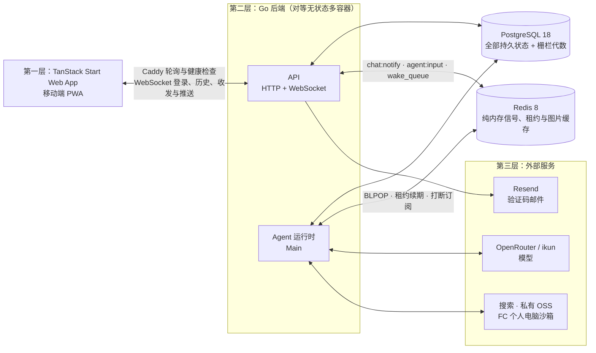

# 01 总体架构

完整架构图见 [`docs/architecture.mmd`](../architecture.mmd)（Mermaid 格式，GitHub 上可直接预览）。本页说明项目定位、各层组件的职责与实现状态，以及工程组织与部署方面的选择和理由。

## 项目定位

用户原话（2026-10-30 更新）：

> 改成主要给自己用，其他人也可以用。

因此：

- 首要目标是维护者自己长期使用；功能取舍、优先级与体验以维护者自己的实际使用为准，不再以企业部署后服务众多终端用户为首要设计目标。
- 项目仍然开源：其他人可以自行部署使用，也可以注册使用维护者向公众开放的实例；每位用户各自拥有自己的 Main（2026-11-02 起只有 Main）。
- 部署、配置和本地开发流程应让其他自行部署者能照文档上手，不能依赖维护者本机的私有资源；但不为企业级集成（如统一登录、多角色权限）预留设计，以后确有需要再单独讨论。
- 模型与发信的 Key 由实际部署者配置，费用由部署者承担；维护者实例由维护者承担。
- 支持删除用户，暂时只能由管理员删除，用户不能自行删除。
- 管理后台代码位于同一仓库的 `admin/`，作为独立服务部署，与 `frontend/` 聊天客户端分开。

此前的定位（2026-10-15）为企业级开源项目——“任何企业都可以 fork、部署，去服务他们的用户”，已由上述定位取代；更早的定位为“让每个人都能部署自己的 personal agent”。交付范围是整张架构图的全部内容，实现时同时考虑 dev 和 prod 环境。

## 三层结构

### 第一层：Web 与 PWA 前端

2026-10-27，用户确认将前端彻底改为纯 Web 应用，移动端使用 PWA。这取代 2026-10-23 的 Lynx 选择及同日较早的 Android 原生宿主优先方案。桌面和移动端共用 React、React DOM、TypeScript 与 CSS，直接使用浏览器 API，不再生成 Lynx bundle 或维护原生容器。

选择理由：当前功能以邮箱登录、长期聊天与实时消息为主，标准 DOM 已能覆盖。React 直接渲染浏览器元素后，存储、WebSocket、中文输入法、选区、无障碍与键盘适配不再需要跨宿主桥接。PWA 使用同一份 Web 产物，移动端通过添加到主屏幕获得独立窗口。

| 组件 | 职责 | 状态 |
| --- | --- | --- |
| React 界面 | 邮箱登录、Main 消息、Markdown、输入框内的发送中与发送失败提示、失败重发与真实思考动态 | 本地实现 |
| TypeScript 连接管理 | 主页打开即连 WebSocket、收到 `ready` 前显示 loading、`hello` 携带令牌、重连按 position 补消息、历史翻页与登录命令走同一连接、发送等待 `delivered`、重发沿用 client_message_id；服务器事件在 `serverEvents.ts` 定义、由 `ServerEventRelay.ts` 统一中转 | 本地实现 |
| 浏览器存储 | localStorage 保存登录，兼容早期 Flutter 与 Lynx 的键；sessionStorage 按账号保存当前标签页草稿 | 本地实现 |
| PWA | 安装清单、多尺寸图标、离线应用外壳、显式版本更新 | 本地实现，移动真机待验收 |

保留 Poke 式 IM 布局：全屏消息列表、底部胶囊输入框，无联系人栏、头像、菜单、外层卡片和任务面板。工具过程留在后台，Main 的实际消息进入聊天。连续消息按发送方和两分钟间隔分组，三十分钟间隔或跨日显示时间；消息列表不显示回执，发送中与发送失败只在输入框提示，失败时内容留在输入框、再按发送即重发（2026-11-02，见 [04](04-messaging.md#消息状态)）。上翻阅读不自动回底，加载旧消息保留阅读位置。

2026-11-03，用户要求消息列表虚拟滚动。列表只挂载视口上下附近的消息：已经量过的高度按消息记住，还没出现在视口附近的先按估计高度占位，进入预渲染范围后再量真实高度；视口上方的高度变化会同步滚动位置，避免阅读内容跳动。贴底、上翻不自动回底、加载更早消息时留在原处、引用回看都不变。这样很长的历史不用把每条 Markdown 都留在页面上。同日，用户要求发送消息后不要把列表拉回底部：人已经贴在底部时，新消息和输入框高度变化仍跟着底部走；正在看更早消息时，发送后留在原地。选择理由是发送不打断正在进行的阅读。

2026-10-28，用户要求输入框外围透明，单行时文字与图标垂直居中，多行时加号和发送按钮固定在输入框底部，文字向上扩展，并在左侧增加加号。输入框以透明外围的浮层覆盖消息区，滚动内容为输入框实际高度预留底部空间；多行输入与已选文件改变高度时同步更新。用户确认本次加号仅提供本地文件选择入口，支持显示文件名和移除选择；不上传文件、不随聊天发送文件。 该阶段范围已被 2026-11-02 的多模态输入需求取代：当前在统一输入面板中混排文字、引用和图片，加号实际上传图片到私有 OSS，模型调用前由后端读取并转 base64，详见 [04](04-messaging.md#引用图片与多模态输入框)。

中文名为「阿芒」，英文名为 Aether。保留用户指定的深绿背景黄色毛绒角色图标，原图位于 `frontend/public/app-icon.png`；管理看板独立部署的副本位于 `admin/public/app-icon.png`。界面沿用森林绿 `#204b32`、柔黄 `#f6cf83` 与奶油白 `#fffcf4`，前端色值集中在 `frontend/src/palette.css`。使用系统字体，避免离线应用外壳依赖大型字体下载。2026-10-28，用户要求整体字号略微放大：正文与输入框由 16px 调整为 18px，其余文字同步增加 2px，并相应增加行高，改善阅读舒适度。

2026-11-04，用户要求添加暗色模式。实现默认跟随系统外观，通过 `prefers-color-scheme` 切换聊天端和管理看板的配色变量：保留森林绿背景与柔黄强调，消息气泡、输入框、引用、表单、错误提示和看板面板使用深色表面与浅色文字。Shiki 同时生成 GitHub 深浅两套高亮变量，代码块随页面即时切换；`color-scheme` 同步原生控件，`theme-color` 按系统外观匹配浏览器顶栏。使用 CSS 媒体查询使首屏直接匹配系统，运行中也无需刷新；不新增主题设置或持久化状态，保留现有全屏聊天布局。PWA 清单保留原品牌启动色，实际页面及支持动态顶栏的浏览器使用匹配的页面主题色。

2026-11-02，用户要求 Markdown 渲染对齐 Aether Start。Main 正文改用同款 unified / remark 管线，支持中文紧邻标点的加粗与删除线、GFM 表格与任务列表、KaTeX 行内和块级公式，以及带语言标签、行号和复制反馈的 Shiki 高亮代码块；排版对齐其标题层级、列表缩进和块间距，配色与 18px 正文沿用当前主题。选择相同解析管线是为了统一语法和阅读体验，替代手工遍历 marked token。整条消息一次解析，保留跨段列表与引用式链接；当前后端整条推送，不引入 Start 的流式 DOM 动画。代码高亮器和常用语言包按需加载，未知语言或高亮加载失败显示原文。原始 HTML 不执行，也不转成 DOM；解析结果先清洗，再生成公式。图片与 Start 一样展示，仅允许无账号密码的 HTTP(S)，不发送页面来源；链接同样只允许这些地址，新窗口使用 `noopener noreferrer`。表格、代码块与块级公式在各自区域横向滚动。用户消息显示原文。Enter 换行、Ctrl+Enter 发送，中文输入法确认候选字不触发发送。通过 Visual Viewport 与安全区域适配移动键盘。

2026-10-28，用户要求删除整个顶部栏，让聊天内容直接占满页面顶部；同时删除页面的「安装应用」按钮和安装说明弹窗，安装继续使用浏览器自带入口。Service Worker 注册与显式更新继续保留，更新提示仅在有待更新版本时出现。

PWA 的清单位于 `frontend/public/manifest.webmanifest`。`frontend/scripts/build-pwa.mjs` 从现有图标生成普通图标、Apple 图标与带安全边距的 maskable 图标，随后按构建内容生成 Service Worker。缓存只包含本次构建的公开静态资源，不缓存认证响应、消息 API 或 WebSocket。入口缓存 `/`，避免 Go 对 `/index.html` 的重定向影响离线导航。

PWA 的设计目标是在完成在线缓存后，断网仍可打开应用并起草消息。2026-11-11 修复了离线冷启动一直停在 loading 的问题：已缓存登录令牌的用户离线打开页面时直接进入聊天页起草消息（草稿保存在 `sessionStorage`），输入框上方显示离线状态提示；网络恢复后自动连上 WebSocket 并补齐最新一页历史。右上角悬浮圆形入口统一排列，依次为按工作区绑定条件显示的「查看电脑」、「搜索历史聊天」以及点击展开邮箱与「退出登录」的账号浮层。新版 Service Worker 下载后等待用户点击「更新应用」，切换前不会自动刷新；当前标签页的草稿在刷新后恢复。Android 可使用浏览器安装入口，iPhone 与 iPad 在 Safari 的分享菜单中选择「添加到主屏幕」。PWA 安装依赖 HTTPS，本地 localhost 为开发例外。系统推送通知尚未实现。

2026-11-02，用户要求前端改为 TanStack Start。Start 基于现有 React、React DOM 与 TypeScript，接管文件路由、HTML 外壳和构建时预渲染，底层构建工具保留 Rsbuild。当前采用 [Start 官方 SPA 模式](https://tanstack.com/start/latest/docs/framework/react/guide/spa-mode)：构建时生成公开的 HTML 外壳，登录与聊天在浏览器启动后通过既有 Go WebSocket 恢复。聊天数据属于登录用户，当前无需为了搜索引擎渲染消息，因此继续静态部署，避免新增常驻 JavaScript 服务或第二套认证与消息 API。

代码位于 `frontend/src/`：`router.tsx` 创建路由器，`routes/__root.tsx` 维护 HTML、元信息与 PWA 清单，`routes/index.tsx` 挂载现有聊天应用。`routeTree.gen.ts` 由 Start 自动生成并提交，不手改；开发和构建时重新生成。聊天控制器随 React effect 创建和清理，兼容开发时 Strict Mode 的重跑。移动键盘的可视视口监听保留在 `App.tsx` 生命周期内。

依赖固定在 `frontend/package-lock.json`，Node.js 最低版本为 `22.12.0`。`npm run build` 先生成路由与构建、执行类型检查，再生成 PWA 图标与 Service Worker。唯一部署目录仍是 `frontend/build/web`，Go 同源服务和 Cloudflare Static Assets 继续读取该目录。构建时使用的服务端产物放在 `frontend/build/server`，不部署、不进入 PWA 缓存。具体验收记录和命令见 [`frontend/README.md`](../../frontend/README.md)。旧框架的历史验收不作为当前 Web/PWA 的验收证据。

### 第二层：Go 后端

| 组件 | 职责 | 状态 |
| --- | --- | --- |
| 健康检查 | `GET /healthz`，同时检查 PostgreSQL 与 Redis 连通性 | `已实现` |
| 认证 | 邮箱验证码登录、退出，全部走聊天 WebSocket 命令，见 [03 认证](03-auth.md) | `已实现` |
| 消息 API | WebSocket 登录、历史翻页、收发与推送；服务器事件定义与中转在 `events.go`，见 [04 消息与实时通信](04-messaging.md) | `已实现` |
| Main 运行时 | 按用户串行运行 Main，调用模型与工具，见 [05 Main 运行时](05-main-runtime.md) | `已实现` |
| `read_message` / `search_message` | 按 ID 读取、按关键词搜索历史消息 | `已实现` |
| 主题记忆 | 根索引与详细主题均由 Main 通过单一 `memory` 工具渐进加载，不自动注入；明确的长期偏好与约定默认自动保存 | `开发中` |
| 需求队列 | `tasks` 登记独立目标与补充，每用户一项执行中，完成后依次领取，见 [11](11-tasks.md) | `开发中` |
| Schedule 与闲置反思 | 2026-11-08 重新加入：`schedule` 工具设置一次性或周期定时任务；2026-11-11 起距离最近一次请求满闲置时长即周期投递后台反思。调度器插入不可见触发消息并唤醒 Main，见 [10](10-schedules.md) | `开发中` |
| 压缩 | 超过回答间隔或上下文阈值后，在下一次模型请求前生成摘要；阈值由看板配置 | `开发中` |
| 管理员只读观测接口 | 用户、Main、模型调用与历史步骤，见 [08](08-admin-observability.md) | `开发中` |
| 管理员用户操作接口 | 删除用户等管理操作 | `待确认` |

### 第三层：外部服务

| 服务 | 用途 | 状态 |
| --- | --- | --- |
| OpenRouter、ikun Gemini、ikun Claude | Main 对话与独立上下文压缩模型 | `已实现` |
| Resend | 发送验证码邮件（仅 `prod`） | `已实现` |
| `search`、`search_twitter`、`fetch_url`、`read_image` | Serper、Parallel、EveryInfra 与直接图片读取，见 [05](05-main-runtime.md#search-与-fetch_url-已实现) | `已实现` |
| 阿里云私有 OSS（配 Redis 共享图片缓存） | 聊天图片与 50 MiB 工作区文件的流式存取与临时签名 | `已实现` |
| 阿里云 FC Agent Sandbox + AgenticFS | 持久化 `/mnt/workspace` 个人 Linux 电脑、只读实时桌面与双向文件流转，见 [07](07-sandbox.md) | `已实现` |
| 其余 HTTP API、MCP | 后续外部执行工具 | `待确认` |

## 语义澄清

### Main 是逻辑概念

用户原话：

> 自动创建用户。main agent只是一个逻辑概念。

因此，“每用户固定一个 Main Agent”表示用户与 Main 的逻辑关系，不能据此预设每用户拥有常驻进程、独立容器或独立服务。Main 由 `user_id` 确定，有消息要处理时才在某台后端上运行（见 [05 Main 运行时](05-main-runtime.md)）。

### 任务是虚拟概念（Subagent 已于 2026-11-02 删除）

用户原话：

> 在我的设想里，没有任务这个实体概念（只是说有这个虚拟概念）。

该节记录原设计：当时“任务”只是 Main 交给 Subagent 的说明，不单独建模，实体是 Subagent 本身。2026-11-02 Subagent 已整体删除，Subagent 派发不再存在，见 [05 删除 Subagent](05-main-runtime.md#删除-subagent2026-11-02)。2026-11-06 起，用户需求改为 `tasks` 持久化实体，由同一个 Main 依次执行，见 [11 需求队列](11-tasks.md)。

### 架构图的修改记录

原始架构图只按用户确认修改过以下几处：第二层标题由“Go 后端 · 阿里云新加坡”改为“Go 后端”，以匹配通用部署定位；`task_id` 改为 `subagent_id`；Subagent 的“进度 / 完成 / 失败回报”改为与 Main 互相 `send_message`、失败时由运行时代发通知；前端通信由 HTTP/SSE 改为 HTTP + WebSocket。2026-10-23 按用户确认采用 B：Main 也连接共用执行工具。

## 原始架构给出的约束

- 消息保存后直接触发接收方。
- Main 使用 `messageList` 上下文，按用户串行处理。
- Main 直接使用执行工具；当前已实现 `search` 和 `fetch_url`。
- 历史消息搜索和读取受用户权限及消息归属限制。
- 保存消息、Run 状态及执行轨迹。
- 浏览器和代码任务在隔离执行环境中执行。
- Web/PWA 打开主页即通过 WebSocket 与后端交互，登录、历史与收发共用一条连接，支持断线恢复。

## 关键设计

**持久状态全在 PostgreSQL，Redis 只传跨实例信号、临时租约与旁路图片缓存，对等容器运行 Main（2026-11-11 更新）。** 对齐 LangSmith Data Plane 模式：消息、任务、记忆、工作区绑定与步骤轨迹 100% 保存在 PostgreSQL（文件原件在私有 OSS）；同机纯内存 Redis（关闭磁盘持久化）只承担唤醒队列、每用户 30 秒临时租约、跨实例思考打断与聊天新消息推送广播，以及以 `oss://` 为键的共享图片缓存，Redis 重启清空不丢失任何业务数据。生产部署两个完全对等的无状态后端容器（`api-1`、`api-2`），每个容器同时接收 WebSocket 与运行 Agent，并配合 `users.main_lease_epoch` 栅栏代数防脑裂覆盖，实现发版零停机滚动更新与单容器异常自动切流，详见 [05](05-main-runtime.md#对等多实例调度与停机交接2026-11-11)。此前 2026-11-09 曾简化为单进程，现已升级为本方案。

**一切通信都是消息。** 用户与 Main 只通过消息联系，Main 的消息列表就是它的模型上下文（见 [02 数据模型](02-data-model.md)）。2026-10-30 起，Main 生成的正文就是它对用户说的话（整条生成结束后一次性推送）。

## 工程组织

同一仓库组织前端、后端、环境配置和文档：

| 目录 | 用途 | 状态 |
| --- | --- | --- |
| `backend/` | Go 后端 | 有代码 |
| `frontend/` | React Web/PWA、TypeScript 连接管理与静态构建 | 本地实现，移动真机待验收 |
| `admin/` | TanStack Start 管理看板与 Node 同源代理，独立运行和部署 | 有代码 |
| `infra/` | dev/prod 环境与部署配置 | 生产 Docker 和 Cloudflare 配置见 [09](09-deployment.md) |
| `docs/` | 架构图、本 wiki、决策总览 | 有内容 |

后端内部：

| 目录 | 用途 |
| --- | --- |
| `backend/cmd/server/` | 程序入口：读取配置、建立数据库连接池、启动 HTTP 服务、Agent 调度与定时任务进程 |
| `backend/internal/config/` | 启动时一次性读取环境变量 |
| `backend/internal/httpapi/` | HTTP 路由、WebSocket 聊天（登录、历史与收发）、服务器事件定义 |
| `backend/internal/agent/` | Main 运行时：运行循环、调用 OpenRouter、系统提示词与工具定义 |
| `backend/internal/database/` | sqlc 生成的数据库访问代码（不要手改） |
| `backend/db/migrations/` | goose 迁移文件 |
| `backend/db/queries/` | 手写 SQL，sqlc 据此生成代码 |

## 技术栈

| 部分 | 选择 | 理由 |
| --- | --- | --- |
| 后端语言 | Go `1.27.2` | 较低版本的 Go 会按 `go.mod` 自动下载对应工具链 |
| Go 模块路径 | `github.com/OmniNetOpensource/aether-personal/backend` | 与 GitHub 仓库一致 |
| HTTP 层 | 标准库 `net/http` | 不引入 Web 框架 |
| 日志 | `log/slog`；dev 输出文本，prod 输出 JSON | 标准库 |
| 数据库访问 | pgx `v5.11.0` + sqlc `v1.31.1` | 手写 SQL，sqlc 生成带类型的 Go 调用代码，由 pgx 执行 |
| 数据库 | PostgreSQL 18（镜像暂留 `pgvector/pgvector:pg18`），主键 `uuidv7()` | 业务持久事实、历史检索与租约栅栏代数共用一个数据库 |
| 信号协调与图片缓存 | Redis 8（`redis:8-alpine` 纯内存模式）+ `redis/go-redis` v9 | 跨实例唤醒队列、用户临时租约、思考打断/聊天推送 Pub/Sub 及 `oss://` 图片旁路缓存，不存持久业务状态 |
| 迁移 | goose `v3.29.0`（`go tool goose`） | 见 [02 数据模型](02-data-model.md#迁移) |
| WebSocket | `coder/websocket` | 见 [04 消息与实时通信](04-messaging.md#websocket) |
| 模型 | OpenRouter | 一个 Key 接入多家模型 |
| 邮件 | Resend，用 `net/http` 直接调用 | 见 [03 认证](03-auth.md) |
| 前端 | TanStack Start + React + TypeScript，Rsbuild 构建 | SPA 静态部署，移动端安装 PWA |
| 管理看板 | TanStack Start + React + TypeScript，Rsbuild 构建；Node 内置 HTTP 托管与代理 | 与聊天端同款 SPA，独立服务与域名部署，见 [08](08-admin-observability.md#看板改用-tanstack-start2026-11-03) |

## 后端骨架 `已实现`

- `internal/config` 启动时一次性读取环境变量，不满足即报错退出。
- `GET /healthz` 每次请求同时 ping PostgreSQL 与 Redis，均正常返回 `200 ok`，任一不可用返回 `503`，供 Caddy 主动健康检查在单容器重启或异常时切流。
- 连接池不预先连接数据库，健康状态由 `/healthz` 反映。Agent 调度启动时读一次持久待办并补推无租约任务，此后每 5 秒补偿扫描一次，见 [05](05-main-runtime.md#对等多实例调度与停机交接2026-11-11)。
- 等待基础设施就绪由编排层负责：dev compose 同时配置 PostgreSQL `pg_isready` 与 Redis `redis-cli ping` 健康检查，`make db-up` 带 `--wait`；生产 compose 中 `api-1`、`api-2` 使用 `depends_on: condition: service_healthy` 等待 `postgres` 与 `redis`。
- 收到停止信号后，HTTP 服务最多等待 5 秒关闭；正在运行的 Agent 随信号取消，立即释放 Redis 租约并将未完工作推回唤醒队列，由存活容器无缝接手，见 [05](05-main-runtime.md#对等多实例调度与停机交接2026-11-11)。
- dev compose 固定项目名 `aether-personal-dev`，避免与其他目录名为 `dev` 的 compose 项目冲突。
- `.env` 位于 `backend/`，由 Makefile 加载并传给 compose；仓库提供 `backend/.env.example`。
- 已验证：数据库正常时 `/healthz` 返回 200，停止数据库后返回 503，缺少 `APP_ENV` 时启动报错退出。

## 配置

基础设施启动配置来自环境变量，dev 使用未提交的 `.env`。运行时模型选择和六组服务配置由管理员在看板保存到数据库，见 [08](08-admin-observability.md)。`APP_ENV` 必填且只允许 `dev` / `prod`。`SERVICE_ENCRYPTION_KEY` 必填；缺少供应商 Key 不阻止启动，管理员可先登录看板补齐，调用未配置的服务时报错。服务凭证不回退环境变量，旧值仅由显式导入命令迁移一次。

| 环境变量 | 说明 |
| --- | --- |
| `APP_ENV` | 必填，`dev` 或 `prod`；决定日志格式、是否真实发信 |
| `DATABASE_URL` | 必填，PostgreSQL 连接串 |
| `REDIS_URL` | 服务进程必填，Redis 连接串（本地示例 `redis://localhost:6379/0`，生产 Compose 自动注入 `redis://redis:6379/0`） |
| `PORT` | 可选，默认 `8080` |
| `SERVICE_ENCRYPTION_KEY` | 必填，Base64 编码的 32 字节主密钥；凭证密文保存在数据库，主密钥由部署端单独保存和备份 |
| `MAIN_MODEL` | 可选，默认 `deepseek/deepseek-v4.1-flash-1017` |
| `DATABASE_MAX_CONNS` | 单容器默认 20，最小 5；聊天推送已改走 Redis Pub/Sub，不再占用池外 PostgreSQL 长连接 |
| `AGENT_CAPACITY` | 单容器默认 `DATABASE_MAX_CONNS - 4`，可调小，最小 1；满载时暂停从 Redis 队列取活，新待办自动流向空闲容器 |
| `IMAGE_CACHE_MAX_BYTES`、`IMAGE_CACHE_TTL` | 可选，Redis 共享图片缓存总字节上限（默认 `134217728` 即 128 MiB，至少 4 MiB）与绝对有效期（默认 `24h`，最小 `1s`） |
| `FRONTEND_DIR` | 同源提供 Web/PWA 的构建目录 |
| `POSTGRES_PORT`、`REDIS_PORT` | 可选，本地 dev 容器映射到本机的端口，默认 `5432` 与 `6379` |

## 代码托管

2026-10-27，用户要求默认直接在 `main` 开发，不再自行创建独立开发分支。开始前先获取远端最新 `main` 并同步已有工作；推送公开仓库仍需用户授权。

- GitHub 个人账号 `OmniNetOpensource` 下的公开仓库 `aether-personal`，许可协议 Apache-2.0。
- 维护者提交使用 GitHub noreply 邮箱，避免在公开仓库中暴露真实邮箱；发布前已从文档和提交历史中移除维护者本机路径。
- `.gitignore` 忽略系统文件、编辑器目录、`.env` 类文件和 `/backend/bin/`。
- 代码托管位置与应用运行位置是独立事项。

## 部署

- 项目提供通用 Docker Compose 部署；阿里云新加坡仅为维护者自己实例的部署位置。
- 2026-10-26 确认 Web 使用 Cloudflare，聊天域名为 `aether.forkicks.fun`。采用 Workers Static Assets 托管页面与同源代理，Go 与 PostgreSQL 运行在服务器，避免重写现有 Agent Runtime。配置、步骤与未完成的公众上线条件见 [09](09-deployment.md)。
- 迁移作为单独命令执行，不在后端启动时自动执行（理由见 [02 数据模型](02-data-model.md#迁移)）。
- 生产单机默认部署两个完全对等且零持久挂载卷的无状态后端容器 `api-1`、`api-2` 与一个纯内存 `redis` 容器，由 Caddy 主动健康检查与轮询转发，发布时不停服滚动更新，详见 [09](09-deployment.md)。

## 模型服务与费用

项目以维护者自用为主、同时开源供其他人自行部署，因此模型、邮件和联网工具的 Key 由实际部署者配置，费用由部署者承担；维护者实例由维护者承担。Main 的模型见 [05 Main 运行时](05-main-runtime.md#模型)。

## 本地开发

根目录 `make dev` 构建 Web/PWA、启动数据库、迁移并运行后端。Go 按 `FRONTEND_DIR` 提供页面，与 API 和 WebSocket 同源，避免独立开发端口的跨源问题。`make check` 运行 Go、前端、看板与 Cloudflare Worker 的编译及静态检查。完整步骤见根目录 README。

用户在 2026-10-22 明确技术实现由开发者决定，仅产品决策询问用户。该要求替代此前逐项询问技术微决策的工作方式，已确认产品选择继续记录在 Wiki 与决策总览。

用户在 2026-10-29 进一步明确：没说改就不要改。代理可以先调查现状、核对是否符合预期并汇报结论与建议，但未经用户明确说改，不动代码与文档。理由是改动的时机与范围由用户决定，调查结论先经用户确认，避免代理把讨论当成已授权的执行。

### 不做本地测试类验证（2026-11-09）

2026-10-23 起的规则是“禁止写任何测试文件”。代理把它理解为只禁止测试代码，仍然会起临时数据库和独立后端进程、写一次性 WebSocket 脚本发真实请求做端到端验证，也按约定对每条新迁移做执行、回滚、再执行。2026-11-09 实现 `read_video` 时，用户看到代理在做这类验证后明确叫停：“任何本地的测试样子的都不要”，迁移的执行、回滚、再执行也不要。

现在的规则：不写测试文件；不运行测试、端到端验证或临时验证脚本；不为验证去起临时数据库或后端进程；新迁移不在本地执行、回滚或再执行来验证。编译和静态检查不算测试，用户确认“可以运行”：`go build ./...`、`go vet ./...`、`sqlc generate` 后的生成代码检查与前端类型检查照常做。

历史中曾存在的 `make check-integration`、`check-live`、`check-research` 等测试类命令已于 2026-11-11 从根目录 `Makefile` 中移除。各页记录的以往本地验证保留为历史，不作为今后的做法先例。

## 代码注释

2026-10-28，用户要求写代码时给每一个小模块前写上注释，方便人类阅读。

选择理由：读代码的人先看注释就知道这一小块负责什么、为什么存在，再看实现确认细节，不必逐行推断作者的意图。这里的小模块包括文件、类型、函数／方法、组件，以及函数内可独立理解的一段逻辑；每处用一两句说明职责即可，不逐行复述代码，模块内部的其他注释仍只写代码本身表达不了的约束。

同一天，用户进一步要求每个文件开头都写文件头注释，并且更新文件时同步更新它，这样一眼扫过文件列表或刚打开文件就知道该不该继续读。确认的范围是手写源文件：后端与前端的手写代码、手写 SQL 查询（`backend/db/queries/`）、管理看板与 Worker 脚本、运维脚本。排除三类：sqlc 生成代码（重新生成会被覆盖，且约定不手改）、已落地的历史迁移（不应改动既有迁移内容）、JSON 等不支持注释的配置文件。Go 文件的文件头与 `package` 之间留一空行：紧贴 `package` 的注释会被 Go 工具当成整个包的文档注释，同一包每个文件都写就会互相冲突；留空行后它只是普通的文件头注释。带 shebang 的脚本把文件头放在 shebang 的下一行，因为第一行必须是解释器声明。

## 写代码前的预期核对

2026-10-28，用户曾要求在写代码之前先核对预期：把所有可能失败的点列出来，由用户确定该失败状态是否走得到。确认不可达的不写防御处理，确认可达的才设计失败处理。当时的理由是，不可达分支会让主流程长期背着用不到的状态和复核。

2026-10-30，用户要求删除这套协作方式。完成一项需求时，不再把可能的报错和失败状态列出来找用户确认。失败处理由开发者判断：防御仍只发生在系统边界，即后端 API 的请求、用户输入和外部服务响应；内部模块继续按互信契约编写。已经按当时核对确定的产品行为保持不变，例如上下文压缩只把模型调用失败当作需要处理的失败，见 [05 Main 运行时](05-main-runtime.md)。

2026-11-06，用户进一步把失败处理改成：不做防御性编码，每一层的报错直接向上抛。选择是：不写重复校验、不可达分支的兜底和中间层的降级或自行恢复；每一层遇到错误直接向上抛（Go 里即 `return`，必要时只用 `%w` 补本层上下文），不在中间层吞错，由最外层统一记录并决定如何呈现。理由是防御分支会让主流程长期背着用不到的状态和复核，而错误逐层抛出能保留原始错误与本层上下文，让问题在最外层一次看清。此条取代上一段「防御只发生在系统边界」的表述；已按旧决定落地的产品行为不因此回溯改动。
