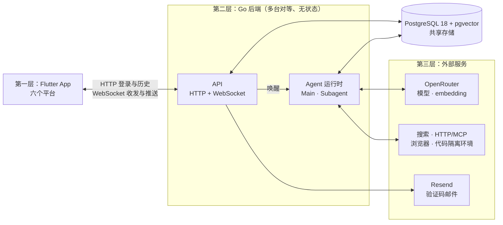

# 01 总体架构

完整架构图见 [`docs/architecture.mmd`](../architecture.mmd)（Mermaid 格式，GitHub 上可直接预览）。本页说明项目定位、各层组件的职责与实现状态，以及工程组织与部署方面的选择和理由。

## 项目定位

用户原话（2026-10-15 更新）：

> 这是一个企业级的开源 personal agent 的项目，任何企业都可以 fork、部署，去服务他们的用户。

因此：

- 部署者是企业，一次部署服务该企业的众多终端用户；终端用户各自拥有自己的 Main 与 Subagent。
- 部署、配置和本地开发流程都要让陌生的企业部署者和贡献者能够上手，不能依赖维护者本机的环境或私有资源。
- 模型与发信的 Key 由部署的企业配置，费用由该企业承担。
- 支持删除用户，暂时只能由企业管理员删除，终端用户不能自行删除。
- 管理后台是单独的前端仓库、单独部署，不放在本仓库的 Flutter 工程中。

此前的定位为“让每个人都能部署自己的 personal agent”，已由上述定位取代。交付范围是整张架构图的全部内容，实现时同时考虑 dev 和 prod 环境。

## 三层结构

### 第一层：Flutter 前端

| 组件 | 职责 | 状态 |
| --- | --- | --- |
| 聊天界面 | 仅显示与 Main 的消息流，提供必要登录、输入、历史、重发及消息状态 | `已实现` |
| 连接管理 | 打开聊天页建立 WebSocket，断线自动重连并补齐消息，刷新恢复登录 | `已实现` |

目标平台：Android、iOS、macOS、Windows、Linux、Web。

用户在 2026-10-22 确认先制作 WhatsApp 风格的简版 Flutter 客户端，本地首个验收平台为 Flutter Web，在 In-App Browser 中联调真实后端。用户进一步明确：“subagent不需要显示给用户。只需要显示和main的消息流，其他都不需要”。因此不制作任务列表、任务详情或工具过程面板，后台结果由 Main 发给用户。六个平台仍是完整交付目标。

2026-10-23，用户在查看多组设计参考后确认采用 [Poke](https://poke.com/) 的联系人式 IM 方向，随后进一步要求删除所有内部容器和其他元素，全屏只展示消息列表与输入框。最终页面采用白底、灰色短信式气泡和底部胶囊输入框，没有联系人栏、头像、菜单、外层卡片或空白页介绍。连续消息按发送方和时间间隔分组，日期及发送状态留在消息流内；向上滚动时自动加载更早消息。选择理由是让长期单一 Main 对话更直接，减少界面干扰。进度仍是 Main 发出的真实消息，送达、已读、失败重发继续使用原有协议。

本轮保留邮箱登录、历史加载、断线恢复、失败重发及 Markdown 来源链接。Flutter 静态检查与 14 项测试通过，覆盖 320、390、768、1440 像素宽度、844×390 横屏、1.3 倍字体、长链接、表格、代码块、窄屏键盘、多行草稿、最新回执、失败重发和自动加载历史。停在底部时，窗口尺寸或键盘改变后继续显示最新消息；主动上翻阅读时不强制回到底部。Flutter Web 已在 In-App Browser 检查手机、平板与桌面的实际页面；原生平台和真实手机软键盘尚未验收。

工程名为 `aether_personal`，组织标识为 `io.github.omninetopensource`，显示名 Aether。UI 使用 Flutter 自身组件，不引入状态管理框架。HTTP、WebSocket、客户端消息 ID 和登录态恢复分别使用 `http`、`web_socket_channel`、`uuid`、`shared_preferences`，Main 正文通过 `flutter_markdown_plus` 显示可选择的 Markdown，来源链接由 `url_launcher` 在新标签页打开；补充 Markdown 行内语法以识别紧跟中文冒号的来源网址，沿用 `markdown` 包的 URL 解析规则。用户消息保留原文。链接仅接受 HTTP(S)，远程图片显示替代文字。具体版本固定在 `frontend/pubspec.lock`。中文字体 Noto Sans SC 及 OFL 许可随应用打包；构建不依赖外部 CanvasKit CDN。

本地 SDK 采用 Flutter 官方 stable 渠道，安装到 `$HOME/develop/flutter`，不修改全局 shell 配置。2026-10-22 安装版本为 Flutter `3.47.7`、Dart `3.13.5`，框架提交为 `abaf9c5237`。Web 构建、静态检查和前端测试已通过，真实登录、消息收发与刷新恢复已在 In-App Browser 验证。原生平台仍缺 Android SDK 或完整 Xcode，尚未构建验收。

### 第二层：Go 后端

| 组件 | 职责 | 状态 |
| --- | --- | --- |
| 健康检查 | `GET /healthz`，同时检查数据库连接 | `已实现` |
| 认证 API | 邮箱验证码登录、退出，见 [03 认证](03-auth.md) | `已实现` |
| 消息 API | WebSocket 收发与推送、`GET /messages` 历史翻页，见 [04 消息与实时通信](04-messaging.md) | `已实现` |
| Main 运行时 | 按用户串行运行 Main，调用模型与工具，见 [05 Main 运行时](05-main-runtime.md) | `已实现` |
| `send_message` | Main 发消息给用户或 Subagent，Subagent 发给 Main | `已实现` |
| `read_message` / `search_message` | 按 ID 读取、按关键词与语义搜索历史消息 | `仅设计` |
| `assign_subagents` | 派出 Subagent，异步启动并立即返回 `subagent_id` | `已实现` |
| Subagent 运行时 | 独立上下文、后台执行、每用户 3 个并行、持久排队、15 分钟超时 | `已实现` |
| 压缩 | 上下文过长时生成摘要 | `仅设计` |
| 向量计算 | 后台为消息补算 embedding | `仅设计` |
| 管理员接口 | 供管理后台删除用户等 | `待确认` |

### 第三层：外部服务

| 服务 | 用途 | 状态 |
| --- | --- | --- |
| OpenRouter 对话接口 | Main 使用 `minimax/minimax-m3.1-flash`（`MAIN_MODEL` 可改） | `已实现` |
| OpenRouter embedding 接口 | `google/gemini-embedding-2`，1536 维 | `仅设计` |
| Resend | 发送验证码邮件（仅 `prod`） | `已实现` |
| `search`、`fetch_url` | Serper、Parallel、EveryInfra，见 [05](05-main-runtime.md#search-与-fetch_url-已实现) | `已实现` |
| 其余 HTTP API、MCP | 后续外部执行工具 | `待确认` |
| 浏览器与代码隔离环境 | Subagent 的执行工具 | `待确认` |

## 语义澄清

### Main 是逻辑概念

用户原话：

> 自动创建用户。main agent只是一个逻辑概念。

因此，“每用户固定一个 Main Agent”表示用户与 Main 的逻辑关系，不能据此预设每用户拥有常驻进程、独立容器或独立服务。Main 由 `user_id` 确定，有消息要处理时才在某台后端上运行（见 [05 Main 运行时](05-main-runtime.md)）。

### 任务是虚拟概念，实体是 Subagent

用户原话：

> 在我的设想里，没有任务这个实体概念（只是说有这个虚拟概念）。

因此，“任务”只是 Main 交给 Subagent 的说明，不单独建模；实体是 Subagent 本身。数据库表命名为 `subagents`，其 ID 在数据库、代码、工具接口和架构图中统一称为 `subagent_id`，不使用 `task_id`。

### 架构图的修改记录

原始架构图只按用户确认修改过以下几处：第二层标题由“Go 后端 · 阿里云新加坡”改为“Go 后端”，以匹配通用部署定位；`task_id` 改为 `subagent_id`；Subagent 的“进度 / 完成 / 失败回报”改为与 Main 互相 `send_message`、失败时由运行时代发通知；前端通信由 HTTP/SSE 改为 HTTP + WebSocket。2026-10-23 按用户确认采用 B：Main 也连接共用执行工具。

## 原始架构给出的约束

- 消息保存后直接触发接收方。
- Main 使用 `messageList` 上下文，按用户串行处理。
- Main 保留消息与派发工具，并与 Subagent 共用执行工具；当前已实现 `search` 和 `fetch_url`。历史搜索和读取仍属于设计范围。
- `assign_subagents` 记录 Subagent 后异步启动，立即返回 `subagent_id`。
- Subagent 按任务创建，使用独立上下文，后台执行，限额并行。
- Subagent 与 Main 互相 `send_message`；Subagent 失败时由运行时代发通知。
- 历史消息搜索和读取受用户权限及消息归属限制。
- 保存消息、Run 状态及执行轨迹。
- 浏览器和代码任务在隔离执行环境中执行。
- Flutter 通过 HTTP + WebSocket 与后端交互，支持断线恢复。

## 关键设计

**后端无状态，状态都在 PostgreSQL。** 任何一台后端都能处理任何用户的请求；机器之间用 PostgreSQL 的 `LISTEN/NOTIFY` 互相唤醒，用咨询锁（advisory lock）保证同一用户的 Main 同一时间只在一台机器上运行。不引入 Redis。内存中只有 WebSocket 连接与进行中的模型调用，丢失后都能恢复。详见 [04 消息与实时通信](04-messaging.md#整体结构)。

**一切通信都是消息。** 用户、Main、Subagent 之间只通过消息联系，每个 Agent 的消息列表就是它的模型上下文（见 [02 数据模型](02-data-model.md)）。Main 只有调用 `send_message` 才会对用户说话，直接输出的文字是它自己的思考。

## 工程组织

同一仓库组织前端、后端、环境配置和文档：

| 目录 | 用途 | 状态 |
| --- | --- | --- |
| `backend/` | Go 后端 | 有代码 |
| `frontend/` | Flutter 六个平台共用工程 | Web 已构建并联调，其余平台未验收 |
| `infra/` | dev/prod 环境与部署配置 | 尚未创建 |
| `docs/` | 架构图、本 wiki、决策总览 | 有内容 |

后端内部：

| 目录 | 用途 |
| --- | --- |
| `backend/cmd/server/` | 程序入口：读取配置、建立数据库连接池、启动 HTTP 服务；启动时唤醒仍有待读消息的用户 |
| `backend/internal/config/` | 启动时一次性读取环境变量 |
| `backend/internal/httpapi/` | HTTP 路由、认证、WebSocket、历史消息 |
| `backend/internal/agent/` | Main 运行时：运行循环、调用 OpenRouter、系统提示词与工具定义 |
| `backend/internal/database/` | sqlc 生成的数据库访问代码（不要手改） |
| `backend/db/migrations/` | goose 迁移文件 |
| `backend/db/queries/` | 手写 SQL，sqlc 据此生成代码 |

## 技术栈

| 部分 | 选择 | 理由 |
| --- | --- | --- |
| 后端语言 | Go `1.27.2` | 较低版本的 Go 会按 `go.mod` 自动下载对应工具链 |
| Go 模块路径 | `github.com/OmniNetOpensource/aether-personal/backend` | 与 GitHub 仓库一致 |
| HTTP 层 | 标准库 `net/http` | 不引入 Web 框架 |
| 日志 | `log/slog`；dev 输出文本，prod 输出 JSON | 标准库 |
| 数据库访问 | pgx `v5.11.0` + sqlc `v1.31.1` | 手写 SQL，sqlc 生成带类型的 Go 调用代码，由 pgx 执行 |
| 数据库 | PostgreSQL 18 + pgvector（镜像 `pgvector/pgvector:pg18`），主键 `uuidv7()` | 向量检索与业务数据放在同一个数据库 |
| 迁移 | goose `v3.29.0`（`go tool goose`） | 见 [02 数据模型](02-data-model.md#迁移) |
| WebSocket | `coder/websocket` | 见 [04 消息与实时通信](04-messaging.md#websocket) |
| 模型 | OpenRouter | 一个 Key 接入多家模型 |
| 邮件 | Resend，用 `net/http` 直接调用 | 见 [03 认证](03-auth.md) |
| 前端 | Flutter 3.47.7 | 六平台工程，当前验收 Web |

## 后端骨架 `已实现`

- `internal/config` 启动时一次性读取环境变量，不满足即报错退出。
- `GET /healthz` 每次请求 ping 数据库，正常返回 `200 ok`，失败返回 `503`。
- 后端启动时不检查数据库连通性，避免数据库晚于后端就绪时出现崩溃重启循环；数据库状态由 `/healthz` 反映。
- 等待数据库就绪由编排层负责：dev compose 使用 `pg_isready` 健康检查，`make db-up` 带 `--wait`，数据库可连接后才返回；将来的 Docker 部署中，后端使用 `depends_on: condition: service_healthy` 等待数据库。
- 收到停止信号后取消运行时请求，HTTP 服务最多等待 5 秒关闭；未完成的执行步骤保留在数据库，重启后恢复。
- dev compose 固定项目名 `aether-personal-dev`，避免与其他目录名为 `dev` 的 compose 项目冲突。
- `.env` 位于 `backend/`，由 Makefile 加载并传给 compose；仓库提供 `backend/.env.example`。
- 已验证：数据库正常时 `/healthz` 返回 200，停止数据库后返回 503，缺少 `APP_ENV` 时启动报错退出。

## 配置

配置只来自环境变量；dev 使用未提交的 `.env`，由启动命令加载。`APP_ENV` 必填且只允许 `dev` / `prod`，`prod` 缺少必需配置时启动即报错退出。

| 环境变量 | 说明 |
| --- | --- |
| `APP_ENV` | 必填，`dev` 或 `prod`；决定日志格式、是否真实发信 |
| `DATABASE_URL` | 必填，PostgreSQL 连接串 |
| `PORT` | 可选，默认 `8080` |
| `OPENROUTER_API_KEY` | 必填（dev 也需要真实调用模型） |
| `MAIN_MODEL` | 可选，默认 `minimax/minimax-m3.1-flash` |
| `SUBAGENT_MODEL` | 可选，留空使用 `MAIN_MODEL` |
| `DATABASE_MAX_CONNS` | 默认 20，最小 5；预留 4 条连接处理普通请求 |
| `SERP_API_KEY`、`PARALLEL_API_KEY`、`EVERYINFRA_API_KEY` | 联网工具密钥；缺少时相应工具返回错误 |
| `FRONTEND_DIR` | 同源提供 Flutter Web 的构建目录 |
| `RESEND_API_KEY`、`EMAIL_FROM` | `prod` 必填；dev 不发邮件，验证码打印在日志中 |
| `POSTGRES_PORT` | 可选，本地 dev 数据库映射到本机的端口，默认 `5432` |

## 代码托管

- GitHub 个人账号 `OmniNetOpensource` 下的公开仓库 `aether-personal`，许可协议 Apache-2.0。
- 维护者提交使用 GitHub noreply 邮箱，避免在公开仓库中暴露真实邮箱；发布前已从文档和提交历史中移除维护者本机路径。
- `.gitignore` 忽略系统文件、编辑器目录、`.env` 类文件和 `/backend/bin/`。
- 代码托管位置与应用运行位置是独立事项。

## 部署

- 项目提供通用 Docker 部署（具体形式 `待确认`）；阿里云新加坡仅为维护者自己实例的部署位置。
- 迁移作为单独命令执行，不在后端启动时自动执行（理由见 [02 数据模型](02-data-model.md#迁移)）。
- 目前只部署一台后端，但代码按多台的要求编写。

## 模型服务与费用

项目开源、供企业 fork 部署，因此模型、邮件和联网工具的 Key 由部署企业配置，费用由该企业承担。Main 与 Subagent 的模型见 [05 Main 运行时](05-main-runtime.md#模型)。

## 本地开发

根目录 `make dev` 构建 Flutter Web、启动数据库、迁移并运行后端。Go 按 `FRONTEND_DIR` 提供页面，与 API 和 WebSocket 同源，避免独立开发端口的跨源问题。`make check` 检查 Go 和 Flutter；`make check-integration` 在独立 schema 运行真实 PostgreSQL 集成测试。完整步骤见根目录 README。

用户在 2026-10-22 明确技术实现由开发者决定，仅产品决策询问用户。该要求替代此前逐项询问技术微决策的工作方式，已确认产品选择继续记录在 Wiki 与决策总览。
