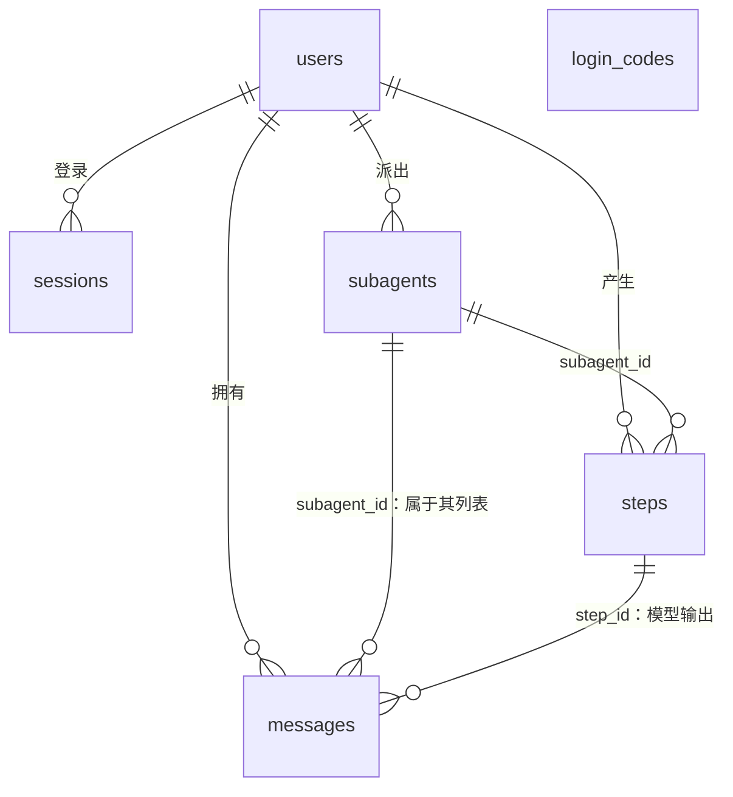
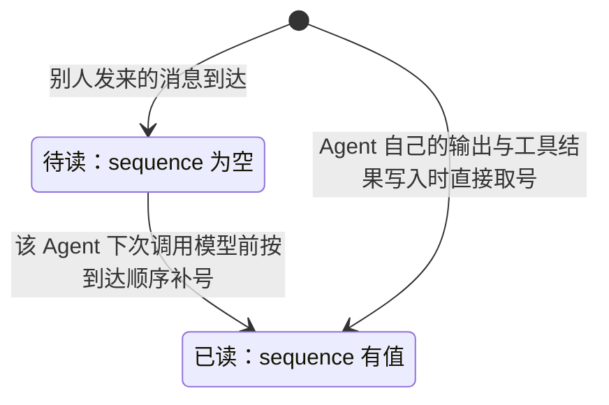

# 02 数据模型

用户原话：

> 任何消息列表，本质上都是一个 agent 的上下文列表。用户的是 main，其他 subagent 是他们自己的。

因此：

- 只有 Agent 拥有消息列表：每个用户的 Main 一份，每个 Subagent 各一份。用户没有独立列表，用户与 Main 的对话就是 Main 的列表，聊天界面读取 Main 的列表。
- 不建 `agents` 表：Main 由 `user_id` 确定，Subagent 由 `subagents` 表确定。
- 通信消息与模型上下文存在同一张 `messages` 表中。A 发给 B 的消息作为一行写入 B 的列表，记录发送方；发送方一侧已有对应的工具调用记录，同一内容允许在两侧各存一份。

设计时参考了 Letta（archive 分支）的 `messages` / `steps` 设计，以及 OpenAI Agents SDK、Google ADK 的会话消息表。

## 表关系

共 6 张表：

| 表 | 用途 | 状态 |
| --- | --- | --- |
| `users` | 用户；每个用户即一个 Main | `已实现` |
| `subagents` | Main 派出的每个 Subagent | 表已建，运行时 `已实现` |
| `messages` | 每个 Agent 的上下文列表，即 `messageList` | `已实现` |
| `steps` | 每一次模型请求的记录 | `已实现` |
| `login_codes` | 待验证的登录验证码，见 [03 认证](03-auth.md#表结构) | `已实现` |
| `sessions` | 登录令牌，见 [03 认证](03-auth.md#表结构) | `已实现` |

## 通用规则

- **主键**使用 UUID v7（PostgreSQL 18 的 `uuidv7()`）：按时间递增，可直接用于排序。
- **固定取值的字段**（如 `status`、`role`、`sender`）使用 `text` 加 `CHECK` 约束，不使用 PostgreSQL 枚举类型：取值仍在演变，`CHECK` 约束增删改名都容易；Go 代码中自行定义对应常量。
- **不建 `runs` 表**：Main 可能持续运行，“一轮”的边界不清晰。执行轨迹直接按 `messages.sequence` 查看，失败原因记在 `steps` 或工具结果消息中，Subagent 状态记在 `subagents.status`，按用户串行处理用 PostgreSQL 咨询锁，重启恢复依据待读消息和未得到结果的工具调用判断。

## 各表字段

### `users`

| 字段 | 类型 | 说明 |
| --- | --- | --- |
| `id` | uuid | 主键 |
| `email` | text | 登录邮箱，唯一 |
| `created_at` | timestamptz | 注册时间 |

### `subagents`

| 字段 | 类型 | 说明 |
| --- | --- | --- |
| `id` | uuid | 主键，即 `subagent_id` |
| `user_id` | uuid | 所属用户 |
| `status` | text | `running`（正在工作）/ `idle`（停下，等待新消息）/ `failed`（因错误停下） |
| `created_at` | timestamptz | 创建时间 |

Subagent 另有可空的 `started_at`，记录本次激活开始时间。重启接管 `running` 任务时保留原值，15 分钟截止时间不会因重启延长；`idle` 或 `failed` 收到新消息后重新开始计时。该字段由 `00004` 迁移增加。

- 不保存任务说明：Main 给出的任务说明是该 Subagent 列表中的第一条消息，之后的补充与修改是后续消息；单独保存会重复且会过时。若界面需要简短名称，届时再加。
- 不设结束时间：停下的 Subagent 收到新消息会被重新唤醒，最后活动时间以其最后一条消息为准。状态的运行规则见 [05 Main 运行时](05-main-runtime.md#subagent-已实现)。

### `messages`

| 字段 | 类型 | 说明 |
| --- | --- | --- |
| `id` | uuid | 主键，由数据库生成；`read_message` 使用的 ID，也用作推送位置与翻页位置 |
| `user_id` | uuid | 所属用户 |
| `subagent_id` | uuid | 属于哪个 Agent 的列表：为空表示 Main，否则为该 Subagent |
| `sequence` | bigint | 全局递增序号，用于排序；**为空表示待读** |
| `role` | text | `system` / `user` / `assistant` / `tool` |
| `content` | jsonb | 按 OpenRouter 格式保存的内容，组装上下文时直接使用 |
| `sender` | text | 别人发来的消息填发送方：`user` / `main` / `subagent` / `system`；否则为空 |
| `sender_subagent_id` | uuid | 发送方是 Subagent 时填；`system` 发出的与某个 Subagent 相关的通知也填该 Subagent |
| `step_id` | uuid | 模型输出的消息指向产生它的那次请求；工具结果和别人发来的消息为空 |
| `client_message_id` | uuid | App 生成，同一用户下唯一，只用于识别重发（见 [04 消息与实时通信](04-messaging.md#消息-id-与重发)） |
| `is_summary` | boolean | 是否为压缩摘要，默认 false |
| `embedding` | vector(1536) | 消息的向量；为空表示尚未计算 |
| `created_at` | timestamptz | 写入（到达）时间 |

### `steps`

记录每一次模型请求的元信息，不重复保存请求内容：某次请求的内容可由该 Agent 在其输出之前的 `messages` 还原。

| 字段 | 类型 | 说明 |
| --- | --- | --- |
| `id` | uuid | 主键 |
| `user_id` | uuid | 所属用户 |
| `subagent_id` | uuid | 为空表示 Main 的请求，否则为该 Subagent 的请求 |
| `model` | text | 使用的模型 |
| `input_tokens` | integer | 输入 token 数 |
| `output_tokens` | integer | 输出 token 数 |
| `cost` | numeric | 费用 |
| `error` | text | 失败原因，成功时为空 |
| `started_at` | timestamptz | 开始时间 |
| `finished_at` | timestamptz | 结束时间 |

## 排序与待读规则

- `sequence` 由数据库序列 `message_sequence` 发号，整张表共用一个递增计数器。
- Agent 自己产生的内容（模型输出、工具结果）写入时直接取号：`message_sequence` 是该列的默认值，插入时省略该列即可。由此保证工具调用之后紧跟工具结果。
- 别人发来的消息到达时显式写入空值，即待读；该 Agent 下一次调用模型前，按到达顺序用 `nextval('message_sequence')` 补号。
- `messageList` 为该 Agent 列表中最新一条摘要及其之后、`sequence` 不为空的行，按 `sequence` 排序。
- 聊天界面中的 `delivered` / `read` 由 `sequence` 是否为空算出，不另加列（见 [04 消息与实时通信](04-messaging.md#消息状态)）。
- 往某用户的列表插入消息时需先取按用户区分的写入锁，原因见 [04 消息与实时通信](04-messaging.md#写入顺序)。

## 压缩与上下文检索 `仅设计`

每个 Agent 对应一条无限长的上下文，采用“压缩（compact）+ 上下文检索”来近似：

- **压缩**：让模型把当前上下文总结为一段摘要，作为一条 `is_summary = true` 的消息追加到该 Agent 的列表中。摘要覆盖它之前的全部内容；再次压缩时，新摘要总结上一条摘要及其之后的消息。
- 压缩本身是一次模型请求，记录一条 `steps`，摘要消息的 `step_id` 指向它。
- 压缩只在两次模型调用之间、且没有未得到结果的工具调用时进行，避免拆开工具调用与工具结果。
- 压缩不删除、不修改任何旧消息。`messages` 始终保存完整历史，`search_message` / `read_message` 在完整历史中检索，聊天界面也可回看全部记录。
- 不建单独的 `compactions` 表：摘要本身就是模型看到的一条消息，放在消息列表中最简单。

历史检索采用**混合搜索**：关键词搜索（精确词、编号、人名）与向量搜索（意思相近）结合。

- 向量由 OpenRouter 的 embedding 接口（`POST /api/v1/embeddings`）生成，与聊天模型共用同一个 Key。搜索方式封装在 `search_message` 内部；数据库侧均为增量改动（加列、加索引、加扩展），不修改已有字段。
- embedding 模型固定为 `google/gemini-embedding-2`，请求时指定 `dimensions = 1536`，存为 `vector(1536)`，可使用 pgvector 的 HNSW 索引（普通向量上限 2000 维）。模型写死在代码中、不开放给部署者配置，因为列的维度与模型绑定。选择理由：多语言能力强，且文本与图片处于同一向量空间，便于将来检索图片。
- 向量异步计算：消息保存时 `embedding` 为空，由后台补算；embedding 接口故障不影响消息保存与聊天。
- 向量索引使用余弦距离（`vector_cosine_ops`），因为 Gemini 向量截短到 1536 维后长度不再统一；查询时使用 `<=>` 运算符。

`待确认`：压缩的触发时机与摘要写法；中文关键词搜索实现、两路结果的合并方式、哪些消息参与搜索、`input_type` 的使用；多实例部署下的后台向量计算。

## 外键

所有外键使用 `ON DELETE CASCADE`：删除一个用户时，其 `subagents`、`messages`、`steps`、`sessions` 随之自动删除，不留残余数据。涉及的外键：`subagents → users`、`messages → users`、`messages.subagent_id / sender_subagent_id → subagents`、`messages.step_id → steps`、`steps → users`、`steps → subagents`、`sessions → users`。误删由“仅企业管理员可删除”与数据库备份防范。

## 索引

只为已知的高频查询建索引；索引可随时增删，不影响已有数据。

| 表 | 索引 | 服务的查询 |
| --- | --- | --- |
| `users` | `email` 唯一 | 登录时按邮箱查找；保证邮箱不重复 |
| `subagents` | `(user_id)` | 列出某用户的 Subagent |
| `sessions` | `token_hash` 唯一、`(user_id)` | 按令牌查找会话；删除用户时级联 |
| `messages` | `sequence` 唯一 | 保证序号不重复（待读消息为空值，不受限制） |
| `messages` | `(user_id, subagent_id, sequence)` | 读取某 Agent 的 `messageList`，查找其待读消息 |
| `messages` | `(user_id, subagent_id, sequence) WHERE is_summary` | 查找某 Agent 最新的摘要 |
| `messages` | `(user_id, subagent_id, id)` | 按位置推送、历史翻页 |
| `messages` | `(user_id, client_message_id)` 唯一 | 识别重发 |
| `messages` | `(id) WHERE embedding IS NULL` | 后台查找尚未计算向量的消息 |
| `messages` | `embedding` HNSW | 向量搜索 |

`steps` 暂不建索引，待费用统计或执行轨迹展示时再加。关键词搜索所需索引在实现 `search_message` 时再定。

## 迁移

| 迁移 | 内容 | 状态 |
| --- | --- | --- |
| `00001_create_core_tables.sql` | pgvector 扩展、`users`、`subagents`、`messages`、`steps`、`message_sequence` 序列 | `已实现` |
| `00002_create_auth_tables.sql` | `login_codes`、`sessions` | `已实现` |
| `00003_add_client_message_id.sql` | `messages.client_message_id` 及相关索引 | `已实现` |
| `00004_add_subagent_started_at.sql` | 持久化 Subagent 本次激活时间，支持跨重启的超时判断 | `已实现` |

- 迁移工具使用 goose `v3.29.0`，以 `go tool` 方式固定在 `go.mod` 中，clone 后无需另外安装；命令行工具附带的其他数据库驱动只进入 `go.mod` / `go.sum`，不编入后端程序。
- 迁移作为单独命令执行，不在后端启动时自动执行：本地为 `make migrate`，部署时在启动新版本前执行。迁移失败不影响正在运行的旧版本，也避免多实例同时迁移。
- 迁移文件位于 `backend/db/migrations/`，按顺序编号（`00001_...sql`），每个文件包含 Up 与 Down 两部分；新增迁移后在本地验证执行、回滚、再执行。
- `00001` 已在本地验证：执行、回滚、再执行均成功；序号自动发号与待读补号、`CHECK` 约束、级联删除行为符合设计。
- `00004` 已在本地验证执行、回滚、再执行，最终数据库版本为 4。

## 代码生成（sqlc）

sqlc 配置为 `backend/sqlc.yaml`：读取 `db/migrations` 作为表结构、`db/queries` 中的手写查询，生成到 `internal/database`（包名 `database`，使用 pgx/v5）。

- sqlc 单独安装，版本固定为 `v1.31.1`，不使用 `go tool`：sqlc 内含 PostgreSQL 的 C 语言解析器，`go tool` 需要本机 C 编译器（Windows 默认没有），并会大量增加 `go.mod` 依赖。生成的代码提交进仓库，只有修改 SQL 查询的人需要 sqlc，fork 部署者用不到。
- 生成代码统一规则：不能为空的列用普通类型（`string`、`int64`、`time.Time`、`uuid.UUID`），能为空的列加 `*`，`nil` 表示空；不使用 pgx 自带的 `pgtype.Text`、`pgtype.Int8` 等“值 + Valid 标记”类型。时间列映射为标准库 `time.Time`。
- UUID 映射为 `github.com/google/uuid` 的 `uuid.UUID`，可为空的列映射为 `*uuid.UUID`，在类型上区分能否为空；`pgtype.UUID` 不区分，`string` 失去类型检查。
- `numeric`（费用）映射为 `github.com/shopspring/decimal` 的 `decimal.Decimal`：Go 标准库没有精确小数，`float64` 有累积误差，不适合按用户统计费用和额度；pgx 无需额外注册即可读写。
- sqlc 会将 `vector` 映射为 `pgvector-go` 的 `pgvector.Vector`，用到时需引入该依赖。
