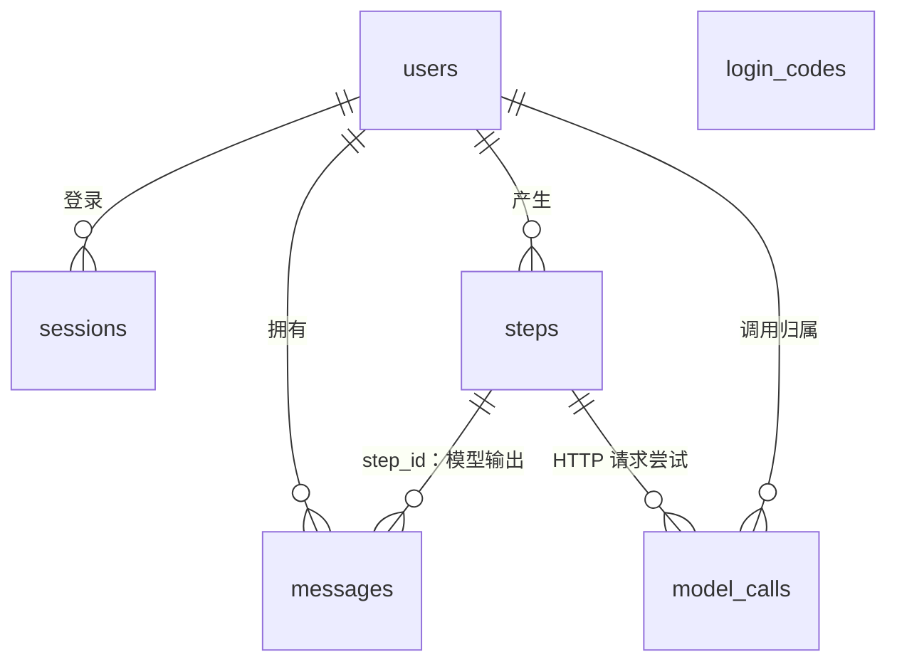

# 02 数据模型

用户原话：

> 任何消息列表，本质上都是一个 agent 的上下文列表。用户的是 main。（2026-11-02 起系统只有 Main，本页按现状更新。）

因此：

- 每个用户的 Main 拥有一份消息列表。用户没有独立列表，用户与 Main 的对话就是 Main 的列表，聊天界面读取 Main 的列表。
- 不建 `agents` 表：Main 由 `user_id` 确定。
- 消息与模型上下文存在同一张 `messages` 表中，用户发来的消息写入 Main 的列表并记录发送方。

设计时参考了 Letta（archive 分支）的 `messages` / `steps` 设计，以及 OpenAI Agents SDK、Google ADK 的会话消息表。

## 表关系

原有 6 张表，调用观测新增 1 张表，运行时模型选择新增 `model_settings`：

| 表 | 用途 | 状态 |
| --- | --- | --- |
| `users` | 用户；每个用户即一个 Main | `已实现` |
| `messages` | Main 的上下文列表，即 `messageList` | `已实现` |
| `steps` | 逻辑执行步骤，包含模型回复与工具执行 | `已实现` |
| `login_codes` | 待验证的登录验证码，见 [03 认证](03-auth.md#表结构) | `已实现` |
| `sessions` | 登录令牌，见 [03 认证](03-auth.md#表结构) | `已实现` |
| `model_calls` | 每次模型 HTTP 请求尝试、结果与可空用量 | `开发中` |
| `model_settings` | 全局 Main 运行时模型选择、版本与最后修改者快照 | `开发中` |
| `service_settings` | 六组服务凭证密文、Key 后缀、Gemini 地址、邮件发件人与更新时间；清除 Key 保留记录 | `开发中` |

## 通用规则

- **主键**使用 UUID v7（PostgreSQL 18 的 `uuidv7()`）：按时间递增，可直接用于排序。
- **固定取值的字段**（如 `status`、`role`、`sender`）使用 `text` 加 `CHECK` 约束，不使用 PostgreSQL 枚举类型：取值仍在演变，`CHECK` 约束增删改名都容易；Go 代码中自行定义对应常量。
- **不建 `runs` 表**：Main 可能持续运行，“一轮”的边界不清晰。执行轨迹直接按 `messages.sequence` 查看，失败原因记在 `steps` 或工具结果消息中，按用户串行处理用 PostgreSQL 咨询锁，重启恢复依据最新一条消息和未得到结果的工具调用判断（2026-11-02 起，见 [05](05-main-runtime.md#运行循环-已实现)）。

## 各表字段

### `users`

| 字段 | 类型 | 说明 |
| --- | --- | --- |
| `id` | uuid | 主键 |
| `email` | text | 登录邮箱，唯一 |
| `main_failed_through_sequence` | bigint | Main 上次运行失败时的最大消息序号；最新消息不超过它时不再自动重试，空表示没有失败停住（`00026`） |
| `created_at` | timestamptz | 注册时间 |

### `subagents`（已删除）

2026-11-02 随 Subagent 整体删除：迁移 `00025` 删除 `subagents` 表，以及 `messages` / `steps` / `model_calls` 的 `subagent_id` 与 `messages.sender_subagent_id` 列，并先清掉 Subagent 上下文的历史行。原表结构见迁移 `00001` / `00004` 与 [05 删除 Subagent](05-main-runtime.md#删除-subagent2026-11-02)。

### `messages`

| 字段 | 类型 | 说明 |
| --- | --- | --- |
| `id` | uuid | 主键，由数据库生成；`read_message` 使用的 ID，也用作推送位置与翻页位置 |
| `user_id` | uuid | 所属用户 |
| `sequence` | bigint | 全局递增序号，用于排序；插入时分配、不能为空（2026-11-02 起，原先为空表示待读） |
| `role` | text | `user` / `assistant` / `tool`（2026-11-02 由 `00021` 去掉 `system`） |
| `visible` | boolean | 是否显示在用户聊天中；真人发给 Main 的消息与 Main 助手消息为 true，指令、运行时提醒、工具回执与摘要为 false（`00021`） |
| `content` | jsonb | 按 OpenRouter 格式保存的内容；普通请求组装时直接使用原文，只删前端展示字段，第一条由代码常量的不可见 user 指令注入、不落库 |
| `sender` | text | 别人发来的消息填发送方：`user` / `main` / `system`；否则为空 |
| `step_id` | uuid | 模型输出的消息指向产生它的那次请求；工具结果和别人发来的消息为空 |
| `client_message_id` | uuid | App 生成，同一用户下唯一，只用于识别重发（见 [04 消息与实时通信](04-messaging.md#消息-id-与重发)） |
| `is_summary` | boolean | 是否为压缩摘要，默认 false |
| `summary_through_sequence` | bigint | 摘要覆盖到的原始消息位置；仅摘要非空 |
| `search_text` | text | 从 `content` 提取的纯文本（`00020`，触发器维护），供关键词搜索与 `read_message` 共用 |
| `created_at` | timestamptz | 写入（到达）时间 |

用户多模态消息继续使用 `messages.content` JSONB，不新增图片二进制列。`content` 保存模型所需的文本与 OSS 图片引用，附带的 `parts` 保存按用户编辑顺序排列的文字、引用位置和图片元信息；`user_text` 用于回显原始正文。图片本体在私有 OSS Bucket，预览签名只在向前端发出时生成。图片读取为 base64 发生在模型渠道适配前，详见 [04](04-messaging.md#引用图片与多模态输入框)。

### `steps`

记录逻辑执行步骤的元信息，完成时间包含工具执行。准确请求尝试另记在 `model_calls`（`00006`），统计与恢复口径见 [08](08-admin-observability.md)。不重复保存请求内容：某次请求的内容可由该 Agent 在其输出之前的 `messages` 还原。

| 字段 | 类型 | 说明 |
| --- | --- | --- |
| `id` | uuid | 主键 |
| `user_id` | uuid | 所属用户 |
| `model` | text | 使用的模型 |
| `input_tokens` | integer | 输入 token 数 |
| `output_tokens` | integer | 输出 token 数 |
| `cost` | numeric | 费用 |
| `error` | text | 失败原因，成功时为空 |
| `started_at` | timestamptz | 开始时间 |
| `finished_at` | timestamptz | 结束时间 |

`00005` 增加可空的 `model_reply jsonb`，在执行工具前保存模型回复，进程中断后复用，避免同一步骤再次请求模型。继续已有回复时不提前消费新消息；新消息在下一次真正调用模型前加入。同一次迁移还加过 `resume_after` 与沙盒表，2026-10-29 由 `00014` 删除。

2026-11-02 运行循环简化后，`00026` 删除 `model_reply`：assistant 消息与它的 step 在同一事务里落库，崩溃后不再需要从 step 里取回模型回复。此后一条普通 step 就是一次模型调用尝试（成功时对应一条 assistant 消息，失败时记下错误），压缩另记一条；工具回执的 `step_id` 指向发起调用的那条 step。

## 排序规则

2026-11-02 之前，别人发来的消息（用户、日程）入库时 `sequence` 为空，表示待读，Agent 下一次调用模型前才按到达顺序补号。用户要求去掉已读状态后，`00026` 把遗留的待读行按 `id` 顺序补号，再把列改为非空，现行规则是：

- `sequence` 由数据库序列 `message_sequence` 发号，整张表共用一个递增计数器；所有消息插入时省略该列，直接取默认值。
- 工具执行期间到达的用户消息会排在工具调用与回执之间，组装请求时回执仍紧跟它的调用（见 [05 请求组装规则](05-main-runtime.md#请求组装规则2026-11-02)），所以不需要靠延后补号来保证调用与回执相邻。
- `messageList` 由最新一条摘要与摘要覆盖位置之后的原始消息组成。摘要先放入上下文，原始消息按 `sequence` 排序；不能直接按摘要自身的插入位置截断。没有摘要时返回全部消息。
- 聊天界面不再显示 `delivered` / `read`（见 [04 消息与实时通信](04-messaging.md#消息状态)）。
- 往某用户的列表插入消息时需先取按用户区分的写入锁，原因见 [04 消息与实时通信](04-messaging.md#写入顺序)。

## 压缩与上下文检索

每个 Main 对应一条无限长的上下文，采用“压缩（compact）+ 上下文检索”来近似：

- **压缩**：让模型把历史总结为一段摘要，作为一条 `is_summary = true` 的消息追加到 Main 的列表中，并记录摘要覆盖到的原始消息位置。再次压缩时，新摘要总结上一条摘要及之后的全部历史。2026-10-28 改为全部压缩：全部上下文发给 Main 当前模型，只在末尾追加一条压缩指令，返回的一条摘要替代全部原上下文，不保留最后一条或任何尾部；投递状态由运行时随摘要单独保存，压缩生成期间新到的消息不纳入本次摘要。2026-10-30 起，达到阈值且恰好由 Main 的用户新消息触发的压缩为例外：只压这条消息之前的历史，摘要覆盖位置停在历史最后一条原文上，这条消息原文保留并接在新摘要之后，详见 [05](05-main-runtime.md#运行循环-已实现) 与下文「自动压缩触发」。2026-11-02 起，压缩被定义为开启新的上下文世代：压缩请求把压缩指令（不可见 user 消息）、原生的待压历史与摘要要求依次发送，新世代以新摘要开头、再接保留消息；世代内请求前缀只追加，理由是尽可能命中供应商前缀缓存以节省费用。同日组装改为原生形态，详见 [05](05-main-runtime.md#运行循环-已实现)。
- 压缩本身是一次模型请求，记录一条 `steps`，摘要消息的 `step_id` 指向它。
- 压缩只在两次模型调用之间、且没有未得到结果的工具调用时进行，避免拆开工具调用与工具结果。
- 压缩不删除、不修改任何旧消息。`messages` 始终保存完整历史，`search_message` / `read_message` 在完整历史中检索，聊天界面也可回看全部记录。
- 不建单独的 `compactions` 表：摘要本身就是模型看到的一条消息，放在消息列表中最简单。

### 自动压缩触发（2026-10-26，开发中）

用户最初要求两个触发条件：距离上一次回答超过 6 小时，或当前上下文达到 200,000 tokens。两个阈值都在管理看板配置并持久化，满足任意一个即触发检查。用户随后选择“等下一次有任务、调用模型前再压缩”。选择理由是空闲期间不产生摘要请求，Agent 再次工作时先缩减上下文。

2026-10-30，用户修正为只保留 token 条件：仍要等上下文达到阈值（看板 `compact_at_tokens`，默认 200,000）才压缩，不再等 6 小时；闲置时长触发取消，只为它服务的看板小时设置、`messages.compact_reply_sequence` 与 `model_settings.compact_after_hours` 由 `00018` 一并删除，历史调用里的 `idle` 原因只作旧记录展示。2026-11-03 起，所有模型共用这一看板阈值：取消 ikun Gemini 固定 400,000 的例外（2026-10-30 曾确认），阈值仍受已知输入容量上限封顶；同日 `00029` 给 `model_settings` 增加可空的 `main_output_limit` 保存看板填写的请求输出上限，为空表示还没在看板保存过、运行时回退部署默认值，实际请求再与所选模型已知的最大输出取较小。达到阈值且这一步恰好领到 Main 的用户新消息时，只压这条消息之前的全部历史并保留这条消息原文，原因记为 `user_message`（`00017` 扩了 `model_calls.compact_reason` 的取值）；没达到阈值就不压。这条消息之前只剩上一条摘要（同一轮重试时摘要已落库）时也不压，避免把刚生成的摘要连同这条消息再压一遍。理由与实现认定方式见 [05](05-main-runtime.md#运行循环-已实现)。

容量指下一次模型请求的完整输入占用，包含系统提示词、工具定义、消息、工具结果与图片，不是历次请求用量之和。触发只看官方用量：以上一次同模型、同 Main 的成功请求由供应商返回并记录在 `model_calls` 的 `prompt_tokens` 与配置阈值和容量比较，本地不估算 token；没有上次用量或已切换模型时不因 token 或容量触发。因此触发会慢一拍——上次请求之后新增的内容要等再下一次请求的官方用量才反映出来，2026-10-28 用户经预期核对接受这一取舍。

运行时沿用 Agent 执行锁，在工具调用与结果完整保存后固定摘要覆盖位置。摘要请求不执行工具，单独记录模型调用与费用。摘要与覆盖位置在同一事务提交，提交成功后才切换上下文。失败时保留旧上下文，不记录为压缩成功。容量不足时不能无限重复压缩或继续发送已知超限的请求。

摘要覆盖位置在压缩开始时固定：全量压缩固定为当时最后一条消息，用户新消息触发固定为这条消息之前历史的最后一条原文；生成期间新到的消息位于覆盖位置之后，切换上下文后仍跟在摘要后面，不会被跳过。摘要正文以历史参考资料传入。原随摘要保存的 Subagent 投递状态字段已于 2026-11-02 随交付检查删除。摘要不作为聊天消息展示。

`00011` 新增摘要覆盖位置、已处理的超时回答位置（已由 `00018` 随闲置触发一并删除）、独立压缩步骤与调用用途。容量与阈值条件作用于 Main。摘要使用 Main 当前配置的模型，关闭工具，使用低推理强度并保留完整输出预算；摘要正文另设长度目标。压缩模型调用成功就使用返回的正文，不校验截断、空正文或工具调用，也不分批压缩；调用失败时不保存摘要、保留原上下文。

看板保存模型时一并保存目录中的上下文容量；已知容量减去输出预留和安全余量后，可能早于配置阈值触发压缩。摘要请求期间新到的消息位于覆盖位置之后，后续普通请求中接在摘要后面。

### 历史检索 `已实现`

2026-10-30，用户确认搜索范围为数据库 `message` 表里的所有内容。据此实现为：范围不按消息类型过滤（摘要、工具结果、运行时消息都在内），不跨用户；Main 搜当前用户的全部 `messages` 行。范围由后端固定为当前用户，`search_message` 的 `who` 参数只按说话人（`user` / `main` / `any`）筛选，不是权限开关。2026-11-02 起新增例外：`name = instructions` 的落库指令行不参加关键词检索与 `read_message`，因为它不是对话中发生过的事件；同日指令改为请求时由代码常量注入、不再落库，此例外只对历史行有效。

历史检索采用**关键词搜索**：在消息的纯文本里找包含关键词的行，按命中次数与新旧排序。

- `00020` 给 `messages` 增加 `search_text` 纯文本列，由触发器从 `content` 提取（正文字符串、多段文本块、工具调用参数），并建 pg_trgm 的 GIN 索引；中文不分词，靠子串与三元组匹配。读取原文的 `read_message` 也返回这份提取文本，极长消息截断并标明。
- `search_message` 一次最多返回 20 条 600 字摘录，模型据此再用 `read_message` 读回原文；关键词没命中时，提示词要求 Agent 换一个更短或更具体的关键词重试。
- 2026-11-02，用户决定删除此前的向量检索：原方案由 OpenRouter 的 embedding 接口（`google/gemini-embedding-2`，1536 维）为消息异步补算向量、存入 `messages.embedding` 并用 HNSW 余弦索引做语义搜索，与关键词结果按 RRF 合并。因其效果从未实测、体感收益不明确，用户决定整体移除；`00024` 删除 `embedding` 列、HNSW 与待补算索引及 pgvector 扩展，后台补算工人与 `search_message` 的 `query` 参数一并删除。数据库镜像暂留 `pgvector/pgvector:pg18`：本地实测在官方 `postgres:18` 镜像下连删除 HNSW 索引都会因缺 pgvector 库文件失败，删索引必须在仍带该库的镜像上执行；待 `00024` 在生产执行完成，再单独把镜像换为官方 `postgres:18`。

## 外键

所有外键使用 `ON DELETE CASCADE`：删除一个用户时，其 `messages`、`steps`、`sessions` 随之自动删除，不留残余数据。涉及的外键：`messages → users`、`messages.step_id → steps`、`steps → users`、`sessions → users`。误删由“仅管理员可删除”与数据库备份防范。

## 索引

只为已知的高频查询建索引；索引可随时增删，不影响已有数据。

| 表 | 索引 | 服务的查询 |
| --- | --- | --- |
| `users` | `email` 唯一 | 登录时按邮箱查找；保证邮箱不重复 |
| `sessions` | `token_hash` 唯一、`(user_id)` | 按令牌查找会话；删除用户时级联 |
| `messages` | `sequence` 唯一 | 保证序号不重复 |
| `messages` | `(user_id, sequence)` | 读取 Main 的 `messageList`；`main_work` 取每个用户最新一条消息 |
| `messages` | `(user_id, sequence) WHERE is_summary` | 查找 Main 最新的摘要 |
| `messages` | `(user_id, id)` | 按位置推送、历史翻页 |
| `messages` | `(user_id, client_message_id)` 唯一 | 识别重发 |
| `messages` | `search_text` GIN（pg_trgm） | 关键词子串搜索 |

`steps` 暂不建索引，待费用统计或执行轨迹展示时再加。

## 迁移

| 迁移 | 内容 | 状态 |
| --- | --- | --- |
| `00001_create_core_tables.sql` | pgvector 扩展、`users`、`subagents`、`messages`、`steps`、`message_sequence` 序列 | `已实现` |
| `00005_add_user_sandboxes.sql` | 模型回复；其中的沙盒表与延迟调度已由 `00014` 删除 | `已实现` |
| `00014_drop_user_sandboxes.sql` | 删除沙盒表与 `steps.resume_after` | `已实现` |
| `00015_add_service_settings.sql` | 服务凭证 AES-GCM 密文与配套配置，主密钥不进入数据库 | `开发中` |
| `00002_create_auth_tables.sql` | `login_codes`、`sessions` | `已实现` |
| `00003_add_client_message_id.sql` | `messages.client_message_id` 及相关索引 | `已实现` |
| `00004_add_subagent_started_at.sql` | 持久化 Subagent 本次激活时间，支持跨重启的超时判断 | `已实现` |
| `00021_user_visible_messages.sql` | `messages.visible` 显式记录聊天可见性；`role` 去掉 `system`，旧运行时 system 行转为带 `name` 的不可见 user 行 | `已实现` |
| `00024_drop_message_embedding.sql` | 删除 `messages.embedding` 列、HNSW 与待补算索引及 pgvector 扩展，向量检索整体移除 | `已实现` |
| `00025_remove_subagents.sql` | 删除 `subagents` 表与各表 `subagent_id` 列，Subagent 整体移除（先清其历史行） | `已实现` |
| `00026_derive_main_work_from_messages.sql` | 去掉待读：遗留待读行补号后 `sequence` 改为非空；删除落库的指令、当前时间与进度提醒行及 `steps.model_reply`；新增 `users.main_failed_through_sequence` 与视图 `main_work` | `已实现` |
| `00029_add_main_output_limit.sql` | `model_settings.main_output_limit`：看板保存的请求输出上限，为空回退部署默认值 | `已实现` |

- 迁移工具使用 goose `v3.29.0`，以 `go tool` 方式固定在 `go.mod` 中，clone 后无需另外安装；命令行工具附带的其他数据库驱动只进入 `go.mod` / `go.sum`，不编入后端程序。
- 迁移作为单独命令执行，不在后端启动时自动执行：本地为 `make migrate`，部署时在启动新版本前执行。迁移失败不影响正在运行的旧版本，也避免多实例同时迁移。
- 迁移文件位于 `backend/db/migrations/`，按顺序编号（`00001_...sql`），每个文件包含 Up 与 Down 两部分；新增迁移后在本地验证执行、回滚、再执行。
- `00001` 已在本地验证：执行、回滚、再执行均成功；序号自动发号与待读补号、`CHECK` 约束、级联删除行为符合设计。
- `00004` 已在本地验证执行、回滚、再执行，最终数据库版本为 4。

## 代码生成（sqlc）

sqlc 配置为 `backend/sqlc.yaml`：读取 `db/migrations` 作为表结构、`db/queries` 中的手写查询，生成到 `internal/database`（包名 `database`，使用 pgx/v5）。

- sqlc 单独安装，版本固定为 `v1.31.1`，不使用 `go tool`：sqlc 内含 PostgreSQL 的 C 语言解析器，`go tool` 需要本机 C 编译器（Windows 默认没有），并会大量增加 `go.mod` 依赖。生成的代码提交进仓库，只有修改 SQL 查询的人需要 sqlc，fork 部署者用不到。
- 生成代码统一规则：不能为空的列用普通类型（`string`、`int64`、`time.Time`、`uuid.UUID`），能为空的列加 `*`，`nil` 表示空；不使用 pgx 自带的 `pgtype.Text`、`pgtype.Int8` 等“值 + Valid 标记”类型。时间列映射为标准库 `time.Time`。
- UUID 映射为 `github.com/google/uuid` 的 `uuid.UUID`，可为空的列映射为 `*uuid.UUID`，在类型上区分能否为空；`pgtype.UUID` 不区分，`string` 失去类型检查。
- `numeric`（费用）映射为 `github.com/shopspring/decimal` 的 `decimal.Decimal`：Go 标准库没有精确小数，`float64` 有累积误差，不适合按用户统计费用和额度；pgx 无需额外注册即可读写。
