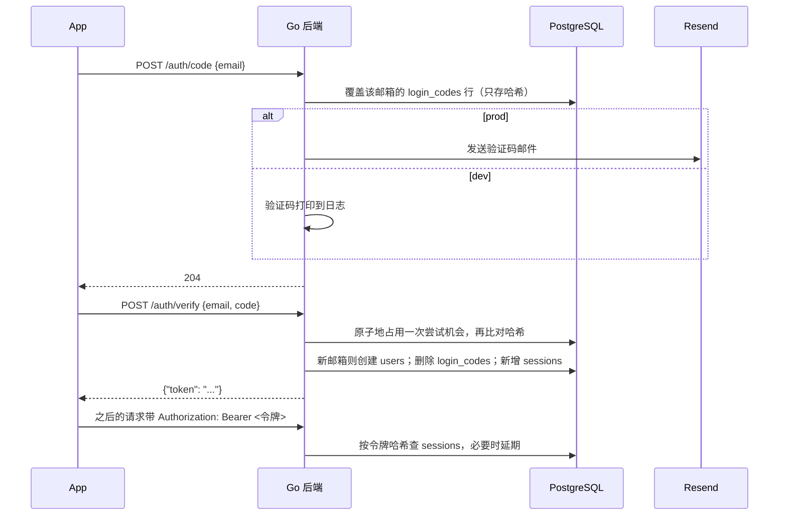

# 03 认证 `已实现`

终端用户用邮箱验证码登录，新邮箱验证成功后自动创建用户。登录后获得一个随机令牌，之后的 HTTP 请求通过请求头携带，WebSocket 在第一条消息中携带（见 [04 消息与实时通信](04-messaging.md#websocket)）。

## 流程

## 接口

| 接口 | 成功 | 失败 |
| --- | --- | --- |
| `POST /auth/code` | 204 | 60 秒内重复请求 429 |
| `POST /auth/verify` | 200 `{"token": "..."}` | 验证码错误或过期统一 400 |
| `POST /auth/logout` | 204，只退出当前设备 | 未登录 401 |

- 邮箱去除首尾空格并转为小写后再使用。
- 未携带或携带无效、过期令牌的请求返回 401。
- 核对验证码时先原子地占用一次尝试机会再比对，并发请求也不会超过 5 次。

## 规则与理由

### 登录凭证

- 使用随机令牌 + 数据库记录（`sessions` 表），不使用 JWT：退出登录或管理员删除用户时删除记录，令牌立即失效；删除用户时经级联删除自动清除。JWT 签发后在过期前无法收回。
- 令牌通过请求头 `Authorization: Bearer <令牌>` 传递：客户端为 Flutter，不使用 Cookie。
- 允许多设备同时登录，每次登录新增一条 `sessions` 记录。
- `POST /auth/logout` 只退出当前设备（删除当前令牌的记录）；“退出所有设备”暂不提供。
- 滑动过期：连续 30 天不活跃才失效。中间件在距上次延期超过一天时将过期时间推迟到 30 天后，避免每次请求都写库。过期令牌按未登录处理，返回 401；过期记录暂留表中，以后再加定期清理。

### 验证码

- 6 位数字，有效期 10 分钟；同一邮箱 60 秒内只能请求一次，防止轰炸邮箱和浪费发信额度。
- 同一验证码最多输错 5 次，之后作废，防止暴力猜测；请求新验证码时旧验证码立即作废，同一时间只有一个有效。
- 验证码与登录令牌在数据库中只存哈希值，不存原文，数据库泄露也拿不到可用的凭证。
- 验证码只有一百万种可能，数据库泄露时其哈希可被穷举反推；因验证码 10 分钟过期、用过即删，影响有限，暂不引入服务端密钥。登录令牌为 32 字节随机数，不受此影响。

### 发信

- 按 `APP_ENV` 区分：`dev` 不发邮件，把验证码打印到后端日志，本地无需 Resend Key；`prod` 通过 Resend 发信，启动时缺少 Resend 配置直接报错退出，且绝不打印验证码。不采用“配了 Key 才发”，避免正式环境漏配时验证码被静默打进日志。
- 两个环境变量，仅 `prod` 必填：`RESEND_API_KEY` 与 `EMAIL_FROM`（如 `Aether <noreply@company.com>`）。发件域名需由部署企业先在 Resend 后台验证，部署说明中写明步骤。
- 维护者自己的部署沿用 aether-start 已在 Resend 验证的域名，发件人为 `noreply@mail.forkicks.fun`。
- 直接用 `net/http` 调用 Resend 发信接口，不引入官方 SDK：只需“发一封邮件”这一个功能。
- 验证码邮件为中英双语，写在同一封邮件里，不做多语言切换；企业 fork 后可自行修改文案。样式沿用 aether-start 的深色验证码邮件。

## 表结构

迁移 `00002_create_auth_tables.sql`：

- `login_codes`：`email` 主键（一个邮箱一行，请求新验证码时覆盖，旧的自然作废）、`code_hash`、`attempts`、`expires_at`、`created_at`（判断 60 秒重发间隔）。不关联 `users`，因为新邮箱验证成功前用户还不存在；验证成功后删除该行。
- `sessions`：`id`、`user_id`（级联删除，带索引）、`token_hash`（唯一）、`expires_at`、`created_at`。滑动延期不需要额外的列：剩余不足 29 天即说明距上次延期超过一天。

## 涉及代码

- `backend/internal/httpapi/auth.go`：接口与 `requireSession` 中间件。
- `backend/internal/httpapi/login_email.go`：调用 Resend 发送验证码邮件。
- `backend/db/queries/auth.sql`：验证码与会话的查询。

## 尚未包含

- 企业统一登录（SSO）等登录方式扩展。`待确认`
- 企业管理员的身份与权限、管理后台接口。`待确认`
- 过期会话的定期清理。`待确认`
