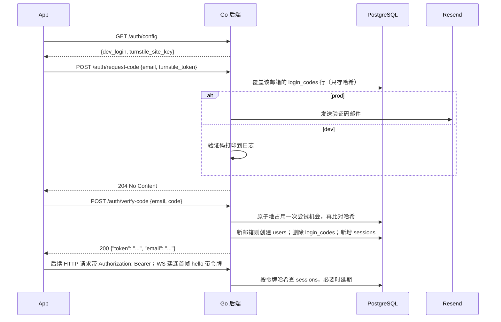

# 03 认证 `已实现`

终端用户用邮箱验证码登录，新邮箱验证成功后自动创建用户。2026-11-27 起，认证与所有聊天读写统一迁回标准 HTTP（`GET /auth/config`、`POST /auth/request-code`、`POST /auth/verify-code`、`POST /auth/dev-login`、`GET /auth/session`、`POST /auth/logout`），未登录时不建立聊天 WebSocket，登录拿到 Bearer 令牌后才连接 `/ws` 接收实时推送（见 [04 消息与实时通信](04-messaging.md#websocket)）。管理看板使用独立的密码登录和会话，见 [08](08-admin-observability.md#权限与-api)。

## 生产注册范围

2026-10-26，用户确认首版直接向公众开放注册。任何新邮箱验证成功后均可创建用户，不要求邀请码或人工审核。选择理由是让公众可以直接注册使用，访问范围不限制为维护者或受邀用户。

现有邮箱登录支持新邮箱验证后自动创建账号，但开放注册的生产部署尚未验收。2026-10-30 补充生产验证码的共享限流和 Turnstile 校验，实际生产域名、真实挑战和邮件送达仍需验收。

2026-10-30，用户确认“现在先无限额度开放”。首版不设置每用户每日输入次数、模型费用额度或全站模型费用上限，选择理由是先让公众无额度门槛使用。该决定不取消登录验证码的防刷保护，也不改变已有的运行时并发与超时约束。模型与联网供应商仍按实际调用计费；后续是否增加额度另行确认。

## 本地开发登录

2026-10-28，用户确认本地 dev 默认无需登录，直接使用 mock 邮箱。`APP_ENV=dev` 时后端在 `GET /auth/config` 中标记 `dev_login: true`，前端未登录时自动调用 `POST /auth/dev-login`，创建或复用 `dev@example.com` 并签发普通聊天会话。无需点击按钮、输入邮箱或验证码；自动登录失败时保留「开发测试登录」按钮供重试。选择理由是打开本地页面即可开始调试，同时复用真实会话、用户数据和聊天链路。所有开发测试登录共享这一用户的聊天记录。

`prod` 的 `GET /auth/config` 返回 `dev_login: false` 及 Turnstile 公开站点密钥，且后端 `POST /auth/dev-login` 返回 403；生产继续使用邮箱验证码。开发登录只模拟身份，模型请求和其他服务仍按当前配置真实调用。

## 流程

## HTTP 认证接口

| 接口 | 成功响应 | 失败响应 |
| --- | --- | --- |
| `GET /auth/config` | `200 {dev_login, turnstile_site_key?}` | 公开接口，无需令牌 |
| `POST /auth/dev-login` | `200 {token, email}`，仅 dev | prod 返回 `403` |
| `POST /auth/request-code` | `204 No Content` | 60 秒冷却或窗口超限返回 `429`，校验失败返回 `400`，发信不可用返回 `503` |
| `POST /auth/verify-code` | `200 {token, email}` | 邮箱无效或验证码错误/过期返回 `400` |
| `GET /auth/session` | `200 {email, desktop_available}` | 令牌缺失或失效返回 `401` |
| `POST /auth/logout` | `204 No Content`，只退出当前设备 | 令牌缺失或失效返回 `401` |

- 邮箱去除首尾空格并转为小写后再使用。
- 未携带或携带无效、过期令牌的请求返回 401。
- 核对验证码时先原子地占用一次尝试机会再比对，并发请求也不会超过 5 次。

## 规则与理由

### 登录凭证

- 使用随机令牌 + 数据库记录（`sessions` 表），不使用 JWT：退出登录或管理员删除用户时删除记录，令牌立即失效；删除用户时经级联删除自动清除。JWT 签发后在过期前无法收回。
- 令牌在 HTTP 请求中通过 `Authorization: Bearer` 传递，在 WebSocket 建连后的首帧 `hello` 中传递，不使用 Cookie，也不放在网址里。
- 允许多设备同时登录，每次登录新增一条 `sessions` 记录。
- `POST /auth/logout` 只退出当前设备（删除当前令牌的记录），前端随即断开推送 WebSocket；“退出所有设备”暂不提供。
- 滑动过期：连续 30 天不活跃才失效。中间件在距上次延期超过一天时将过期时间推迟到 30 天后，避免每次请求都写库。过期令牌按未登录处理，返回 401；过期记录暂留表中，以后再加定期清理。

### 验证码

- 6 位数字，有效期 10 分钟；同一邮箱 60 秒内只能请求一次，防止轰炸邮箱和浪费发信额度。
- 同一验证码最多输错 5 次，之后作废，防止暴力猜测；请求新验证码时旧验证码立即作废，同一时间只有一个有效。
- 验证码与登录令牌在数据库中只存哈希值，不存原文，数据库泄露也拿不到可用的凭证。
- 正确验证码的尝试占用、用户与会话创建、验证码删除在同一事务提交，行锁保证同一验证码并发提交也只能成功一次。错误验证码仍提交尝试次数；数据库失败则回滚。
- 验证码只有一百万种可能，数据库泄露时其哈希可被穷举反推；因验证码 10 分钟过期、用过即删，影响有限，暂不引入服务端密钥。登录令牌为 32 字节随机数，不受此影响。

### 生产验证码防刷

生产 `POST /auth/request-code` 携带 Turnstile 的一次性令牌。公开 site key 随 `GET /auth/config` 下发，秘密 Key 只在后端；后端调用 Cloudflare Siteverify，要求成功、hostname 与部署配置完全一致，且 action 为 `request_code`。缺少配置、验证服务不可用或验证失败均不发信，dev 不加载挑战。

IP 只取 Worker 覆盖写入的 `X-Aether-Client-IP`，不信任浏览器传来的同名头或任意 `X-Forwarded-For`。Caddy 的源站凭证和不公开的 API 容器共同构成信任边界。IPv4 归一化，IPv6 按 /64 计数。数据库计数只存地址或邮箱的 SHA-256 哈希，哈希不是匿名化；超过两天的旧窗口记录会清理。

PostgreSQL 共享以下固定窗口，重连或重启不重置。每个窗口自首次占用起算，不按自然日重置，边界附近可能出现相邻窗口的突发流量。

| 用途 | 默认限制 |
| --- | --- |
| 调用挑战验证 | 全站每分钟 100 次；每个 IP 每分钟 5 次、每小时 30 次 |
| 发验证码邮件 | 全站每分钟 30 次、每 24 小时 1000 次；每邮箱每 24 小时 20 次 |
| 同邮箱重复发码 | 沿用 60 秒冷却 |

这些限制只保护验证码邮件，不限制已登录用户的消息或模型使用。选择共享数据库而非进程内计数，是为了避免多实例、重启与重连绕过。挑战尝试失败仍计数；发信名额与邮箱冷却在一个事务中占用，拒绝时一起回滚。调用 Resend 前先提交，发信失败或结果未知也不退还名额，避免重试风暴。

达到限制返回 `429`；挑战失效返回 `400`；生产配置缺失或服务不可用返回 `503`。全站邮件保护触发时新登录可能暂时受限，已登录聊天继续运行。

### 发信

- 按 `APP_ENV` 区分：`dev` 不发邮件，把验证码打印到后端日志，本地无需 Resend Key；`prod` 通过 Resend 发信，缺少配置时发信请求失败，且绝不打印验证码。缺少服务配置不阻止启动，管理员可进入看板补齐。
- Resend Key 与发件人由管理看板“服务配置”页维护，环境变量不作为日常调用的回退。发件域名需由部署者先在 Resend 后台验证，见 [08 服务凭证管理](08-admin-observability.md#服务凭证管理2026-10-30)。
- 维护者自己的部署沿用 aether-start 已在 Resend 验证的域名，发件人为 `noreply@mail.forkicks.fun`。
- 直接用 `net/http` 调用 Resend 发信接口，不引入官方 SDK：只需“发一封邮件”这一个功能。
- 验证码邮件为中英双语，写在同一封邮件里，不做多语言切换；自行部署后可自行修改文案。样式沿用 aether-start 的深色验证码邮件。

## 远程记忆 MCP OAuth 2.1（2026-11-25）

2026-11-25，用户确认将记忆提取为现有后端直接挂载的远程 MCP 插件（`/mcp/memory`，无状态 Streamable HTTP），并一步到位实现标准 **MCP OAuth 2.1（PKCE `S256` + 动态客户端注册 DCR）**，以支持 ChatGPT Developer Mode、Gemini Apps Developer Mode、Claude、Cursor 等外部产品与 aether 实时双向共享同一份 `/memories` 数据。选择理由是 ChatGPT 与 Gemini 网页端不支持手动填入静态 Bearer Token，而标准 OAuth 2.1 既满足消费级网页端接入，也兼容全部本地开发工具，且将外部权限严格限定在 `scope=memory`（无法访问聊天记录、模型设置或沙箱电脑）。

- **对外源地址配置**：通过环境变量 `PUBLIC_ORIGIN`（如 `https://aether.forkicks.fun`，dev 默认 `http://localhost:$PORT`）统一生成发现文档与回调元数据，避免生产容器经 Caddy 收到源站域名时拼错地址；prod 未配置时不阻断主服务启动，仅 MCP/OAuth 接口返回 503。
- **发现与注册**：
  - `GET /.well-known/oauth-protected-resource` 与 `GET /.well-known/oauth-protected-resource/mcp/memory`（RFC 9728）：声明受保护资源 `<PUBLIC_ORIGIN>/mcp/memory`、授权服务器 `<PUBLIC_ORIGIN>` 与 `memory` 范围；`/mcp/memory` 鉴权失败时在 `401` 响应头携带 `WWW-Authenticate: Bearer resource_metadata="...", scope="memory"`。
  - `GET /.well-known/oauth-authorization-server`（RFC 8414）：声明授权页、换票、注册与撤销端点，以及 `PKCE S256`、`token_endpoint_auth_methods_supported: ["none"]` 和 `authorization_response_iss_parameter_supported: true`（RFC 9207，使 ChatGPT 稳定使用固定回调地址）。
  - `POST /oauth/register`（RFC 7591 DCR）：仅允许 `https://` 或本机回环 `http://`（不含 fragment 与内嵌密码）的回调地址；生产环境复用 `login_rate_limits` 按 IP 与全局窗口限流。不启用 CIMD 远端拉取，避免引入 SSRF 攻击面。
- **SPA 授权确认页（`/oauth/authorize`）**：因系统不使用 Cookie（登录态保存在 `localStorage`）且 Cloudflare Worker 拒绝源站 `3xx` 重定向，`/oauth/authorize` 由前端 SPA 渲染。页面先调用 `GET /oauth/authorize/context` 校验客户端与已注册回调（绝不向未验证回调地址重定向），未登录时就地复用现有 WebSocket 邮箱验证码/开发登录流程，登录后由用户点击“允许/拒绝”调用 `POST /oauth/authorize/decision`（经 `requireChatUser` 鉴权）换取带 `iss` 的回调地址并由浏览器跳转。
- **授权码与令牌生命周期**：迁移 `00067_add_mcp_oauth.sql` 新增 `oauth_clients`、`oauth_authorization_codes` 与 `oauth_tokens`，授权码与访问/刷新令牌在数据库中一律只存 SHA-256 哈希。授权码有效期 5 分钟并在 `POST /oauth/token` 中单次原子删除消费且以恒定时间比对 PKCE `S256`；访问令牌有效期 1 小时，刷新令牌 90 天滑动有效并在每次刷新时单语句原子轮换。`/mcp/memory` 鉴权通过后以 5 分钟节流更新 `last_used_at`。
- **撤销与管理**：提供 `POST /oauth/revoke`（RFC 7009）以及经 `requireChatUser` 保护的 `GET /oauth/connections` 与 `DELETE /oauth/connections/{id}`，用户在 `/memories` 页顶栏「MCP 接入」弹窗即可复制接入地址、查看已授权应用并随时一键撤销。

## 表结构

迁移 `00002_create_auth_tables.sql`：

- `login_codes`：`email` 主键（一个邮箱一行，请求新验证码时覆盖，旧的自然作废）、`code_hash`、`attempts`、`expires_at`、`created_at`（判断 60 秒重发间隔）。不关联 `users`，因为新邮箱验证成功前用户还不存在；验证成功后删除该行。
- `sessions`：`id`、`user_id`（级联删除，带索引）、`token_hash`（唯一）、`expires_at`、`created_at`。滑动延期不需要额外的列：剩余不足 29 天即说明距上次延期超过一天。

迁移 `00067_add_mcp_oauth.sql`：

- `oauth_clients`：`id`（`client_id`）、`client_name`、`redirect_uris`、`created_at`。
- `oauth_authorization_codes`：`code_hash` 主键、`client_id`、`user_id`、`redirect_uri`、`code_challenge`、`scope`（`CHECK (scope = 'memory')`）、`resource`、`expires_at`、`created_at`。
- `oauth_tokens`：`id`、`client_id`、`user_id`、`scope`、`resource`、`access_token_hash`（唯一）、`access_expires_at`、`refresh_token_hash`（唯一）、`refresh_expires_at`、`created_at`、`last_used_at`。

## 涉及代码

- `backend/internal/httpapi/auth.go`：登录配置、验证码发信与核销、开发登录、会话查询/登出与 Bearer 鉴权中间件。
- `backend/internal/httpapi/oauth.go`：MCP OAuth 2.1 发现文档、DCR、授权校验与决策、令牌换取/轮换/撤销与连接管理。
- `backend/internal/httpapi/mcp_memory.go`：无状态 Streamable HTTP `/mcp/memory` 处理器与 OAuth Bearer 鉴权中间件。
- `backend/internal/httpapi/websocket.go`：已登录用户的单向实时推送连接（首帧 `hello` 鉴权）；服务器推送事件定义与写出中转见 `backend/internal/httpapi/events.go`。
- `backend/internal/httpapi/login_email.go`：调用 Resend 发送验证码邮件。
- `backend/db/queries/auth.sql`、`backend/db/queries/oauth.sql`：验证码、会话与 OAuth 的查询。
- `frontend/src/components/oauth/OAuthAuthorizePage.tsx`、`frontend/src/lib/oauth.ts`：OAuth 授权确认页与前端请求封装。

## 尚未包含

- 其他登录方式扩展（如 SSO）。`待确认`
- 管理员的个人身份与多角色权限。当前共享密码看板见 [08](08-admin-observability.md#权限与-api)。
- 过期会话的定期清理。`待确认`
