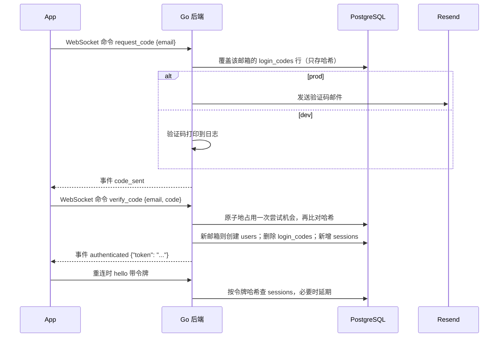

# 03 认证 `已实现`

终端用户用邮箱验证码登录，新邮箱验证成功后自动创建用户。2026-10-28 起，登录全程走主页打开时建立的聊天 WebSocket：前端连接后先发 `hello` 携带已有令牌，没有令牌时在同一条连接上发送验证码与开发登录命令（见 [04 消息与实时通信](04-messaging.md#websocket)），聊天不再使用 HTTP 登录或历史接口。管理看板使用独立的密码登录和会话，见 [08](08-admin-observability.md#权限与-api)。

## 生产注册范围

2026-10-26，用户确认首版直接向公众开放注册。任何新邮箱验证成功后均可创建用户，不要求邀请码或人工审核。选择理由是让公众可以直接注册使用，访问范围不限制为维护者或受邀用户。

现有邮箱登录支持新邮箱验证后自动创建账号，但开放注册的生产部署尚未验收。当前只有按邮箱的验证码重发间隔和尝试次数限制。公众上线前需要补充注册与发信防滥用，以及按用户的模型用量与并发限制。具体额度和超额后的产品行为尚待确认，不能将开放注册理解为无限使用。

## 本地开发登录

2026-10-28，用户确认本地 dev 默认无需登录，直接使用 mock 邮箱。`APP_ENV=dev` 时后端在 `ready` 事件中标记 `dev_login`，前端随即在同一条 WebSocket 上自动发送 `dev_login` 命令，创建或复用 `dev@example.com` 并签发普通聊天会话；已有该邮箱的会话则直接复用，已有其他邮箱的会话则切换为开发用户。无需点击按钮、输入邮箱或验证码；自动登录失败时保留「开发测试登录」按钮供重试。选择理由是打开本地页面即可开始调试，同时复用真实会话、用户数据和聊天链路。所有开发测试登录共享这一用户的聊天记录。

`prod` 的 `ready` 事件中 `dev_login` 为 false，且后端拒绝 `dev_login` 命令；生产继续使用邮箱验证码。开发登录只模拟身份，模型请求和其他服务仍按当前配置真实调用。

## 流程

## WebSocket 命令与事件

登录不再提供 HTTP 接口，全部在主页的聊天 WebSocket 上以命令与事件完成，协议见 [04](04-messaging.md#websocket)。

| 命令 | 成功事件 | 失败事件 |
| --- | --- | --- |
| `hello`（可带令牌） | `ready {dev_login, authenticated}` | 令牌失效时回未登录 `ready`，前端清掉本地令牌 |
| `dev_login` | `authenticated {"token": "...", "email": "dev@example.com"}`，仅 dev | prod 回 `request_failed {code: "dev_login_unavailable"}` |
| `request_code` | `code_sent` | 60 秒内重复请求回 `request_failed {code: "too_frequent"}` |
| `verify_code` | `authenticated {"token": "..."}` | 验证码错误或过期统一回 `request_failed {code: "invalid_code"}` |
| `logout` | `logged_out`，只退出当前设备 | 未登录回 `request_failed {code: "unauthorized"}` |

- 邮箱去除首尾空格并转为小写后再使用。
- 未携带或携带无效、过期令牌的请求返回 401。
- 核对验证码时先原子地占用一次尝试机会再比对，并发请求也不会超过 5 次。

## 规则与理由

### 登录凭证

- 使用随机令牌 + 数据库记录（`sessions` 表），不使用 JWT：退出登录或管理员删除用户时删除记录，令牌立即失效；删除用户时经级联删除自动清除。JWT 签发后在过期前无法收回。
- 令牌在重连的 `hello` 中传递，不使用 Cookie，也不放在网址里。
- 允许多设备同时登录，每次登录新增一条 `sessions` 记录。
- `logout` 命令只退出当前设备（删除当前令牌的记录），连接本身保持未登录状态；“退出所有设备”暂不提供。
- 滑动过期：连续 30 天不活跃才失效。中间件在距上次延期超过一天时将过期时间推迟到 30 天后，避免每次请求都写库。过期令牌按未登录处理，返回 401；过期记录暂留表中，以后再加定期清理。

### 验证码

- 6 位数字，有效期 10 分钟；同一邮箱 60 秒内只能请求一次，防止轰炸邮箱和浪费发信额度。
- 同一验证码最多输错 5 次，之后作废，防止暴力猜测；请求新验证码时旧验证码立即作废，同一时间只有一个有效。
- 验证码与登录令牌在数据库中只存哈希值，不存原文，数据库泄露也拿不到可用的凭证。
- 验证码只有一百万种可能，数据库泄露时其哈希可被穷举反推；因验证码 10 分钟过期、用过即删，影响有限，暂不引入服务端密钥。登录令牌为 32 字节随机数，不受此影响。

### 发信

- 按 `APP_ENV` 区分：`dev` 不发邮件，把验证码打印到后端日志，本地无需 Resend Key；`prod` 通过 Resend 发信，启动时缺少 Resend 配置直接报错退出，且绝不打印验证码。不采用“配了 Key 才发”，避免正式环境漏配时验证码被静默打进日志。
- 两个环境变量，仅 `prod` 必填：`RESEND_API_KEY` 与 `EMAIL_FROM`（如 `Aether <noreply@company.com>`）。发件域名需由部署企业先在 Resend 后台验证，部署说明中写明步骤。
- 维护者自己的部署沿用 aether-start 已在 Resend 验证的域名，发件人为 `noreply@mail.forkicks.fun`。
- 直接用 `net/http` 调用 Resend 发信接口，不引入官方 SDK：只需“发一封邮件”这一个功能。
- 验证码邮件为中英双语，写在同一封邮件里，不做多语言切换；企业 fork 后可自行修改文案。样式沿用 aether-start 的深色验证码邮件。

## 表结构

迁移 `00002_create_auth_tables.sql`：

- `login_codes`：`email` 主键（一个邮箱一行，请求新验证码时覆盖，旧的自然作废）、`code_hash`、`attempts`、`expires_at`、`created_at`（判断 60 秒重发间隔）。不关联 `users`，因为新邮箱验证成功前用户还不存在；验证成功后删除该行。
- `sessions`：`id`、`user_id`（级联删除，带索引）、`token_hash`（唯一）、`expires_at`、`created_at`。滑动延期不需要额外的列：剩余不足 29 天即说明距上次延期超过一天。

## 涉及代码

- `backend/internal/httpapi/auth.go`：验证码与会话的核心逻辑。
- `backend/internal/httpapi/websocket.go`：在聊天连接上处理 `hello` 与登录命令；服务器事件定义与写出中转见 `backend/internal/httpapi/events.go`。
- `backend/internal/httpapi/login_email.go`：调用 Resend 发送验证码邮件。
- `backend/db/queries/auth.sql`：验证码与会话的查询。

## 尚未包含

- 企业统一登录（SSO）等登录方式扩展。`待确认`
- 企业管理员的个人身份与多角色权限。当前共享密码看板见 [08](08-admin-observability.md#权限与-api)。
- 过期会话的定期清理。`待确认`
