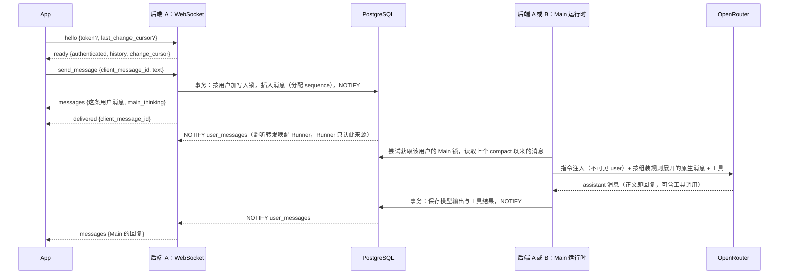

# 04 消息与实时通信 `已实现`

用户原话：

> 我希望做成 web socket，即，一打开聊天页面，就建立起双向通信的通道。

> 我想采取类似这样的架构：生产者、共享存储、消费者。

> 把 messages 表里，没有发给用户的消息全部发给用户不就行了嘛？

2026-10-28，用户进一步要求：

> 修改一下项目的架构：访问主页直接与后端进行 web socket 连接，此时显示 loading 态，连接好了之后直接通过这个通道进行通信。

> 我想定义一下后端会传来的事件类型们，然后在一个文件里专门中转这些事件

因此：访问主页时前端立刻与后端建立一条 WebSocket 双向通道，收到后端 `ready` 事件前只显示 loading 态；连接就绪后，登录、历史消息、发消息与实时推送全部走这条通道，登录、历史与消息收发不调用 HTTP；图片字节通过独立的 `POST /images` 上传到 OSS。谁产生消息就写入 `messages` 表，谁需要就从表里查，PostgreSQL 的 `LISTEN/NOTIFY` 只负责“该去查了”的提醒。

服务器事件先集中定义、再由一个文件统一中转：后端事件结构只定义在 `backend/internal/httpapi/events.go`，该文件的 `eventRelay` 是聊天 WebSocket 唯一的写出口；前端在 `frontend/src/serverEvents.ts` 定义对应的校验结构，`frontend/src/ServerEventRelay.ts` 是前端唯一接触聊天 WebSocket 的文件，它把原始帧校验为事件后转交给 `ChatController`，其余前端代码不直接处理原始帧。

## 整体结构

参考业界做法后，采用“实例无状态、状态放在共享存储”的结构（与 [LangGraph Agent Server](https://docs.langchain.com/langsmith/agent-server)、[DBOS](https://www.dbos.dev/blog/postgres-is-all-you-need-for-durable-execution) 同一思路），不采用把请求路由到固定实例的 Actor 模型（如 Cloudflare Durable Objects、Restate Virtual Objects），因为后者依赖专门的平台。

- 所有后端机器对等、无状态：机器内存中不保存丢失后无法找回的信息，Main 的上下文与运行状态（由消息表推出）都在 PostgreSQL 中。
- 用户请求不需要路由到“正在运行 agent 的机器”：收到消息的机器只负责存入数据库；同一用户的 Main 由数据库锁保证同一时间只有一台机器运行，正在运行的机器在下一次模型调用前会取到新消息。
- 机器之间通过 PostgreSQL 的 `LISTEN/NOTIFY` 互相唤醒，通知只带用户 ID，数据始终以表为准。不引入 Redis。
- 内存中只有两样东西：WebSocket 连接（断开后 App 重连到任意机器即可）与进行中的模型调用（机器崩溃后由其他机器重新调用）。
- 不单独建 `events` 表：用户能看到的消息本就在 `messages` 中，每条 WebSocket 连接自己记录推送位置，从 `messages` 中查出位置之后的消息即可。
- 目前只部署一台，但代码按多台的要求编写。

## 一条消息的完整路径

### 用户发消息

1. App 发送 `send_message`，`client_message_id` 由 App 生成；消息暂不进入消息列表，输入框保留内容并显示“发送中…”。
2. 后端校验：`client_message_id` 为合法 UUID；支持文字、引用和图片组成的 `parts` 列表；至少一项非空，正文与引用合计不超过 32,000 个字符（防止超长消息撑爆上下文、耗费模型费用）。不合法即断开连接。
3. 存入 `messages`，`id` 与 `sequence` 都由数据库在插入时生成；同一用户下 `client_message_id` 已存在时不重复保存。
4. 先把这条消息推给当前连接，再在同一连接上回复 `delivered`。顺序反过来时，输入框清空与消息出现在列表之间会有一瞬间两边都看不到这条消息。App 收到 `delivered` 即发送成功，输入框清空；15 秒未收到或连接断开即发送失败，输入框显示错误并保留内容，再按发送就用同一个 `client_message_id` 重发。
5. 发送 NOTIFY，使用户的其他设备也能收到这条消息。
6. 唤醒该用户的 Main：尝试获取锁，获取到则运行；获取不到说明已有机器在运行，到此为止。Main 的运行见 [05 Main 运行时](05-main-runtime.md)。

## WebSocket

使用 `coder/websocket` 库，连接地址 `GET /ws`。前端打开主页就连接，此时显示 loading；后端回 `ready` 后才进入登录页或聊天页，之后所有聊天通信都走这条连接。

- 浏览器中的 WebSocket 不能自定义请求头，因此连接建立后前端立刻发送 `hello`，其中可携带已有登录令牌；5 秒内未收到 `hello` 即断开。不把令牌放在网址中，避免被写入访问日志。未带令牌或令牌已失效也能连上，后端回未登录的 `ready`，登录命令在同一条连接上继续进行。
- 登录靠 `hello` 中的令牌而非 Cookie，跨站页面无法冒用身份，因此不校验 Origin（Web 客户端可能部署在其他域名）。
- 后端每 30 秒发送心跳 ping；连接断开时前端自动重连，重连时仍先发 `hello`。
- 不合规则的 `send_message`（缺 `client_message_id`、内容全空、正文与引用超过 32,000 字符，或图片引用不属于当前用户）直接断开连接，原因 `invalid send_message`。正常使用的前端不会发出这类消息，出现即说明前端有 bug 或有人手动调用，断开让问题立刻暴露。登录与历史翻页是用户可重试的请求，其失败通过 `request_failed` 事件按 `request_id` 回复，不关闭连接。
- 多台后端时，WebSocket 连接绑定在某一台机器上，由 NOTIFY 唤醒持有该用户连接的机器去查表推送。连接未登录时不注册唤醒，登录成功后才绑定用户。

前端发往后端的命令：

| 命令 | 说明 |
| --- | --- |
| `{"type": "hello", "token": "...", "last_change_cursor": "123"}` | 连接后的第一帧；`last_change_cursor` 为最后收到的变更序号（十进制字符串），用于重连补齐，首次连接可省略，令牌也可省略 |
| `{"type": "request_code", "request_id": "...", "email": "..."}` | 未登录时请求邮箱验证码 |
| `{"type": "verify_code", "request_id": "...", "email": "...", "code": "..."}` | 未登录时用验证码登录 |
| `{"type": "dev_login", "request_id": "..."}` | 未登录时请求开发测试登录，仅 dev 后端接受 |
| `{"type": "load_history", "request_id": "...", "before": "..."}` | 已登录时向前翻一页历史，`before` 可省略取最新一页 |
| `{"type": "logout", "request_id": "..."}` | 退出当前会话，连接保持未登录状态 |
| `{"type": "send_message", "client_message_id": "...", "parts": [...]}` | 按顺序发送文字、引用与图片；旧纯文本客户端仍可只带 `text` |

后端发往前端的事件只在 `events.go` 与 `serverEvents.ts` 两处对应定义，并分别由后端 `eventRelay` 与前端 `ServerEventRelay` 中转：

| 事件 | 说明 |
| --- | --- |
| `{"type": "ready", "authenticated": false, "dev_login": false, "change_cursor": "0"}` | 连接就绪但未登录；已登录时 `authenticated` 为 true 并带 `email`，首次连接同时带最新一页 `history` |
| `{"type": "authenticated", "request_id": "...", "token": "...", "email": "...", "history": {...}, "change_cursor": "123"}` | 在当前连接上登录成功，带最新一页历史 |
| `{"type": "code_sent", "request_id": "..."}` | 验证码已发送 |
| `{"type": "history", "request_id": "...", "messages": [...]}` | 一页历史消息 |
| `{"type": "delivered", "client_message_id": "..."}` | 消息已存入数据库 |
| `{"type": "logged_out", "request_id": "..."}` | 当前会话已退出 |
| `{"type": "request_failed", "request_id": "...", "code": "invalid_code"}` | 对应请求失败，`code` 区分邮箱无效、验证码错误、过于频繁等可重试原因 |
| `{"type": "messages", "messages": [...], "main_thinking": false, "main_failed": false, "change_cursor": "123"}` | 新消息与 Main 处理、失败状态；失败时列表底部显示重试提示，新输入清除，重连从数据库恢复 |

2026-11-03，助手开始输出时先占住行位置，整条回复完成后才对用户可见。一条旧行可能晚于后来的用户消息推送，因此聊天按 `position` 排序，实时同步单独用 `change_cursor`。新可见消息用写入时的序号，隐藏行转为可见时分配一个新的变更序号。首屏先读取推送游标再取历史，期间提交的消息可以按 ID 去重。历史翻页只推进历史断点。兼容旧客户端传 `last_position`，服务端用对应的原始写入序号补发后续变更。

### 推送的消息

| 字段 | 说明 |
| --- | --- |
| `id` | 显示 ID：用户与 Main 的消息都用所在行 ID（Main 一行至多一条正文消息） |
| `position` | 所在行的 ID，用于显示排序和向前翻页 |
| `client_message_id` | 仅用户消息有；对应 App 发送时生成的 ID |
| `sender` | `user` 或 `main` |
| `text` | 正文文字，兼容旧客户端 |
| `parts` | 用户消息的有序多模态内容；图片项的 `url` 是本次读取生成的临时预览地址 |
| `created_at` | 写入时间 |

## 引用、图片与多模态输入框

2026-11-02，用户要求引用和图片上传对齐 Aether Start，并进一步要求多模态输入框、图片存入阿里云 OSS，由后端转为 base64 再发给模型。

输入框使用与 Start 相同的 Tiptap 编辑器。文字、引用和图片是按光标顺序排列的内容，引用和图片是可选中、删除、撤销的行内节点。Enter 换行，Ctrl+Enter 发送，中文输入法确认候选字不发送。支持从文件选择、粘贴和拖放添加图片。上传尚未完成时不能发送，失败保留原有文字与引用。当前标签页的文字草稿保存在 sessionStorage；图片与引用草稿只保留在内存。

同日按用户要求细调输入框内部元素：面板内边距 12px，内容区与工具栏相隔 8px，正文行高 32px，相邻段落相隔 4px。引用与图片节点统一为 44px 高、两侧各留 4px；缩略图为 36px 方形并完整显示，引用过长时单行省略、悬停可读全文。删除按钮在节点内居中，占用独立空间，不覆盖文字或图片。工具栏按钮在桌面为 40px，触屏为 44px；桌面展示 Ctrl+Enter 提示，焦点和悬停状态沿用当前主题。空输入框不显示占位文字。这样文字与附件混排时有稳定的对齐和间距，也更容易点选与删除。 已在桌面与 320px 内容宽度下检查长引用和图片混排，无横向溢出，引用与图片的删除、撤销均可正常使用。

用户进一步要求光标不要与节点重合。节点外壳在卡片两侧各保留 4px 内边距，让原生光标落在卡片边框之外；不向正文添加空格或零宽字符，避免改变发送内容和方向键的移动次数。已检查引用前、相邻节点之间、图片后的落点，以及节点之间的文字插入与撤销。

选中同一条助手回复内的可见文字后显示“引用”按钮，点击后在输入框当前光标位置插入引用。引用保存文字快照、消息 ID 与可见正文中的起止位置。历史中的引用可以回到原文，必要时继续加载更早历史；浏览器支持 CSS Highlight 时高亮所选文字，否则提示整条消息。代码工具栏和公式隐藏 MathML 不计入正文位置。

消息的 `parts` 有三种类型：`text` 保存正文，`quote` 保存引用快照与位置，`image` 保存文件名、OSS 对象引用、字节大小和 MIME 类型。发送、重发、历史展示与模型内容均保留这些项的先后顺序。允许只发引用或只发图片。每条最多 20 段引用、8 张图片，单张最多 4 MiB，每条图片合计最多 8 MiB，支持 PNG、JPEG、GIF 和 WebP。

图片通过 `POST /images?name=...` 以原始字节上传，使用当前登录令牌的 Bearer 认证。后端校验真实格式与大小后写入私有 OSS Bucket 的 `aether-chat/<user_id>/<随机 UUID>.<扩展名>`。消息只保存 `oss://<bucket>/<object>` 持久引用，不保存临时签名链接。前端预览链接由后端签名，有效期一天；重新加载历史会重新签名。Bucket 保持私有与阻止公共访问，不需要浏览器跨域写入权限。

后端在渠道适配前读取 OSS 图片并转为 base64 data URL，OpenRouter 与 ikun Gemini 共用这一步。普通上下文合并与压缩都保留图片段，避免把图片退化成 `[image]` 文本。模型调用日志仍按原有规则记录实际发出的请求，其中可包含图片 base64。OSS 凭证未配置时，文字与引用仍可使用，图片上传明确提示到看板配置。

OSS AccessKey ID、Secret、Bucket 与地域作为一组配置保存在 `service_settings` 的加密载荷中，沿用 AES-GCM 与独立部署主密钥。看板只回显 Bucket、地域和 Secret 末尾四位；替换凭证时同时输入 ID 和 Secret。项目专用 RAM 身份仅需要指定 Bucket 的 `aether-chat/*` 对象的 `oss:GetObject`、`oss:PutObject` 权限，策略见 `infra/oss/ram-policy.json`。

新增迁移 `00022` 修复多段内容搜索文本提取时的 SQL 运算顺序问题，`00023` 将 `aliyun_oss` 纳入服务目录。两项均在隔离数据库中验证执行、回滚、再执行。 已实际验证文字与引用混排、删除与撤销、上传失败保留草稿、Enter 换行与 Ctrl+Enter 发送。OSS 图片实际上传后，消息中为对象引用，模型调用存档中为 base64，OpenRouter 与 ikun Gemini 均正确识别了用于验收的红色正方形与蓝色圆形。粘贴图片、纯图片发送和刷新后恢复也已通过实际验收；未登录上传、不支持的格式、超大图片和跨用户图片引用均被入口拒绝。

## 消息状态

用户原话：

> 我希望给用户发的消息添加这么几个状态：sending，delivered，read

| 状态 | 含义 | 判断方式 |
| --- | --- | --- |
| `sending` | App 已发出，后端尚未确认 | 只存在于 App |
| `failed` | 请求未发送成功（如断网），用户可点击重发 | 只存在于 App |
| `delivered` | 已存入数据库，Main 尚未加入上下文 | `sequence` 为空 |
| `read` | Main 已加入上下文 | `sequence` 有值 |

不新增列，后端返回消息时由 `sequence` 算出 `delivered` / `read`。

2026-11-02，用户要求去掉已读状态，并重新规定消息状态：

> 把已读什么的状态去掉。

> 只有发送成功或失败，但是只有发送失败才显示错误

> 输入框负责展示发送中状态，message list不展示这个状态。

本段取代上表。消息只有发送成功与发送失败两种结果，消息列表里的消息不带任何状态标记：

- 发送中：消息不进入列表，内容留在输入框，输入框显示“发送中…”，发送按钮不可用。
- 发送成功（收到 `delivered`）：消息随后端推送出现在列表中，输入框清空，不显示任何回执。
- 发送失败（超时或断线）：输入框显示“发送失败：原因”并保留内容；再按发送沿用同一个 `client_message_id`，后端若其实已经保存过就不再重复保存。

后端同时删除待读机制（`sequence` 入库即分配，见 [05](05-main-runtime.md#运行循环-已实现)），`messages` 与 `history` 事件不再带 `read_up_to`。选择理由：已读只反映 Main 何时把消息放进上下文，对用户没有可以采取的行动；真正需要用户处理的只有发送失败。把发送中的状态放在输入框里，列表中就只有已经存进数据库的消息，前端不必再维护本地临时消息与服务器消息的对应和排序。

## 推送

- 每条 WebSocket 连接记录自己推送到的消息位置。同一用户可有多条连接（多设备），因此不能在消息上标记“已发送”。
- 收到该用户的 NOTIFY 后，每条连接从 `messages` 查出变更序号大于该连接断点的可见消息，连同 Main 处理状态推送给 App。
- 前端重连时在 `hello` 中带上最后收到的变更序号，后端从其后补齐；首次连接时后端在 `ready` 中直接带最新一页历史，更早的消息由前端发 `load_history` 命令、后端回 `history` 事件翻页。
- 每台机器用一条专用数据库连接执行 `LISTEN user_messages`。监听连接断开后会重连，并让本机所有连接各查一次表，补上断开期间丢失的通知。此补查只覆盖聊天连接：Manager 同在这一条监听上接收唤醒，但 2026-11-03 起只认通知、不在重连时补扫，断开期间错过的 Main 工作等下一次通知触发全量扫描时恢复（见 [05](05-main-runtime.md#运行循环-已实现)）。

## 助手消息宽度

2026-11-02，用户先要求 assistant message 的宽度变成 full，随后改为 `w-fit`、最大宽度不超过消息区域。助手消息列使用 `width: fit-content` 与 `max-width: 100%`，短回复按内容收缩，长回复可以使用消息区域的完整可用宽度，不再受 `84%` 与 `720px` 的单条消息上限约束。消息区域原有的居中最大宽度、左右留白和消息间距保持不变，用户消息宽度也保持不变。选择理由是让短回复紧凑，同时保留长回复的阅读宽度。

## Main 思考气泡 `开发中`

2026-10-23，用户要求：“我希望main在thinking的时候，展示小气泡”。聊天列表底部显示一个与 Main 消息同色的小气泡，三个圆点依次浮动；完成、失败或断线后收起。不新增聊天消息，不展示思考内容，也不根据回复文本或固定计时猜测是否结束。

WebSocket 的每个 `messages` 帧包含 `main_thinking` 布尔快照。当前用户的 Main 有待处理的工作时为 true（2026-11-02 起以 `main_work` 判断：最新一条消息是用户消息、工具回执或带工具调用的 assistant 消息，且不在失败停住状态），覆盖排队、模型调用与工具执行；Main 已停下时为 false。状态依据数据库查询，首次连接与重连都会同步，历史翻页不覆盖这个实时状态。Main 运行退出时通知连接重新查询，30 秒心跳也重新同步以补偿漏通知。

前端尊重系统的减少动画设置；用户上翻历史时，不因气泡变化强制滚动。读屏标签为“Aether 正在思考”。选择理由是用户能确认 Main 仍在处理，同时保持只有消息列表和输入框的界面。

已通过 Go 构建、静态检查、现有 PostgreSQL 集成检查，以及 Flutter 静态检查、14 项现有测试与 Web 构建。真实聊天任务中已观察到三点气泡，并确认任务完成后自动收起，刷新后的空闲状态无残留；未新增测试文件。

## 用户能看到的消息

当前实现中，用户只能看到两类消息内容：自己发的消息，以及 Main 模型生成的正文（2026-10-30 起取代旧的 `send_message(to=user)` 方式，详见 [05](05-main-runtime.md#main-如何回复用户)）。

2026-11-02 起用 `messages.visible` 列显式记录（`00021`）：聊天查询只取 Main 列表中 `visible = true` 的行。真人消息写入时即为 true，Main 助手行落库时为 true，其正文仍在 Go 代码中提取（`agent.AssistantTextToUser`），正文非空才产生一条显示消息；指令、Agent 间投递、运行时提醒、工具回执与摘要为 false。文字仍只存一份，不加 `user_visible_text` 列。
- 后端等模型整条回复生成结束、助手消息落库后才经 NOTIFY 推送整条正文，不向前端逐段推送生成中的文字。

## 历史消息

已登录连接发送 `load_history` 命令，后端回 `history` 事件。从最新往前翻页，每页 50 条用户可见的消息；首次连接的最新一页直接随 `ready` 或 `authenticated` 事件带回，不必再单独请求。

- 以 UUIDv7 的消息 ID 作翻页位置，与推送和重连使用同一个位置值（最初是因为待读消息没有序号）。
- 部分行（Main 未发消息给用户的 `assistant` 行）不产生可见消息，因此后端会继续往前查，直到凑满一页或没有更早的行。

## 消息 ID 与重发

- 所有消息的 `id` 由数据库生成（`uuidv7()`），用于排序：若由 App 生成，UUIDv7 中的时间来自手机，手机时钟不准或被伪造时顺序会错乱。
- `messages.client_message_id`（App 生成，同一用户下唯一）只用于识别重发：断网导致 `delivered` 未送达时，用户在输入框再按发送会带同一个 `client_message_id`，后端发现已存在则不再保存，直接回复 `delivered`。输入框内容被修改或发送成功后才换新的 `client_message_id`。

## 写入顺序

`id` 与 `sequence` 都在执行插入语句时分配，提交后才能被查到。两台机器同时写入同一用户的消息时，先分配到编号的可能后提交；连接若已把推送位置更新到较大的编号，较小的那条会被永远跳过。

因此，往某个用户的消息列表插入消息时，在同一事务中先执行 `pg_advisory_xact_lock`（按用户区分）再插入，提交时自动释放。同一用户的写入因此排队进行，先分配编号的一定先提交，按“位置之后”查询不会漏。每次只排队几毫秒，不同用户互不影响。

UUIDv7 的时间来自数据库服务器时钟；时钟被人为往回调时，新 `id` 可能小于旧 `id`。服务器时钟同步通常是逐渐校准，风险可接受。

两把锁的区别：

| 锁 | 范围 | 作用 |
| --- | --- | --- |
| 写入锁 `pg_advisory_xact_lock('messages:<user_id>')` | 单个插入事务，提交时自动释放 | 同一用户的插入排队，保证 `id` 顺序与提交顺序一致 |
| Main 锁 `pg_try_advisory_lock('main:<user_id>')` | Main 运行全程，结束后手动释放 | 同一用户的 Main 同一时间只在一台机器上运行；机器崩溃时数据库自动释放 |

## 暂不采用、以后再评估

- 将“连接服务器”与“agent worker”拆成两组机器（LangGraph 的做法）：代码按两种角色分开编写，目前在同一进程中运行。
- 用租约代替 advisory lock：目前使用 advisory lock，更简单且机器崩溃时立即释放。
- 边生成边显示时通知量大，届时评估 NOTIFY 是否足够，或合并发送、引入 Redis。

`待确认`：边生成边显示的推送方式；各平台的 WebSocket 连接恢复行为；其他平台的连接与部署验收。
