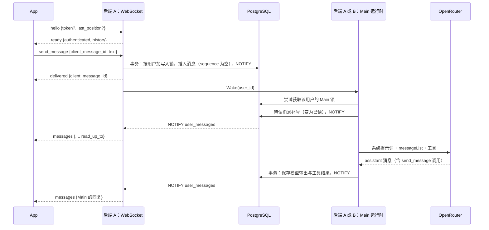

# 04 消息与实时通信 `已实现`

用户原话：

> 我希望做成 web socket，即，一打开聊天页面，就建立起双向通信的通道。

> 我想采取类似这样的架构：生产者、共享存储、消费者。

> 把 messages 表里，没有发给用户的消息全部发给用户不就行了嘛？

2026-10-28，用户进一步要求：

> 修改一下项目的架构：访问主页直接与后端进行 web socket 连接，此时显示 loading 态，连接好了之后直接通过这个通道进行通信。

> 我想定义一下后端会传来的事件类型们，然后在一个文件里专门中转这些事件

因此：访问主页时前端立刻与后端建立一条 WebSocket 双向通道，收到后端 `ready` 事件前只显示 loading 态；连接就绪后，登录、历史消息、发消息与实时推送全部走这条通道，前端不再为聊天调用 HTTP 接口。谁产生消息就写入 `messages` 表，谁需要就从表里查，PostgreSQL 的 `LISTEN/NOTIFY` 只负责“该去查了”的提醒。

服务器事件先集中定义、再由一个文件统一中转：后端事件结构只定义在 `backend/internal/httpapi/events.go`，该文件的 `eventRelay` 是聊天 WebSocket 唯一的写出口；前端在 `frontend/src/serverEvents.ts` 定义对应的校验结构，`frontend/src/ServerEventRelay.ts` 是前端唯一接触聊天 WebSocket 的文件，它把原始帧校验为事件后转交给 `ChatController`，其余前端代码不直接处理原始帧。

## 整体结构

参考业界做法后，采用“实例无状态、状态放在共享存储”的结构（与 [LangGraph Agent Server](https://docs.langchain.com/langsmith/agent-server)、[DBOS](https://www.dbos.dev/blog/postgres-is-all-you-need-for-durable-execution) 同一思路），不采用把请求路由到固定实例的 Actor 模型（如 Cloudflare Durable Objects、Restate Virtual Objects），因为后者依赖专门的平台。

- 所有后端机器对等、无状态：机器内存中不保存丢失后无法找回的信息，Main 的上下文、待读消息、Subagent 状态等都在 PostgreSQL 中。
- 用户请求不需要路由到“正在运行 agent 的机器”：收到消息的机器只负责存入数据库；同一用户的 Main 由数据库锁保证同一时间只有一台机器运行，正在运行的机器在下一次模型调用前会取到新消息。
- 机器之间通过 PostgreSQL 的 `LISTEN/NOTIFY` 互相唤醒，通知只带用户 ID，数据始终以表为准。不引入 Redis。
- 内存中只有两样东西：WebSocket 连接（断开后 App 重连到任意机器即可）与进行中的模型调用（机器崩溃后由其他机器重新调用）。
- 不单独建 `events` 表：用户能看到的消息本就在 `messages` 中，每条 WebSocket 连接自己记录推送位置，从 `messages` 中查出位置之后的消息即可。
- 目前只部署一台，但代码按多台的要求编写。

## 一条消息的完整路径

### 用户发消息

1. App 发送 `send_message`，`client_message_id` 由 App 生成，App 显示 `sending`。
2. 后端校验：`client_message_id` 为合法 UUID；只支持纯文本，`text` 非空且不超过 32,000 个字符（防止超长消息撑爆上下文、耗费模型费用）。不合法即断开连接。
3. 存入 `messages`，`id` 由数据库生成，`sequence` 为空；同一用户下 `client_message_id` 已存在时不重复保存。
4. 在同一连接上回复 `delivered`；App 超时未收到则显示 `failed`，可点击重发。
5. 发送 NOTIFY，使用户的其他设备也能收到这条消息。
6. 唤醒该用户的 Main：尝试获取锁，获取到则运行；获取不到说明已有机器在运行，到此为止。Main 的运行见 [05 Main 运行时](05-main-runtime.md)。

## WebSocket

使用 `coder/websocket` 库，连接地址 `GET /ws`。前端打开主页就连接，此时显示 loading；后端回 `ready` 后才进入登录页或聊天页，之后所有聊天通信都走这条连接。

- 浏览器中的 WebSocket 不能自定义请求头，因此连接建立后前端立刻发送 `hello`，其中可携带已有登录令牌；5 秒内未收到 `hello` 即断开。不把令牌放在网址中，避免被写入访问日志。未带令牌或令牌已失效也能连上，后端回未登录的 `ready`，登录命令在同一条连接上继续进行。
- 登录靠 `hello` 中的令牌而非 Cookie，跨站页面无法冒用身份，因此不校验 Origin（Web 客户端可能部署在其他域名）。
- 后端每 30 秒发送心跳 ping；连接断开时前端自动重连，重连时仍先发 `hello`。
- 不合规则的 `send_message`（缺 `client_message_id`、文字为空或超过 32,000 字符）直接断开连接，原因 `invalid send_message`。正常使用的前端不会发出这类消息，出现即说明前端有 bug 或有人手动调用，断开让问题立刻暴露。登录与历史翻页是用户可重试的请求，其失败通过 `request_failed` 事件按 `request_id` 回复，不关闭连接。
- 多台后端时，WebSocket 连接绑定在某一台机器上，由 NOTIFY 唤醒持有该用户连接的机器去查表推送。连接未登录时不注册唤醒，登录成功后才绑定用户。

前端发往后端的命令：

| 命令 | 说明 |
| --- | --- |
| `{"type": "hello", "token": "...", "last_position": "..."}` | 连接后的第一帧；`last_position` 为最后收到的消息位置，用于重连补齐，首次连接可省略，令牌也可省略 |
| `{"type": "request_code", "request_id": "...", "email": "..."}` | 未登录时请求邮箱验证码 |
| `{"type": "verify_code", "request_id": "...", "email": "...", "code": "..."}` | 未登录时用验证码登录 |
| `{"type": "dev_login", "request_id": "..."}` | 未登录时请求开发测试登录，仅 dev 后端接受 |
| `{"type": "load_history", "request_id": "...", "before": "..."}` | 已登录时向前翻一页历史，`before` 可省略取最新一页 |
| `{"type": "logout", "request_id": "..."}` | 退出当前会话，连接保持未登录状态 |
| `{"type": "send_message", "client_message_id": "...", "text": "..."}` | 发消息 |

后端发往前端的事件只在 `events.go` 与 `serverEvents.ts` 两处对应定义，并分别由后端 `eventRelay` 与前端 `ServerEventRelay` 中转：

| 事件 | 说明 |
| --- | --- |
| `{"type": "ready", "authenticated": false, "dev_login": false}` | 连接就绪但未登录；已登录时 `authenticated` 为 true 并带 `email`，首次连接同时带最新一页 `history` |
| `{"type": "authenticated", "request_id": "...", "token": "...", "email": "...", "history": {...}}` | 在当前连接上登录成功，带最新一页历史 |
| `{"type": "code_sent", "request_id": "..."}` | 验证码已发送 |
| `{"type": "history", "request_id": "...", "messages": [...], "read_up_to": "..."}` | 一页历史消息 |
| `{"type": "delivered", "client_message_id": "..."}` | 消息已存入数据库 |
| `{"type": "logged_out", "request_id": "..."}` | 当前会话已退出 |
| `{"type": "request_failed", "request_id": "...", "code": "invalid_code"}` | 对应请求失败，`code` 区分邮箱无效、验证码错误、过于频繁等可重试原因 |
| `{"type": "messages", "messages": [...], "read_up_to": "...", "main_thinking": false, "activity": {...}}` | 新消息、当前已读位置与 Main 处理状态 |

> 重连字段叫 `last_position` 而非 `last_message_id`：Main 一行里可能有多条消息，它们的 `id`（工具调用 ID）各不相同但 `position`（行 ID）相同，分开命名避免前端误把消息 `id` 当作重连位置。不用 `sequence`：用户消息在 Main 读到前 `sequence` 为空，且 `sequence` 顺序不等于写入顺序；行 ID 在写入时即生成，并由写入锁保证与写入顺序一致。

### 推送的消息

| 字段 | 说明 |
| --- | --- |
| `id` | 显示 ID：用户消息为行 ID；Main 的消息为 `send_message` 的工具调用 ID |
| `position` | 所在行的 ID，App 记下最后一条的值，重连时带上 |
| `client_message_id` | 仅用户消息有；App 据此把本地 `failed` 的消息改为 `delivered` |
| `sender` | `user` 或 `main` |
| `text` | 文字内容 |
| `created_at` | 写入时间 |

## 消息状态

用户原话：

> 我希望给用户发的消息添加这么几个状态：sending，delivered，read

| 状态 | 含义 | 判断方式 |
| --- | --- | --- |
| `sending` | App 已发出，后端尚未确认 | 只存在于 App |
| `failed` | 请求未发送成功（如断网），用户可点击重发 | 只存在于 App |
| `delivered` | 已存入数据库，Main 尚未加入上下文 | `sequence` 为空 |
| `read` | Main 已加入上下文 | `sequence` 有值 |

不新增列，后端返回消息时由 `sequence` 算出 `delivered` / `read`。

## 推送

- 每条 WebSocket 连接记录自己推送到的消息位置。同一用户可有多条连接（多设备），因此不能在消息上标记“已发送”。
- 收到该用户的 NOTIFY 后，每条连接从 `messages` 查出位置之后用户能看到的消息，以及当前已读位置，推送给 App。
- 已读位置用一个值 `read_up_to` 表示（最后一条已读的用户消息）：待读消息总是一次性按顺序补号，已读只会从前往后连续推进。
- 前端重连时在 `hello` 中带上最后收到的位置，后端从其后补齐；首次连接时后端在 `ready` 中直接带最新一页历史，更早的消息由前端发 `load_history` 命令、后端回 `history` 事件翻页。
- 每台机器用一条专用数据库连接执行 `LISTEN user_messages`。监听连接断开后会重连，并让本机所有连接各查一次表，补上断开期间丢失的通知。

## Main 思考气泡 `开发中`

2026-10-23，用户要求：“我希望main在thinking的时候，展示小气泡”。聊天列表底部显示一个与 Main 消息同色的小气泡，三个圆点依次浮动；完成、失败或断线后收起。不新增聊天消息，不展示思考内容，也不根据回复文本或固定计时猜测是否结束。

WebSocket 的每个 `messages` 帧包含 `main_thinking` 布尔快照。当前用户的 Main 有待读消息或未完成步骤时为 true，覆盖排队、模型调用与工具执行；Main 已停下、只有 Subagent 在后台工作时为 false。状态依据数据库查询，首次连接与重连都会同步，历史翻页不覆盖这个实时状态。Main 运行退出时通知连接重新查询，30 秒心跳也重新同步以补偿漏通知。

前端尊重系统的减少动画设置；用户上翻历史时，不因气泡变化强制滚动。读屏标签为“Aether 正在思考”。选择理由是用户能确认 Main 仍在处理，同时保持只有消息列表和输入框的界面。

已通过 Go 构建、静态检查、现有 PostgreSQL 集成检查，以及 Flutter 静态检查、14 项现有测试与 Web 构建。真实聊天任务中已观察到三点气泡，并确认任务完成后自动收起，刷新后的空闲状态无残留；未新增测试文件。

## 用户能看到的消息

当前实现中，用户只能看到两类消息内容：自己发的消息，以及 Main 用 `send_message` 发给用户的文字。2026-10-26 已确认增加额外 Agent 汇总 Main 与 Subagent 的行动，作为运行动态显示在聊天底部，更新同一处文字，刷新和重连会恢复当前状态，见 [05 行动摘要 Agent](05-main-runtime.md#行动摘要-agent开发中)。

不加列，在 Go 代码中解析：查出 Main 列表中位置之后的用户消息与 `assistant` 行，用户消息直接取文字；`assistant` 行遍历 `tool_calls`，取出发给用户的 `send_message` 的 `text`。每条消息以工具调用 ID 作为显示 ID，同一行中的多条消息一起推送，推送位置仍用行 ID。一行中也可能一条都没有（Main 只思考、不说话）。

- 不加 `user_visible_text` 列：表结构不变，文字只存一份。
- 显示与执行共用同一个解析函数（`agent.MessagesToUser` 与执行时共用的 `parseSendMessage`）：执行时因参数不合法而失败的调用，显示时同样跳过。

## 历史消息

已登录连接发送 `load_history` 命令，后端回 `history` 事件。从最新往前翻页，每页 50 条用户可见的消息；首次连接的最新一页直接随 `ready` 或 `authenticated` 事件带回，不必再单独请求。

- 以 UUIDv7 的消息 ID 作翻页位置，因为待读消息没有序号。
- 部分行（Main 未发消息给用户的 `assistant` 行）不产生可见消息，因此后端会继续往前查，直到凑满一页或没有更早的行。

## 消息 ID 与重发

- 所有消息的 `id` 由数据库生成（`uuidv7()`），用于排序：若由 App 生成，UUIDv7 中的时间来自手机，手机时钟不准或被伪造时顺序会错乱。
- `messages.client_message_id`（App 生成，同一用户下唯一）只用于识别重发：断网导致 `delivered` 未送达时，用户重发会带同一个 `client_message_id`，后端发现已存在则不再保存，直接回复 `delivered`。
- 推送的消息带上 `client_message_id`，App 重连后收到断线期间已保存的消息，可自动将本地 `failed` 的消息改为 `delivered`。

## 写入顺序

`id` 与 `sequence` 都在执行插入语句时分配，提交后才能被查到。两台机器同时写入同一用户的消息时，先分配到编号的可能后提交；连接若已把推送位置更新到较大的编号，较小的那条会被永远跳过。

因此，往某个用户的消息列表插入消息时，在同一事务中先执行 `pg_advisory_xact_lock`（按用户区分）再插入，提交时自动释放。同一用户的写入因此排队进行，先分配编号的一定先提交，按“位置之后”查询不会漏。每次只排队几毫秒，不同用户互不影响。

UUIDv7 的时间来自数据库服务器时钟；时钟被人为往回调时，新 `id` 可能小于旧 `id`。服务器时钟同步通常是逐渐校准，风险可接受。

两把锁的区别：

| 锁 | 范围 | 作用 |
| --- | --- | --- |
| 写入锁 `pg_advisory_xact_lock('messages:<user_id>')` | 单个插入事务，提交时自动释放 | 同一用户的插入排队，保证 `id` 顺序与提交顺序一致 |
| Main 锁 `pg_try_advisory_lock('main:<user_id>')` | Main 运行全程，结束后手动释放 | 同一用户的 Main 同一时间只在一台机器上运行；机器崩溃时数据库自动释放 |

## 暂不采用、以后再评估

- 将“连接服务器”与“agent worker”拆成两组机器（LangGraph 的做法）：代码按两种角色分开编写，目前在同一进程中运行。
- 用租约代替 advisory lock：目前使用 advisory lock，更简单且机器崩溃时立即释放。
- 边生成边显示时通知量大，届时评估 NOTIFY 是否足够，或合并发送、引入 Redis。

`待确认`：边生成边显示的推送方式；各平台的 WebSocket 连接恢复行为；其他平台的连接与部署验收。

## 行动摘要快照（2026-10-26，开发中）

每个 WebSocket `messages` 帧增加 `activity`。`state` 为 `working` 或 `idle`，同时携带递增的 `revision` 和 `work_version`；工作中时 `summary` 为最新 recap，尚未生成时为空。该快照覆盖 Main 与 Subagent 的工作，Main 等待 Subagent 时继续显示动态。客户端只有在线时显示活动，断线时收起，重连后以最新快照恢复。

当前实现的动态不追加到 `messages`，不占聊天历史位置，也不进入 Main 的上下文。2026-10-26，用户要求 recap 与普通消息有明显区别，样式更小、更淡。recap 采用无气泡背景的 12px 淡色文字，不同时展示跳动圆点。尚无摘要时仍显示原有思考提示。工作结束时后端推送 `idle`，客户端收起动态文字。运行规则与本地验证见 [05 行动摘要 Agent](05-main-runtime.md#行动摘要-agent开发中)。

### recap 随聊天历史保留（已确认需求，尚未实现）

用户进一步要求：

> 我希望recap也持久化保留在消息上，怎么做？

recap 需要作为聊天时间线中的独立条目保留，继续使用小号淡色文字。任务结束后保留已经展示的 recap，刷新和历史翻页能够读到。该需求扩展此前只显示最新动态的范围。

拟采用独立的 `recaps` 表保存每条摘要，再由聊天查询把普通消息与 recap 合并为时间线。现有 `messages` 同时承担 Agent 上下文，独立保存 recap 可以避免把界面进度送回模型、进入上下文压缩或触发执行。该技术方案尚未写入代码。

记录包含数据库生成的 UUIDv7、用户 ID、对应的 recap 模型调用 ID、工作版本、摘要文字和创建时间。模型调用 ID 唯一，防止同一次生成被重复保存；外键均级联删除。保存时复用用户消息写入锁，在同一短事务检查工作版本、插入 recap、更新当前快照并通知连接，保持提交顺序与时间线游标一致。

实时推送与历史接口使用相同的条目 ID 和类型，统一按位置分页。前端把 recap 放在生成时的时间线位置，当前状态区域不重复显示同一条摘要。结束执行只关闭活动状态，历史记录继续保留。20 秒或四次模型请求的触发规则不变。
