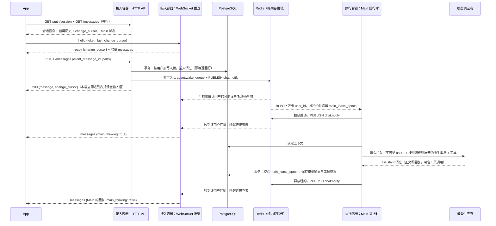

# 04 消息与实时通信 `已实现`

用户原话：

> 我希望做成 web socket，即，一打开聊天页面，就建立起双向通信的通道。

> 我想采取类似这样的架构：生产者、共享存储、消费者。

> 把 messages 表里，没有发给用户的消息全部发给用户不就行了嘛？

2026-10-28，用户进一步要求：

> 修改一下项目的架构：访问主页直接与后端进行 web socket 连接，此时显示 loading 态，连接好了之后直接通过这个通道进行通信。

> 我想定义一下后端会传来的事件类型们，然后在一个文件里专门中转这些事件

2026-11-27，用户确认将聊天通信协议对齐为「**HTTP 负责全部请求-响应（认证、首屏与历史翻页、历史搜索/上下文、发消息、图片与文件上传），WebSocket 仅作为已登录用户的单向实时推送通道**」（取代 2026-10-28 的全量 WebSocket RPC 方案）。选择理由是：消除前后端手搓 `request_id`/`Deferred` RPC 层与单连接命令串行队头阻塞、让弱网或滚动发布期间发消息与搜索不再受 WS 断连阻断、避免未登录用户占用长连接，并与已有的 `/images`、`/files`、`/model-settings`、`/memory-files` 等 HTTP 接口统一鉴权与可观测性模型。

服务器实时推送事件仍先集中定义、再由一个文件统一中转：后端推送事件结构只定义在 `backend/internal/httpapi/events.go`（仅保留 `ready` 与 `messages`）并经 `eventRelay` 写出；前端在 `frontend/src/lib/serverEvents.ts` 定义对应的校验结构，`frontend/src/lib/ServerEventRelay.ts` 是前端唯一接触聊天 WebSocket 的文件，负责首帧 `hello` 鉴权与下行事件解码。

## 整体结构

2026-11-11 更新：后端采用对齐 LangSmith Data Plane 的**对等无状态多容器架构**（生产单机部署 `api-1`、`api-2` 与纯内存 `redis`），每个容器同时接收 WebSocket 与运行 Main。选择理由是在不增加额外主机成本的前提下，消除发布更新与单容器异常期间的连接中断，详见 [05](05-main-runtime.md#对等多实例调度与停机交接2026-11-11)。

- 消息、记忆和轨迹 100% 保存在 PostgreSQL，进程与 Redis 均不保存业务持久状态。
- WebSocket 负载均衡无需配置 Sticky Session：HTTP `Upgrade` 完成后即固定在所连容器，跨容器实时推送通过 Redis Pub/Sub 频道 `chat:notify` 广播用户 ID，持有该用户连接的容器收到后各自查表推送。
- 用户消息提交后，`Manager.Wake` 通过单次 Redis Pipeline 发布 `agent:input`（跨实例打断未占位思考）并去重推入 `agent:wake_queue`（唤醒空闲容器竞争消费）。
- PostgreSQL 不再占用池外 `LISTEN` 长连接，完全回归短事务读写。

## 一条消息的完整路径

### 用户发消息

1. App 调用 `POST /messages`（Bearer 鉴权），`client_message_id` 由 App 生成；消息暂不进入消息列表，输入框保留内容并显示“发送中…”。发送走独立 HTTP 请求，不再受 WS 临时断线重连阻断。
2. 后端校验：`client_message_id` 为合法 UUID；支持文字、引用、图片与工作区文件组成的 `parts` 列表；至少一项非空，正文与引用合计不超过 64,000 个字符（防止超长消息撑爆上下文、耗费模型费用）。不合法返回 `400 Bad Request` 与错误提示，不断开 WebSocket。
3. 存入 `messages`，`id` 与 `sequence` 都由数据库在插入时生成；同一用户下 `client_message_id` 已存在时不重复保存，直接返回已存在的原消息行。
4. 事务提交后立刻唤醒 Main（`Manager.Wake`）并发布 Redis `chat:notify` 让同账号其他端同步，同时 HTTP `200 OK` 直接返回带预览签名的 `message` 与 `change_cursor`。App 收到 `200` 立即把消息合并进列表并清空输入框（不提前跳大 `last_change_cursor`，避免跳过此前尚未推到的助手消息）；WS 后续推回同一条消息时按 `id` 幂等去重。请求超时或失败时输入框显示错误并保留内容，再按发送仍沿用同一个 `client_message_id` 重发。
5. 空闲 Runner 抢到 Redis 执行租约后广播 `chat:notify` 亮起思考气泡；运行结束释放租约后再次广播收起思考气泡并推回 AI 回复。Main 的运行见 [05 Main 运行时](05-main-runtime.md)。

## WebSocket

使用 `coder/websocket` 库，连接地址 `GET /ws`。2026-11-27 起，WebSocket 仅用于**已登录用户**的单向实时推送（增量消息、Main 思考态与失败态），登录、首屏与历史翻页、历史搜索、消息发送及分享管理全部走标准 HTTP。

- 浏览器中的 WebSocket 不能自定义 `Authorization` 请求头，因此建连后前端立刻发送唯一的上行帧 `hello`（携带 `token` 与可选 `last_change_cursor`）；5 秒内未收到合法 `hello` 即断开，令牌缺失或失效直接以 `"unauthorized"` 关闭。不把令牌放在网址中，避免被写入访问日志。
- 鉴权靠 `hello` 中的令牌而非 Cookie，跨站页面无法冒用身份，因此不校验 Origin（Web 客户端可能部署在其他域名）。
- 握手通过后后端调用 `connection.CloseRead(ctx)` 自动处理底层 Ping/Pong/Close 控制帧并在对端关闭或发来非法业务帧时退出，主循环只响应 Redis 唤醒信号与 30 秒心跳 Ping。
- 2026-11-03，用户确认切换标签页或把浏览器切到后台时保持连接：页面隐藏不再主动关闭 WebSocket，也不暂停自动重连；网络恢复时即使页面仍在后台也尝试重连，返回前台时确保连接存在。真正离线或离开页面时仍关闭连接，恢复网络或返回页面后重连；手机系统冻结或回收网页后靠重连与变更游标补齐。

前端建连后发往后端的唯一上行帧：

| 帧 | 说明 |
| --- | --- |
| `{"type": "hello", "token": "...", "last_change_cursor": "123"}` | 建连后的第一帧；`token` 必填，`last_change_cursor` 为最后收到的变更序号（十进制字符串），用于续推补齐 |

后端发往前端的推送事件只在 `events.go` 与 `serverEvents.ts` 两处对应定义，并分别由后端 `eventRelay` 与前端 `ServerEventRelay` 中转：

| 事件 | 说明 |
| --- | --- |
| `{"type": "ready", "change_cursor": "123"}` | 鉴权通过并已注册订阅，返回本次连接的起始同步游标 |
| `{"type": "messages", "messages": [...], "main_thinking": false, "main_failed": false, "change_cursor": "123"}` | 增量可见消息与 Main 处理、失败状态；失败时列表底部显示重试提示，新输入清除，重连或刷新从数据库恢复 |

2026-11-03，助手开始输出时先占住行位置，整条回复完成后才对用户可见。一条旧行可能晚于后来的用户消息推送，因此聊天按 `position` 排序，实时同步单独用 `change_cursor`。新可见消息用写入时的序号，隐藏行转为可见时分配一个新的变更序号。首屏 `GET /messages` 先读取推送游标再取历史，期间提交的消息在 WS 续推时按 ID 去重。历史翻页 `GET /messages?before=...` 只推进历史断点。

### 推送的消息

| 字段 | 说明 |
| --- | --- |
| `id` | 显示 ID：用户与 Main 的消息都用所在行 ID（Main 一行至多一条正文消息） |
| `position` | 所在行的 ID，用于显示排序和向前翻页 |
| `client_message_id` | 仅用户消息有；对应 App 发送时生成的 ID |
| `sender` | `user` 或 `main` |
| `text` | 正文文字，兼容旧客户端 |
| `parts` | 用户消息的有序多模态内容；图片项的 `url` 是本次读取生成的临时预览地址 |
| `created_at` | 写入时间 |

## 引用、图片与多模态输入框

2026-11-02，用户要求引用和图片上传对齐 Aether Start，并进一步要求多模态输入框、图片存入阿里云 OSS，由后端转为 base64 再发给模型。

输入框使用与 Start 相同的 Tiptap 编辑器。文字、引用和图片是按光标顺序排列的内容，引用和图片是可选中、删除、撤销的行内节点。Enter 换行，Ctrl+Enter 发送，中文输入法确认候选字不发送。支持从文件选择、粘贴和拖放添加图片。上传尚未完成时不能发送，失败保留原有文字与引用。当前标签页的文字草稿保存在 sessionStorage；图片与引用草稿只保留在内存。

同日按用户要求细调输入框内部元素：面板内边距 12px，内容区与工具栏相隔 8px，正文行高 32px，相邻段落相隔 4px。引用与图片节点统一为 44px 高、两侧各留 4px；缩略图为 36px 方形并完整显示，引用过长时单行省略、悬停可读全文。删除按钮在节点内居中，占用独立空间，不覆盖文字或图片。工具栏按钮在桌面为 40px，触屏为 44px；桌面展示 Ctrl+Enter 提示，焦点和悬停状态沿用当前主题。空输入框不显示占位文字。这样文字与附件混排时有稳定的对齐和间距，也更容易点选与删除。 已在桌面与 320px 内容宽度下检查长引用和图片混排，无横向溢出，引用与图片的删除、撤销均可正常使用。

用户进一步要求光标不要与节点重合。节点外壳在卡片两侧各保留 4px 内边距，让原生光标落在卡片边框之外；不向正文添加空格或零宽字符，避免改变发送内容和方向键的移动次数。已检查引用前、相邻节点之间、图片后的落点，以及节点之间的文字插入与撤销。

选中同一条助手回复内的可见文字后显示“引用”按钮，点击后在输入框当前光标位置插入引用。引用保存文字快照、消息 ID 与可见正文中的起止位置。历史中的引用可以回到原文，必要时继续加载更早历史；浏览器支持 CSS Highlight 时高亮所选文字，否则提示整条消息。代码工具栏和公式隐藏 MathML 不计入正文位置。

2026-11-11，用户确认自己发出的消息也可以这样引用。位置只计用户自己写的文字，按各段原文顺序拼接；气泡里已有的引用卡片、图片、文件名和「展开全文」不计入。理由是回看高亮和发给模型的快照都要落在选中的原文上，附件和操作按钮不是正文。引用数据结构、条数上限和模型看到的「引用（参考原文）」格式不变。

消息的 `parts` 有四种类型：`text` 保存正文，`quote` 保存引用快照与位置，`image` 保存文件名、OSS 对象引用、字节大小和 MIME 类型，`file`（2026-11-11 新增，面向已绑定工作区的账号）保存任意格式工作区文件的文件名、OSS 持久引用、字节大小和 MIME 类型。发送、重发、历史展示与模型内容均保留这些项的先后顺序。允许只发引用、只发图片或只发文件。每条最多 20 段引用、8 张视觉图片（单张 `<= 4 MiB`、视觉图片合计 `<= 8 MiB`，支持 PNG、JPEG、GIF 和 WebP）、10 个工作区文件（单个与整条消息全部附件合计均 `<= 50 MiB`）。按需导入工作区（`sandbox_import_file`）与 `sandbox_send_file` 独立气泡详见 [07](07-sandbox.md#聊天--mntworkspace-双向文件流转2026-11-11)。

图片通过 `POST /images?name=...` 上传，工作区文件通过 `POST /files?name=...` 流式上传，均使用当前登录令牌的 Bearer 认证。图片写入私有 OSS Bucket 的 `aether-chat/<user_id>/<UUID>.<扩展名>`；工作区文件流式写入 `aether-chat/<user_id>/files/<UUID>`。2026-11-11 起，视觉图片的旁路缓存由每容器独立磁盘卷改为共享 Redis 缓存：直接以 `oss://` 引用为键保存原始图片字节，默认 24 小时绝对有效期（读取不续期，到期由 Redis 自动回收）并在 `{image:cache}:*` 独立键空间内按 `128 MiB` 容量上限淘汰最久未访问的图片。选择理由是双对等容器架构下一次上传即可跨容器共享命中（避免上传落在 `api-1`、发消息校验或模型组装落在 `api-2` 时重复回源 OSS），同时彻底去掉后端容器的磁盘挂载卷与后台清理协程；使用独立 Lua LRU 索引而非全局 `maxmemory-policy`，是为了确保图片缓存淘汰绝不触碰同一 Redis 实例上的唤醒队列与用户租约。消息只保存 `oss://` 持久引用，不保存临时签名链接。前端图片预览与文件下载链接（含 RFC 5987 原文件名 `Content-Disposition`）由后端本地签名，有效期一天。Bucket 保持私有与阻止公共访问，不需要浏览器跨域写入权限。

后端在渠道适配前读取 OSS 图片并转为 base64 data URL，OpenRouter 与 ikun Gemini 共用这一步。2026-11-09 起 `read_image` 抓到的图片也写入同一 OSS 前缀，工具回执只保存 `oss://`，发送时走同一次转换，详见 [05](05-main-runtime.md#read_image-已实现)。普通上下文合并与压缩都保留图片段，避免把图片退化成 `[image]` 文本。模型调用日志仍按原有规则记录实际发出的请求，其中可包含图片 base64。OSS 凭证未配置时，文字与引用仍可使用，图片上传明确提示到看板配置。

OSS AccessKey ID、Secret、Bucket 与地域作为一组配置保存在 `service_settings` 的加密载荷中，沿用 AES-GCM 与独立部署主密钥。看板只回显 Bucket、地域和 Secret 末尾四位；替换凭证时同时输入 ID 和 Secret。项目专用 RAM 身份仅需要指定 Bucket 的 `aether-chat/*` 对象的 `oss:GetObject`、`oss:PutObject` 权限，策略见 `infra/oss/ram-policy.json`。

新增迁移 `00022` 修复多段内容搜索文本提取时的 SQL 运算顺序问题，`00023` 将 `aliyun_oss` 纳入服务目录。两项均在隔离数据库中验证执行、回滚、再执行。 已实际验证文字与引用混排、删除与撤销、上传失败保留草稿、Enter 换行与 Ctrl+Enter 发送。OSS 图片实际上传后，消息中为对象引用，模型调用存档中为 base64，OpenRouter 与 ikun Gemini 均正确识别了用于验收的红色正方形与蓝色圆形。粘贴图片、纯图片发送和刷新后恢复也已通过实际验收；未登录上传、不支持的格式、超大图片和跨用户图片引用均被入口拒绝。

## 消息状态

用户原话：

> 我希望给用户发的消息添加这么几个状态：sending，delivered，read

| 状态 | 含义 | 判断方式 |
| --- | --- | --- |
| `sending` | App 已发出，后端尚未确认 | 只存在于 App |
| `failed` | 请求未发送成功（如断网），用户可点击重发 | 只存在于 App |
| `delivered` | 已存入数据库，Main 尚未加入上下文 | `sequence` 为空 |
| `read` | Main 已加入上下文 | `sequence` 有值 |

不新增列，后端返回消息时由 `sequence` 算出 `delivered` / `read`。

2026-11-02，用户要求去掉已读状态，并重新规定消息状态：

> 把已读什么的状态去掉。

> 只有发送成功或失败，但是只有发送失败才显示错误

> 输入框负责展示发送中状态，message list不展示这个状态。

本段取代上表。消息只有发送成功与发送失败两种结果，消息列表里的消息不带任何状态标记：

- 发送中：消息不进入列表，内容留在输入框，输入框显示“发送中…”，发送按钮不可用。
- 发送成功（收到 `delivered`）：消息随后端推送出现在列表中，输入框清空，不显示任何回执。
- 发送失败（超时或断线）：输入框显示“发送失败：原因”并保留内容；再按发送沿用同一个 `client_message_id`，后端若其实已经保存过就不再重复保存。

后端同时删除待读机制（`sequence` 入库即分配，见 [05](05-main-runtime.md#运行循环-已实现)），`messages` 与 `history` 事件不再带 `read_up_to`。选择理由：已读只反映 Main 何时把消息放进上下文，对用户没有可以采取的行动；真正需要用户处理的只有发送失败。把发送中的状态放在输入框里，列表中就只有已经存进数据库的消息，前端不必再维护本地临时消息与服务器消息的对应和排序。

## 推送

- 每条 WebSocket 连接记录自己推送到的消息位置。同一用户可有多条连接（多设备或连在不同后端容器），因此不能在消息上标记“已发送”。
- 收到 Redis `chat:notify` 频道中该用户的广播后，持有其连接的容器唤醒本地连接，从 `messages` 查出变更序号大于该连接断点的可见消息，连同 Main 处理状态推送给 App。
- 前端首屏通过 `GET /messages` 拿到最新一页历史、`change_cursor` 与 Main 状态，随后在 `hello` 中带上该游标建立推送连接；断线重连时同样在 `hello` 中带上最后收到的变更序号补齐增量；向前翻页通过 `GET /messages?before=<id>` 拉取。
- 每个后端容器用 `ChannelWithSubscriptions` 订阅 Redis `chat:notify`，首次连接与断线重连收到 `subscribe` 确认后自动触发 `wakeAll()` 让本机所有聊天连接补查，避免断连窗口漏推。

## 助手消息宽度

2026-11-02，用户先要求 assistant message 的宽度变成 full，随后改为 `w-fit`、最大宽度不超过消息区域。助手消息列使用 `width: fit-content` 与 `max-width: 100%`，短回复按内容收缩，长回复可以使用消息区域的完整可用宽度，不再受 `84%` 与 `720px` 的单条消息上限约束。消息区域原有的居中最大宽度、左右留白和消息间距保持不变，用户消息宽度也保持不变。选择理由是让短回复紧凑，同时保留长回复的阅读宽度。

## Main 思考气泡 `开发中`

2026-10-23，用户要求：“我希望main在thinking的时候，展示小气泡”。聊天列表底部显示一个与 Main 消息同色的小气泡，内含三个圆点（2026-11-25 起前端移除全部动画与过渡，改为静态展示、直接显隐）；完成、失败或断线后收起。不新增聊天消息，不展示思考内容，也不根据回复文本或固定计时猜测是否结束。

WebSocket 的每个 `messages` 帧包含 `main_thinking` 布尔快照。当前用户的 Main 持有 Redis 执行租约或有运行中的后台 Subagent 时为 true（2026-11-12 起由持有租约与后台运行状态决定，排队等待领单期间保持 false，真正认领开跑时才亮起）；Main 已释放租约且无运行中 Subagent 时为 false。状态依据 Redis 租约与数据库查询，首次连接与重连都会同步，历史翻页不覆盖这个实时状态。Runner 抢占租约与释放租约时均通知连接重新查询，30 秒心跳也重新同步以补偿漏通知。

用户上翻历史时，不因气泡变化强制滚动。读屏标签为“aether 正在处理”。选择理由是用户能确认 Main 仍在处理，同时保持只有消息列表和输入框的界面。

已通过 Go 构建、静态检查、现有 PostgreSQL 集成检查，以及 Flutter 静态检查、14 项现有测试与 Web 构建。真实聊天任务中已观察到三点气泡，并确认任务完成后自动收起，刷新后的空闲状态无残留；未新增测试文件。

## 用户能看到的消息

当前实现中，用户只能看到两类消息内容：自己发的消息，以及 Main 模型生成的正文（2026-10-30 起取代旧的 `send_message(to=user)` 方式，详见 [05](05-main-runtime.md#main-如何回复用户)）。

2026-11-02 起用 `messages.visible` 列显式记录（`00021`）：聊天查询只取 Main 列表中 `visible = true` 的行。真人消息写入时即为 true，Main 助手行落库时为 true，其正文仍在 Go 代码中提取（`agent.AssistantTextToUser`），正文非空才产生一条显示消息；指令、Agent 间投递、运行时提醒、工具回执与摘要为 false。文字仍只存一份，不加 `user_visible_text` 列。
- 后端等模型整条回复生成结束、助手消息落库后才经 NOTIFY 推送整条正文，不向前端逐段推送生成中的文字。

## 历史消息

历史消息与搜索均走标准 HTTP（Bearer 鉴权）：

- `GET /messages`：首屏取最新一页（50 条可见消息）以及当前 `change_cursor`、`main_thinking`、`main_failed`。
- `GET /messages?before=<uuid>`：以 UUIDv7 消息 ID 为游标向前翻页，每页 50 条可见消息。
- `GET /messages/search?q=<keyword>&before=<uuid>`：按关键词搜索当前用户可见消息。
- `GET /messages/{id}/context?direction=around|older|newer`：按锚点加载独立历史上下文窗口。

- 部分行（Main 未发消息给用户的 `assistant` 行）不产生可见消息，因此后端会继续往前查，直到凑满一页或没有更早的行。

## 消息 ID 与重发

- 所有消息的 `id` 由数据库生成（`uuidv7()`），用于排序：若由 App 生成，UUIDv7 中的时间来自手机，手机时钟不准或被伪造时顺序会错乱。
- `messages.client_message_id`（App 生成，同一用户下唯一）只用于识别重发：断网导致 `delivered` 未送达时，用户在输入框再按发送会带同一个 `client_message_id`，后端发现已存在则不再保存，直接回复 `delivered`。输入框内容被修改或发送成功后才换新的 `client_message_id`。

## 写入顺序

`id` 与 `sequence` 都在执行插入语句时分配，提交后才能被查到。即使只有一个进程，WebSocket、Runner 与定时调度器也可能同时写入同一用户的消息，先分配到编号的事务可能后提交；连接若已把推送位置更新到较大的编号，较小的那条会被永远跳过。

因此，往某个用户的消息列表插入消息时，在同一事务中先执行 `pg_advisory_xact_lock`（按用户区分）再插入，提交时自动释放。同一用户的写入因此排队进行，先分配编号的一定先提交，按“位置之后”查询不会漏。每次只排队几毫秒，不同用户互不影响。

UUIDv7 的时间来自数据库服务器时钟；时钟被人为往回调时，新 `id` 可能小于旧 `id`。服务器时钟同步通常是逐渐校准，风险可接受。

写入锁与 Main 的串行执行是两回事：

| 机制 | 范围 | 作用 |
| --- | --- | --- |
| 写入锁 `pg_advisory_xact_lock('messages:<user_id>')` | 单个插入/校验事务，提交时自动释放 | 同一用户的插入与代数校验按单向锁序排队，保证 `id` 顺序与提交顺序一致且不死锁 |
| Redis 用户租约 `agent:lease:<user_id>` + `users.main_lease_epoch` | Main 运行全程（30s TTL，每 10s 续期），结束后释放 | 跨容器保证同一用户同一时间只有一个有效 Runner；栅栏代数阻止超时残留的旧容器改写新容器数据，见 [05](05-main-runtime.md#对等多实例调度与停机交接2026-11-11) |

## 暂不采用、以后再评估

- 将“连接服务器”与“agent worker”拆成两组机器：当前规模下每个后端容器对等兼任两种角色，运维最简单；未来超大规模时可按需拆分。
- 多台主机分布式部署：当前在单机上部署双容器与同机纯内存 Redis（零新增云账单），后续若跨多主机只需将 `DATABASE_URL` 与 `REDIS_URL` 指向 VPC 内的托管实例。
- 边生成边显示：Redis Pub/Sub 通道已就位，后续如需逐段流式推送可直接复用。

`待确认`：边生成边显示的推送方式；各平台的 WebSocket 连接恢复行为；其他平台的连接与部署验收。
