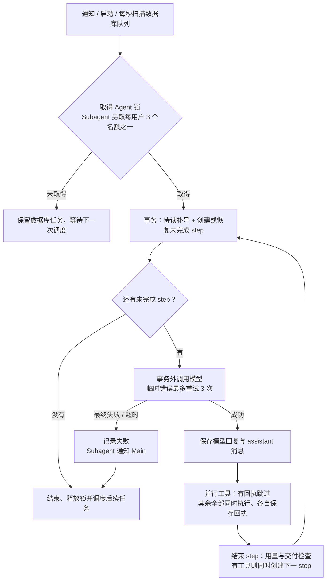
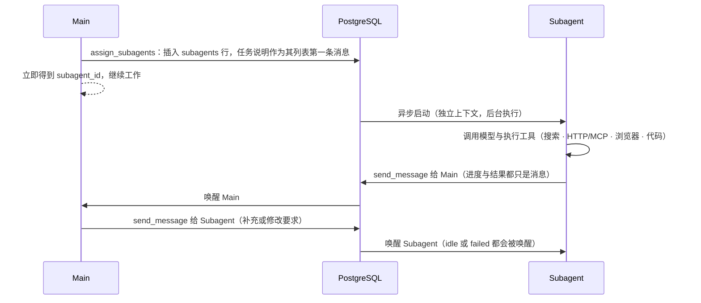

# 05 Main 运行时

每个用户只有一个 Main，与用户之间是一条永不重置的长期对话，使用同一份 `messageList`。Main 是逻辑概念：平时不占任何进程，有待读消息时，某台后端获取该用户的 Main 锁后运行它，处理完即释放。代码在 `backend/internal/agent/`。

## 实现顺序

最小对话（含 WebSocket 收发完整消息）→ 边生成边显示 → 更多工具（`read_message`、`search_message`）→ 压缩与混合搜索 → Subagent。

当前 `已实现` 的代码包含最小 Main 对话、Subagent 派发和双向消息、联网 `search` / `fetch_url`、Web 聊天（现使用 React，移动端为 PWA）。推送完整消息与状态，不推送逐段生成的文字。

2026-10-22，用户调整近期实现顺序：先为 Subagent 添加联网 `search` 与网页读取工具，再制作 WhatsApp 风格的简版 Flutter 客户端，最后在本地联调。完成这些工作需要先实现 Main 派发任务、Subagent 独立运行及双方消息通信。边生成边显示、历史检索和压缩仍属于完整交付范围。

用户原话：

> 我希望给用户发的消息添加这么几个状态：sending，delivered，read；main 先用 haiku5.5；系统提示词就参考 anthropic 发布过的 blog 和我们的产品理念；模型调用失败，无需对用户显示任何内容，内部上报。

## Main 与 Subagent 的执行能力

2026-10-23，用户确认全面采用 B 架构：Main 和 Subagent 共用执行工具。当前包括 `search`、`fetch_url`，使用相同参数、供应商和执行代码。Main 可直接完成任务，也可派发独立任务；不强制所有联网请求都经过 Subagent。理由是让 Main 按任务需要决定分工，减少简单任务的交接。消息权限仍按角色区分：Main 联系用户、派发和指挥 Subagent；Subagent 只向 Main 汇报，不能继续派生。

## Main 如何回复用户

2026-10-30，用户改为：Main 模型生成的正文就是发给用户的消息。后端等模型整条回复生成结束后再一次性推给前端，不逐段推送；正文为空则不产生用户消息，Main 可以就此沉默结束。这一条取代 2026-10-23「只通过 `send_message` 回复用户、禁止直接输出正文」的旧约定。项目尚未上线，旧约定下的数据直接清空，不做兼容。

因此 Main 的每次模型回复里，正文（包括与工具调用同批的正文）都会成为一条用户消息。耗时任务要主动用正文汇报进度：动手前用一两句说明要做什么，之后每几轮工具写一句刚确认了什么、接下来做什么，计划变化或受阻时也写；进度不代替最终结果，也不重复已经说过的进度。简单问题只给结果。模型正文是对外内容，不得暴露内部推理、计划与编排细节。

2026-10-30，用户要求进度再积极一些：提示词按上面的节奏要求汇报；运行时另加兜底。Main 连续 5 个步骤只调用工具、正文为空时，在下一次模型请求的上下文末尾插入一条系统消息，请它先写一句用户能读的进度再继续，同一条回复里仍可调用工具。计数从最近一条这类提醒之后重新算起，数到用户可见正文，或用户、Subagent、日程的新输入为止。同一次沉默最多插入 3 次，避免模型把紧跟工具结果的运行时文字当成注入。提醒写入 `messages`（`role = system`），立刻占序号，之后的请求仍能看见；聊天只显示用户消息和 Main 正文，用户看不到它。Subagent 不插入这条提醒。压缩时按压缩前的原文判断，提醒追加在摘要之后，不写进摘要输入。ikun Gemini 会把中途系统消息并进系统指令，文字仍在，只是不留在工具结果后面；DeepSeek 保留这个位置。

`send_message` 不再用于回复用户，只保留 Agent 间通信：Main 用它给已有 Subagent 发后续指令，Subagent 用它向 Main 汇报。Main 被 Subagent 或 Schedule 唤醒后是否开口仍由它自己判断——不写正文即不打扰用户。

## 运行循环 `已实现`

获取锁后循环：

1. 同一事务为待读消息补号，并创建或恢复 `finished_at` 为空的 `steps`。消息已读而模型尚未完成的工作因此仍可恢复。
2. 检查自动压缩条件，必要时生成摘要；随后组装系统提示词、最新摘要与未被覆盖的消息。Main 连续 5 轮没有用户可见正文时，在这份上下文末尾插入进度提醒。Main 和 Subagent 共用循环，模型、提示词和可用工具按身份选择。压缩的约定是干净的输入输出：消息列表与模型配置（模型、容量、输出上限、阈值）作为已确定的输入；压缩时把待压缩范围按原角色、顺序和内容原样发给同一模型（不对原上下文做任何处理），只在末尾追加一条「请压缩你的上下文、进入下一段对话」的指令，模型返回的一条摘要即替代这段历史。压缩请求明确禁止调用任何工具：不带工具声明，并分别用 OpenRouter 的 `tool_choice: "none"` 与 ikun Gemini 的 `functionCallingConfig` 模式 `NONE` 明确禁用；因为 2026-10-30 一次真实压缩中，模型顺着历史里的工具轨迹输出了 `fetch_url` 工具调用和空正文，空正文被当作摘要落库后，Main 随即看不到被摘要覆盖的历史。除压缩模型调用本身失败外不考虑其他失败状态——待总结历史超过压缩模型容量、摘要为空或带工具调用或被截断、压缩后没变小或仍超限等状态，都依上游约束判定为不可达，不写对应的分块、校验、递归和复核处理。模型调用失败时返回错误，原始消息不动。2026-10-28 用户先确认干净输入输出，后改为全部压缩（不保留最后一条），均经「写代码前的预期核对」，见 [01](01-overview.md#写代码前的预期核对)。
2026-10-30，用户改为：触发只剩 token 条件——仍等上一次同模型成功请求的官方 `prompt_tokens` 达到看板阈值（默认 200,000）或容量上限才压缩，不再等闲置 6 小时（闲置触发及其看板小时设置、`compact_reply_sequence` 记录由 `00018` 一并删除）。达到阈值且这一步恰好领到 Main 的用户新消息时，待压缩范围是这条消息之前的全部历史（上一条摘要也在其中，一并更新），这条消息本身不进压缩请求、原文保留，与同一步同时领到的其余消息一起依次接在新摘要之后发给模型，原因记为 `user_message`（`00017` 扩了 `model_calls.compact_reason` 的取值，看板显示「用户新消息」）；没达到阈值就不压，完整历史照常发送。理由是最新指令不被摘要改写、语气与细节不丢，同时避免短对话每轮都多花一次压缩调用。认定「刚到的用户消息」靠 `prepareStep` 这一步刚领到的待读消息 ID（`prepareContext` 的 `newMessageIDs`），不靠猜上下文最后一条；它之前没有原文（首条消息）或只剩上一条摘要（同一轮重试时摘要已落库）时不压，避免把刚生成的摘要连同这条消息再压一遍。工具续跑、Subagent 与日程唤醒、Subagent 自身达到阈值时仍全量压缩、不保留原文。同日，用户另确认 ikun Gemini 是阈值例外：不跟看板通用阈值，固定到 400,000 才压缩（仍受其输入容量上限封顶，Main 与 Subagent 均适用），利用 Gemini 更大的输入空间晚一点压、少丢一轮历史细节；其他渠道维持看板阈值（默认 200,000）。
3. 在事务外流式调用模型供应商（见下文「模型调用」）。模型整条回复拼完后先存入 step，随后立刻保存 assistant 消息，工具调用从此进入历史。搜索与正文读取也在事务外执行，等待期间保留执行锁，不保留消息写入锁。
4. 2026-10-30，用户确认改为同一步的工具全部并行执行、不设并发上限：每个未有回执的工具调用起一个协程，执行完立刻保存自己的回执（与 `tool_call_id` 对应的 tool 消息即完成标记），全部齐了才结束本步。执行锁连接由运行独占、不能被多个协程同时使用，所以每个工具改从连接池取自己的连接：数据库工具（派发、投递、安排）的执行与回执在各自同一短事务里提交，Main 派发 Subagent 时，创建身份、首条消息和派发回执也在同一事务提交；同一用户的消息插入仍由 `LockUserMessages` 在数据库内串行排队，回执在上下文中的顺序因此是完成顺序，靠 `tool_call_id` 与调用对应，不依赖点名顺序。批次执行期间由一个看守协程定期 ping 锁连接，失效即取消整批。实际能同时跑多少仍受数据库连接池和供应商限流等物理条件约束，运行时不另设数量上限。同日，用户确认去掉联网工具原有的全局 2 秒启动间隔（原先 Serper 搜索与 Parallel 抓取各自按上次发起时间往后排 2 秒）：调用一律立即发出，供应商返回限流错误时按既有失败处理返回工具错误，不在本地排队等待。
5. 全部工具都有回执后，在短事务中记下用量、做交付检查并结束 step；有工具调用时在同一事务创建下一条未完成 step，否则结束。

其他要点：

- **处理中收到新消息**：当前模型请求或工具调用继续执行；待该请求或调用结束，在下一次模型调用前将新消息加入上下文。
- **释放后重新调度**：完成执行后唤醒调度扫描，数据库锁仍是跨实例执行权的依据。
- **释放失败**：释放锁出错时关闭该数据库连接，由数据库释放锁，避免带着锁回到连接池。
- **启动与周期恢复**：启动和每秒扫描待读消息、未完成 step 及仍为 `running` 的 Subagent。通知只减少等待，漏通知不会使任务永久无人处理。
- **连接预算**：`DATABASE_MAX_CONNS` 默认 20、最小 5。每实例最多同时运行“连接池上限减 4”个 Agent，为登录、消息和扫描保留连接。每个 Agent 的全部数据库操作使用自己持有的连接，避免持锁时再等待池中另一条连接。WebSocket 的专用 LISTEN 连接通过 Hijack 移出池，实际数据库连接预算需另加这一条，并计入所有实例的合计。
- **锁连接失效**：等待外部请求时每 5 秒检查锁连接，失效即取消请求；完成网络操作后只有仍持锁的连接能提交结果。
- **崩溃重做**：恢复时复用 step 中已保存的模型回复，并按回执核对工具：有回执的跳过，没有的重新并行执行。数据库工具的执行与回执同事务提交，不会重复生效；联网工具在保存回执前崩溃会被重跑，可能重复计费或产生重复副作用。2026-10-28 用户确认接受这一取舍：用重复执行的成本换取恢复逻辑简单、任务不丢。运行失败收尾时，会给已经保存的助手消息中尚缺回执的工具调用补一条中断回执，避免历史里留下没有回执的工具调用。

## 工具

| 工具 | 作用 | 状态 |
| --- | --- | --- |
| `send_message` | 仅 Agent 间通信：Main 发给本用户 Subagent UUID，Subagent 只能发给 `main`；回复用户走 Main 正文 | `已实现` |
| `read_message` | 按 ID 读取完整消息，受用户权限与消息归属限制 | `仅设计` |
| `search_message` | 在完整历史中混合搜索（关键词 + 向量），见 [02 数据模型](02-data-model.md#压缩与上下文检索) | `仅设计` |
| `assign_subagents` | 创建独立 Subagent 并持久排队，立即返回有序 `subagent_ids` | `已实现` |
| `schedule` | Main 与 Subagent 安排一次性或周期任务，到期将上下文投递给 Main；见 [10](10-schedules.md) | `开发中` |
| `search`、`fetch_url` | Main 与 Subagent 共用搜索和网页读取工具 | `已实现` |

工具参数写在工具描述中。系统提示词明确 Main 的正文就是给用户的消息、且与工具同批的正文也会展示，要求正文只写用户该读的内容、不暴露内部推理与编排；`send_message` 只用于 Agent 之间。参数或接收方无效时返回工具错误，模型可修正；跨用户 Subagent 不可访问。Main 若仍调用 `send_message(to=user)`，工具返回错误说明改用正文，模型可自行修正。

交付检查自 2026-10-30 起只适用于 Subagent（此前 Main 也在检查内）：Subagent 最后一次工具调用必须是成功投递给 `main` 的 `send_message`。检查使用已提交的工具调用与回执，同一批并行工具按调用列表的最后一项判断。之后再执行任何工具（包括 schedule 操作），先前交付即不再满足结束条件。新输入重置交付状态；上下文压缩保留这一状态。

Subagent 返回无工具调用的终止响应时，无论正文为空、普通文本还是 `[DONE]`，只要不满足上述条件，就在事务中持久化内部纠正并创建下一步，再调用模型要求发给 Main 当前结果、明确阻碍或等待后台工作的简短进展。该次纠正请求通过 `tool_choice` 指定 `send_message`；普通请求保留自动工具选择，不在每次调用前强制使用工具。重启从持久化的步骤和纠正状态继续。

同一次结束尝试只纠正一次，仍不遵守时记录失败，防止无限调用；成功交付后清除该次纠正状态，后续执行工具后若再次遗漏消息，仍可重新纠正。Subagent 的失败状态和给 Main 的通知一并提交。纠正本身也是一次实际模型请求，保存用量与费用。

Main 不再有交付检查：正文已在助手消息落库时成为用户消息，无正文结束即合法沉默，运行时不补发、不纠正。这项 Subagent 检查只验证最后一次工具及其投递结果，不能理解内容是否完整或只是一条进度。最终结果的质量仍需真实任务验收。

## 模型

### 模型调用（流式接收、整条推送）

2026-10-30，用户要求改为：供应商到后端流式、后端到前端一次性。两个渠道都逐块读 SSE 事件流，在内存里把正文增量与工具调用参数分片拼成一条完整回复，拼完才落库、发 NOTIFY，前端仍整条收到（本节即上文链接目标）：

- OpenRouter 请求带 `stream: true` 与 `stream_options.include_usage`；用量在末尾分片，拿不到就记空、照常继续，不视为失败。
- ikun Gemini 改用 `:streamGenerateContent?alt=sse`，分片合并成与非流式相同的响应形状后走原有解析；流式特有的「只有 thoughtSignature、正文为空」分片并入前一段，不独立存档（详见 [08](08-admin-observability.md#ikun-gemini2026-10-30)）。
- 失败约定（2026-10-30 用户确认）：流中途断开、或流结束却没有完成标记，按可重试的传输失败处理（沿用最多重试 3 次）；分片不是合法 JSON、工具调用缺名称等拼不出完整消息的情况按无效响应处理，不落库半成品。非 200 错误体仍整段读回取错误信息；分片累计沿用 8 MiB 上限。模型调用日志存档的是实际收到的原始分片。

管理端可全局切换 Main / Subagent 模型或让 Subagent 跟随 Main，保存到数据库，从下次请求读取配置时生效；环境变量提供未保存时的默认值，详见 [08](08-admin-observability.md#一键切换模型2026-10-23开发中)。

- Main 使用 `deepseek/deepseek-v4.1-flash-1017`（OpenRouter，上下文 1,048,576 token）。
- 模型初始默认值由环境变量 `MAIN_MODEL` 配置，默认 `deepseek/deepseek-v4.1-flash-1017`，换模型无需改代码，部署时改配置即可。
- OpenRouter 和 ikun Gemini 的服务凭证在看板保存；dev 与 prod 的实际请求都读取数据库，不使用旧环境变量兜底。服务未配置时模型请求失败，仍允许管理员登录看板配置。

2026-10-30，用户明确接入 Aether 的 ikun Gemini。Main、Subagent 和上下文压缩可选择 `ikun:gemini-*`，请求使用 Gemini 原生协议。OpenRouter 的默认值与既有模型 ID 保留。环境变量、模型目录、签名续接与失败处理见 [08 ikun Gemini](08-admin-observability.md#ikun-gemini2026-10-30)。
- Subagent 的模型通过 `SUBAGENT_MODEL` 独立配置；留空时使用 `MAIN_MODEL` 的实际值，默认与 Main 相同。用户在 2026-10-22 确认此选择，便于先用同一模型联调，再单独调整 Subagent 模型。

2026-10-23，用户要求切换到最新 MiniMax 模型。根据 [OpenRouter 实时模型目录](https://openrouter.ai/api/v1/models) 与 [官方模型页](https://openrouter.ai/minimax/minimax-m3.1-flash)，选择 2026-10-19 发布的 MiniMax M3.1 Flash，使用正式模型 ID `minimax/minimax-m3.1-flash`。它支持工具调用，沿用现有 OpenRouter 接口、提示词和消息协议；Main 默认值及本地配置一并更新，Subagent 留空跟随 Main。后端构建、静态检查及现有测试通过；另在隔离数据库中用真实模型验证了 Main 派发、Subagent 回报，以及 Main 通过 `send_message` 发送进度和结果，两个角色的请求均为新模型。本地后端当时已重新加载该配置。

同日用户进一步指定切换为 `deepseek/deepseek-v4.1-flash-1017`，替代前述 MiniMax 选择。当前 Main 默认值、本地配置与示例说明同步更新；`SUBAGENT_MODEL` 留空，Subagent 跟随 Main 使用该模型。[OpenRouter 模型页](https://openrouter.ai/deepseek/deepseek-v4.1-flash-1017) 与实时目录确认该 ID 存在，并支持工具调用和图片输入，因此保留现有工具与桌面截图能力。构建与静态检查通过；隔离数据库中的真实派发验收共完成 6 个步骤，Main 与 Subagent 均使用该模型，分别经 `send_message` 交付 `DS-SUB-OK` 与 `DS-MAIN-OK`，无模型或持久化错误。本地后端已重启。

## 系统提示词 `已实现`

2026-10-23，用户要求迁入 Aether 的 system prompt。源文件是本地 `aether-start/src/shared/chat/model-catalog.ts` 的 `AETHER_SYSTEM_PROMPT`，来源版本为 `8f042d3`。本项目将其中文调研与表达段落原样放进 `backend/internal/agent/prompt.go` 的 `mainPrompt`，包括尽量使用非中文搜索、优先一手资料、充分理解再回答、朴实平静的语气、解释原理和机制、由浅入深、澄清歧义、使用具体例子、以完整句子和段落为主，以及地道中文表达。选择理由是沿用用户已经在 Aether 调整的交流方式。

为适配本项目保留以下运行契约：

- 每用户一条长期 Main 对话，按用户语言回答，回答篇幅与问题相称。
- Main 与 Subagent 共用联网执行工具，Main 自行决定直接执行或委派；Subagent 仍使用后台任务专用提示词。
- 2026-10-30 改为：Main 的进度与最终结果直接写成正文，正文即用户消息，后端在整条回复生成结束后一次性推送；耗时任务要求动手前和每几轮工具后汇报，连续 5 轮没有用户可见正文时由运行时插入提醒（同一次沉默最多 3 次）；`send_message` 只用于 Agent 间通信，Subagent 仍只通过工具向 Main 汇报；当前实现不展示工具过程和内部任务。
- Aether 原文第一段依赖 `search_chat_history`、`read_chat_history` 与 `/app/会话ID` 链接，本项目尚无这些工具和路由，因此改为依据当前上下文和摘要回顾、保留说话者归属，信息不足时不能断言从未讨论，也不能声称已经检索历史。
- Aether provider 另外拼接的 `buildSystemPrompt()` 不属于本次迁入的 `AETHER_SYSTEM_PROMPT`；其中“不必引用来源”与本项目的研究交付要求冲突，未迁入。Main 与 Subagent 继续共用来源核对及网页属于不可信资料的规则。

实际发给模型的完整提示词以 `backend/internal/agent/prompt.go` 为准，不在文档重复维护一份副本。迁入后已核对 7 段原文逐字保留；后端构建、静态检查和现有测试通过，并用 MiniMax M3.1 Flash 在隔离数据库验证短文本任务经 `send_message` 交付，无 HTTP、持久化或工具错误。本地服务已重启。该验证只覆盖基本交付，不代表全面评测了调研质量与表达风格。

## 模型调用失败

- 不向用户显示任何内容，内部上报：`slog.Error` 记录日志，并写入对应 `steps` 行的 `error`。每次请求（含失败的）都记一条 `steps`。
- 2026-10-30，用户要求模型请求超时改为 10 分钟，与联网工具分开，并限制重试总时间。模型使用独立 HTTP 客户端，单次请求最多 10 分钟；联网工具保留 120 秒。原因是长上下文和高推理请求可能接近或超过原来的两分钟上限，不应因此过早取消并重复生成。
- 临时性错误（网络错误、超时、限流 429、服务端 5xx）最多重试 3 次，间隔为 1、2、4 秒。每轮模型调用从上下文准备开始计时，包含可能触发的压缩、全部尝试和退避，共用 10 分钟总预算；重试不重置截止时间。预算耗尽即取消请求并结束本轮，数据库收尾使用独立于该预算的上下文；模型请求日志保留实际耗时并记为传输失败。若 Subagent 的 15 分钟运行期限或进程退出先发生，仍按外部中断处理。独立发起的压缩请求同样使用模型客户端的 10 分钟单次上限。
- 用户消息已为 `read`，留在上下文中；用户下次发消息时，Main 会一并看到之前未回复的消息。

## Subagent `已实现`

已确认的规则：

- Subagent 与 Main 之间只有消息，没有单独的“汇报”类型：Subagent 用 `send_message` 发消息给 Main，进度与结果都只是消息内容。
- `subagents.status` 由运行时维护，不依赖消息内容。Subagent 因错误无法继续时，运行时向 Main 的列表写入一条 `sender = system`、`sender_subagent_id` 为该 Subagent 的通知。
- Subagent 停下后再收到 Main 的消息，会被重新唤醒继续工作；无论上次是 `idle` 还是 `failed`，收到消息都会唤醒，`failed` 只表示上一次因错误停下。
- 暂不提供强制中断（无 `cancelled` 状态、无 `stop_subagent` 工具）：让 Subagent 停下靠 Main 发消息；卡住或长时间运行的情况由之后的超时规则兜底，超时中断后状态为 `failed`。

用户在 2026-10-22 确认以下运行限制：

- 每个用户最多同时执行 3 个 Subagent，超出的任务保留在数据库中排队，已有任务结束后继续执行。上限按用户划分，避免一个用户一次派发大量任务占满执行资源。
- 每个 Subagent 每次被唤醒后最多连续执行 15 分钟。超时后标为 `failed`，由运行时通知 Main。之后收到 Main 的新消息仍可重新唤醒，避免持续出错或未结束的任务无限占用并发名额。

调度使用每用户三个 PostgreSQL 会话锁名额，跨实例共享上限；排队由 `idle` 与待读消息表示，不新增状态取值。`subagents.started_at` 保留本轮开始时间，重启不会重置截止时间。调度、失败通知、恢复和再唤醒已通过真实 PostgreSQL 隔离 schema 测试，外部接口在该测试中模拟。

其余 HTTP 工具与 MCP 尚待确认。2026-10-29 用户决定先不考虑沙盒，已有实现已删除，执行工具只保留搜索与网页读取，见 [07](07-sandbox.md)。

### assign_subagents `已实现`

用户在 2026-10-22 确认采用 `assign_subagents({tasks:["任务说明1","任务说明2"]})`。数组中的每一项创建一个独立 Subagent，任务说明写入其上下文第一条消息。工具立即返回对应的 `subagent_id`，Main 可以继续处理消息，不等待这些任务完成。

选择理由：Main 可以一次派发多个相互独立的任务，每个 Subagent 保持自己的上下文。任务的派发数量与同时执行数量分开，超出每用户 3 个并发名额的任务排队等待。

### search 与 fetch_url `已实现`

用户在 2026-10-22 确认联网工具“和 aether 一样”。本项目沿用 Aether 当前的服务与工具接口，供 Subagent 搜索和读取网页。

| 工具与用途 | 服务 | 看板服务配置 |
| --- | --- | --- |
| `search(query, platform)`，`platform` 默认为 `google` | Serper，`POST https://google.serper.dev/search` | Serper API Key |
| `search` 的 `weixin` 与 `rednote` 平台 | EveryInfra，`POST https://api.everyinfra.com/api/v1/social` | EveryInfra API Key |
| `search_twitter(query, limit?, sort?)` 读取公开推文 | EveryInfra，`twitter.search`，同一数据 API | EveryInfra API Key |
| `fetch_url(url)` 读取普通网页及 Reddit | Parallel，`POST https://api.parallel.ai/v1/extract` | Parallel API Key |
| `fetch_url` 读取微信公众号文章及小红书笔记 | EveryInfra 的 `wechat_oa.article_detail` 与 `xiaohongshu.note` | EveryInfra API Key |

选择理由：沿用用户已有 Aether 的供应商和使用方式，便于核对行为。`search` 搜索互联网，`search_message` 搜索聊天历史，两者用途不同。

2026-10-30，用户要求接入独立的 `search_twitter`，Main 与 Subagent 共用。复用看板已保存的 EveryInfra Key，不增加凭证、依赖或数据库表。独立工具保留推文正文、原帖链接、作者、发布时间及可用的公开互动计数；推文没有文章标题，不能套用现有 `search` 按标题筛选的逻辑。

`query` 支持 `from:`、`since:`、`until:` 等 X 搜索表达式。`limit` 可选，范围 1–200，省略时使用供应商默认的 25；实际条数可能更少。`sort` 为 `top` 或 `latest`，默认 Top；`latest` 只表达偏好，不保证严格按时间排列或完整历史。参数与排序限制以 [EveryInfra 实时能力目录](https://api.everyinfra.com/api/v1/social/catalog?platform=twitter) 为准。

用户确认本次可达的失败场景包括：无效参数、空查询，Key 未配置或无法解密、数据库读取失败，供应商鉴权／权限／余额／限流／服务错误，网络失败、超时、取消，以及非法 JSON、缺少结果列表或个别字段缺失。实现复用现有凭证读取与 HTTP 边界：参数错误与调用失败返回明确工具错误，单次调用最长 120 秒，不自动重试或切换供应商；空列表正常返回；字段缺失保留其余数据，未知计数不补零。实现位于 `twitter_tools.go`，运行入口与回执持久化复用既有联网流程。

本次本地验证通过 Go 构建、`go vet`、看板脚本语法检查与 diff 检查。复用已有 Key 的真实请求返回 3 条推文；随后在临时本地数据库和独立后端进程中，从聊天 WebSocket 发起请求，模型调用 `search_twitter` 后得到 2 条推文，回执成功保存，聊天端收到原帖链接。另一次运行确认空白查询返回明确工具错误，模型调用记录、看板调用列表和工具统计均正确识别 `search_twitter`。未新增测试文件，临时数据库和验证进程已清理；这些是本地验证，不代表生产部署。

Parallel 返回非空 `full_content` 时使用全文，否则使用同一次响应中的非空 `excerpts`。微信公众号文章和小红书笔记走各自的 EveryInfra 接口，并保留文章链接参数。搜索和正文读取不自动重试或切换供应商。

核对来源为本地 Aether 的 `src/backend/chat/tools/search-tool.ts` 和 `src/backend/chat/tools/fetch-tool.ts`，以及 [Parallel Extract 文档](https://docs.parallel.ai/api-reference/extract/extract)。Go 接入代码位于 `web_tools.go`，协议与错误测试已通过。供应商密钥只在后端读取，缺少密钥时返回明确工具错误。本地已复用 Aether 配置中的 Parallel 和 EveryInfra 密钥。

2026-10-22 已从 Flutter Web 发起真实任务，验证 Main 派发两个后台 Subagent、Parallel 读取官方网页、EveryInfra 搜索和读取微信公众号文章、回传 Main 并显示结果。显式的 `make check-live` 进一步验证微信与小红书搜索、Parallel 正文提取，小红书笔记正文也已通过真实服务检查。2026-10-23 已配置 Serper，并通过真实 Google 搜索检查，返回 6 条来源链接；进一步从 Flutter Web 验证 Google 搜索、Parallel 读取官方文档、Subagent 回传 Main、Main 汇总回复的完整链路。该次任务结束后 Subagent 为 idle，执行步骤无失败、无未完成项。

### 跨模型的回合结束协议（开发中）

此协议自 2026-10-30 起只适用于 Subagent：它收到 `send_message` 的 `delivered` 回执后不得重复发送相同消息；当前工作已交付或等待已派发任务时，通过无工具调用的私有 `[DONE]` 标记结束回合，该标记保留在其内部上下文，不会显示在用户消息流中。运行时仍根据真实已提交工具回执判断交付，标记本身不能替代给 Main 发送结果。此协议解决部分新模型无法稳定以空回复结束、进而重复调用发送消息工具的问题。Main 不再使用该标记：正文即用户消息，不写正文即结束。

## 行动摘要（2026-10-30 已删除）

2026-10-30，用户要求删除 recap。不再单独调用模型汇总 Main 与 Subagent 的行动，也不再把动态文字显示在聊天底部或写入历史。聊天底部仍只在 Main 自己有待读消息或未完成步骤时显示思考气泡。迁移 `00016` 删除已有 recap 调用记录、`recap_state`、`active_agent_users` 和 `steps.activity`，并把 `model_calls.purpose` 收回到 `agent` 与 `compact`。
