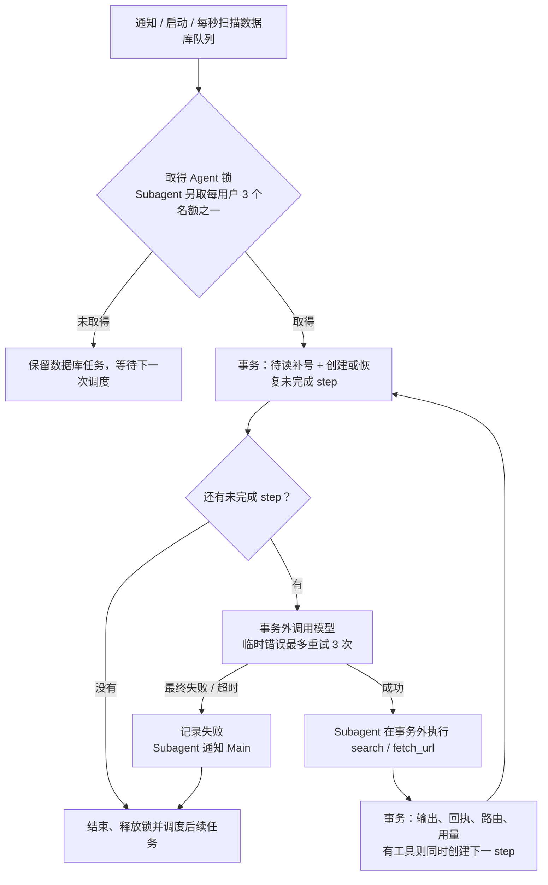
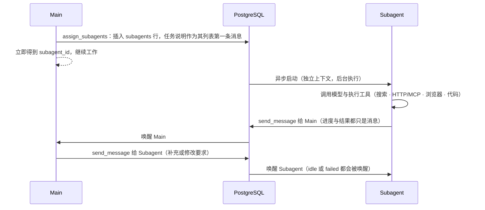

# 05 Main 运行时

每个用户只有一个 Main，与用户之间是一条永不重置的长期对话，使用同一份 `messageList`。Main 是逻辑概念：平时不占任何进程，有待读消息时，某台后端获取该用户的 Main 锁后运行它，处理完即释放。代码在 `backend/internal/agent/`。

## 实现顺序

最小对话（含 WebSocket 收发完整消息）→ 边生成边显示 → 更多工具（`read_message`、`search_message`）→ 压缩与混合搜索 → Subagent。

当前 `已实现` 的代码包含最小 Main 对话、Subagent 派发和双向消息、联网 `search` / `fetch_url`、Web 聊天（现使用 React，移动端为 PWA）。推送完整消息与状态，不推送逐段生成的文字。

2026-10-22，用户调整近期实现顺序：先为 Subagent 添加联网 `search` 与网页读取工具，再制作 WhatsApp 风格的简版 Flutter 客户端，最后在本地联调。完成这些工作需要先实现 Main 派发任务、Subagent 独立运行及双方消息通信。边生成边显示、历史检索和压缩仍属于完整交付范围。

用户原话：

> 我希望给用户发的消息添加这么几个状态：sending，delivered，read；main 先用 haiku5.5；系统提示词就参考 anthropic 发布过的 blog 和我们的产品理念；模型调用失败，无需对用户显示任何内容，内部上报。

## Main 与 Subagent 的执行能力

2026-10-23，用户确认全面采用 B 架构：Main 和 Subagent 共用执行工具。当前包括 `search`、`fetch_url`，使用相同参数、供应商和执行代码。Main 可直接完成任务，也可派发独立任务；不强制所有联网请求都经过 Subagent。理由是让 Main 按任务需要决定分工，减少简单任务的交接。消息权限仍按角色区分：Main 联系用户、派发和指挥 Subagent；Subagent 只向 Main 汇报，不能继续派生。

## Main 如何回复用户

Main 只有调用 `send_message` 才会发消息给用户；模型直接输出的文字是 Main 自己的思考，用户看不到。

用户在 2026-10-23 进一步要求：Main 只通过工具行动与沟通，禁止直接输出正文；耗时任务通过 `send_message` 间歇汇报有意义的进展，完成后再通过 `send_message` 汇报结果。简单请求直接发送结果；进度不代替结果，避免重复或机械汇报。发送结果后或等待后台任务时可以无正文结束。

理由：Main 会被 Subagent 的消息唤醒，很多汇报只需记下、不必打扰用户；“什么时候该开口”是 Main 的能力之一。用户与 Subagent 都通过同一个工具联系，与架构图一致。因此第 1 步就需要实现工具调用（至少 `send_message`）。

## 运行循环 `已实现`

获取锁后循环：

1. 同一事务为待读消息补号，并创建或恢复 `finished_at` 为空的 `steps`。消息已读而模型尚未完成的工作因此仍可恢复。
2. 检查自动压缩条件，必要时生成摘要；随后组装系统提示词、最新摘要与未被覆盖的消息。Main 和 Subagent 共用循环，模型、提示词和可用工具按身份选择。
3. 在事务外调用 OpenRouter。Subagent 的搜索和正文读取也在事务外执行，等待期间保留执行锁，不保留消息写入锁。
4. 在短事务中保存 assistant、工具结果、消息路由及模型用量。Main 派发 Subagent 时，创建身份、首条消息和派发回执也在同一事务提交。
5. 有工具调用时，在保存结果的同一事务创建下一条未完成 step，避免结果已保存但尚未继续调用模型的恢复间隙；否则结束。

其他要点：

- **处理中收到新消息**：当前模型请求或工具调用继续执行；待该请求或调用结束，在下一次模型调用前将新消息加入上下文。
- **释放后重新调度**：完成执行后唤醒调度扫描，数据库锁仍是跨实例执行权的依据。
- **释放失败**：释放锁出错时关闭该数据库连接，由数据库释放锁，避免带着锁回到连接池。
- **启动与周期恢复**：启动和每秒扫描待读消息、未完成 step 及仍为 `running` 的 Subagent。通知只减少等待，漏通知不会使任务永久无人处理。
- **连接预算**：`DATABASE_MAX_CONNS` 默认 20、最小 5。每实例最多同时运行“连接池上限减 4”个 Agent，为登录、消息和扫描保留连接。每个 Agent 的全部数据库操作使用自己持有的连接，避免持锁时再等待池中另一条连接。WebSocket 的专用 LISTEN 连接通过 Hijack 移出池，实际数据库连接预算需另加这一条，并计入所有实例的合计。
- **锁连接失效**：等待外部请求时每 5 秒检查锁连接，失效即取消请求；完成网络操作后只有仍持锁的连接能提交结果。
- **崩溃重做**：未提交的模型与只读网页请求可以重做，供应商可能重复计费。已经提交的派发、投递和工具回执不重复执行。沙盒写操作另有持久化模型回复与操作日志：回执复用、命令按 ID 查询，提交结果不明时不重放，见 [07](07-sandbox.md#实现约束)。

## 工具

| 工具 | 作用 | 状态 |
| --- | --- | --- |
| `send_message` | Main 可发给 `user` 或本用户 Subagent UUID；Subagent 只能发给 `main` | `已实现` |
| `read_message` | 按 ID 读取完整消息，受用户权限与消息归属限制 | `仅设计` |
| `search_message` | 在完整历史中混合搜索（关键词 + 向量），见 [02 数据模型](02-data-model.md#压缩与上下文检索) | `仅设计` |
| `assign_subagents` | 创建独立 Subagent 并持久排队，立即返回有序 `subagent_ids` | `已实现` |
| `schedule` | Main 与 Subagent 安排一次性或周期任务，到期将上下文投递给 Main；见 [10](10-schedules.md) | `开发中` |
| `search`、`fetch_url` | Main 与 Subagent 共用搜索和网页读取工具 | `已实现` |

工具参数写在工具描述中。系统提示词明确“直接输出不显示，用户回复必须走消息通道”，防止简短回复绕过工具而在页面消失。参数或接收方无效时返回工具错误，模型可修正；跨用户 Subagent 不可访问。

运行时还会检查非空、无工具调用的终止正文。如果当前输入或后续搜索、读取之后尚未成功发送消息、也没有刚派发的后台工作，则持久化一次内部纠正，要求模型通过 `send_message` 交付。仍不遵守时记录失败；Subagent 的失败状态和给 Main 的通知一并提交。纠正本身也是一次实际模型请求，保存用量与费用，重启不会重置次数。内部正文始终不会自动转发。

这项检查只验证结构，不能理解一条消息究竟是进度还是最终结果。成功发送后的私有确认和无正文等待可以结束；进度发送后没有再执行工具、直接空输出的情况仍可能漏掉结果。因此最终结果是否完整仍需真实任务验收，不能仅凭“有可见消息”判定任务成功。

## 模型

管理端可全局切换 Main / Subagent 模型或让 Subagent 跟随 Main，保存到数据库，从下次请求读取配置时生效；环境变量提供未保存时的默认值，详见 [08](08-admin-observability.md#一键切换模型2026-10-23开发中)。

- Main 使用 `deepseek/deepseek-v4.1-flash-1017`（OpenRouter，上下文 1,048,576 token）。
- 模型初始默认值由环境变量 `MAIN_MODEL` 配置，默认 `deepseek/deepseek-v4.1-flash-1017`，企业换模型无需改代码。
- `OPENROUTER_API_KEY` 在 dev 与 prod 下都必填：本地开发也需要真实调用模型。
- Subagent 的模型通过 `SUBAGENT_MODEL` 独立配置；留空时使用 `MAIN_MODEL` 的实际值，默认与 Main 相同。用户在 2026-10-22 确认此选择，便于先用同一模型联调，再单独调整 Subagent 模型。

2026-10-23，用户要求切换到最新 MiniMax 模型。根据 [OpenRouter 实时模型目录](https://openrouter.ai/api/v1/models) 与 [官方模型页](https://openrouter.ai/minimax/minimax-m3.1-flash)，选择 2026-10-19 发布的 MiniMax M3.1 Flash，使用正式模型 ID `minimax/minimax-m3.1-flash`。它支持工具调用，沿用现有 OpenRouter 接口、提示词和消息协议；Main 默认值及本地配置一并更新，Subagent 留空跟随 Main。后端构建、静态检查及现有测试通过；另在隔离数据库中用真实模型验证了 Main 派发、Subagent 回报，以及 Main 通过 `send_message` 发送进度和结果，两个角色的请求均为新模型。本地后端当时已重新加载该配置。

同日用户进一步指定切换为 `deepseek/deepseek-v4.1-flash-1017`，替代前述 MiniMax 选择。当前 Main 默认值、本地配置与示例说明同步更新；`SUBAGENT_MODEL` 留空，Subagent 跟随 Main 使用该模型。[OpenRouter 模型页](https://openrouter.ai/deepseek/deepseek-v4.1-flash-1017) 与实时目录确认该 ID 存在，并支持工具调用和图片输入，因此保留现有工具与桌面截图能力。构建与静态检查通过；隔离数据库中的真实派发验收共完成 6 个步骤，Main 与 Subagent 均使用该模型，分别经 `send_message` 交付 `DS-SUB-OK` 与 `DS-MAIN-OK`，无模型或持久化错误。本地后端已重启。

## 系统提示词 `已实现`

2026-10-23，用户要求迁入 Aether 的 system prompt。源文件是本地 `aether-start/src/shared/chat/model-catalog.ts` 的 `AETHER_SYSTEM_PROMPT`，来源版本为 `8f042d3`。本项目将其中文调研与表达段落原样放进 `backend/internal/agent/prompt.go` 的 `mainPrompt`，包括尽量使用非中文搜索、优先一手资料、充分理解再回答、朴实平静的语气、解释原理和机制、由浅入深、澄清歧义、使用具体例子、以完整句子和段落为主，以及地道中文表达。选择理由是沿用用户已经在 Aether 调整的交流方式。

为适配本项目保留以下运行契约：

- 每用户一条长期 Main 对话，按用户语言回答，回答篇幅与问题相称。
- Main 与 Subagent 共用联网执行工具，Main 自行决定直接执行或委派；Subagent 仍使用后台任务专用提示词。
- 只通过工具行动和沟通，关键进展与最终结果必须用 `send_message`，禁止直接输出正文；当前实现不展示工具过程和内部任务。2026-10-26 新增的行动摘要 Agent 汇总这些行动供用户查看，见下文。
- Aether 原文第一段依赖 `search_chat_history`、`read_chat_history` 与 `/app/会话ID` 链接，本项目尚无这些工具和路由，因此改为依据当前上下文和摘要回顾、保留说话者归属，信息不足时不能断言从未讨论，也不能声称已经检索历史。
- Aether provider 另外拼接的 `buildSystemPrompt()` 不属于本次迁入的 `AETHER_SYSTEM_PROMPT`；其中“不必引用来源”与本项目的研究交付要求冲突，未迁入。Main 与 Subagent 继续共用来源核对及网页属于不可信资料的规则。

实际发给模型的完整提示词以 `backend/internal/agent/prompt.go` 为准，不在文档重复维护一份副本。迁入后已核对 7 段原文逐字保留；后端构建、静态检查和现有测试通过，并用 MiniMax M3.1 Flash 在隔离数据库验证短文本任务经 `send_message` 交付，无 HTTP、持久化或工具错误。本地服务已重启。该验证只覆盖基本交付，不代表全面评测了调研质量与表达风格。

## 模型调用失败

- 不向用户显示任何内容，内部上报：`slog.Error` 记录日志，并写入对应 `steps` 行的 `error`。每次请求（含失败的）都记一条 `steps`。
- 临时性错误（网络错误、超时、限流 429、服务端 5xx）自动重试 3 次，间隔逐渐拉长（1、2、4 秒）；仍失败则放弃本轮。
- 用户消息已为 `read`，留在上下文中；用户下次发消息时，Main 会一并看到之前未回复的消息。

## Subagent `已实现`

已确认的规则：

- Subagent 与 Main 之间只有消息，没有单独的“汇报”类型：Subagent 用 `send_message` 发消息给 Main，进度与结果都只是消息内容。
- `subagents.status` 由运行时维护，不依赖消息内容。Subagent 因错误无法继续时，运行时向 Main 的列表写入一条 `sender = system`、`sender_subagent_id` 为该 Subagent 的通知。
- Subagent 停下后再收到 Main 的消息，会被重新唤醒继续工作；无论上次是 `idle` 还是 `failed`，收到消息都会唤醒，`failed` 只表示上一次因错误停下。
- 暂不提供强制中断（无 `cancelled` 状态、无 `stop_subagent` 工具）：让 Subagent 停下靠 Main 发消息；卡住或长时间运行的情况由之后的超时规则兜底，超时中断后状态为 `failed`。

用户在 2026-10-22 确认以下运行限制：

- 每个用户最多同时执行 3 个 Subagent，超出的任务保留在数据库中排队，已有任务结束后继续执行。上限按用户划分，避免一个用户一次派发大量任务占满执行资源。
- 每个 Subagent 每次被唤醒后最多连续执行 15 分钟。超时后标为 `failed`，由运行时通知 Main。之后收到 Main 的新消息仍可重新唤醒，避免持续出错或未结束的任务无限占用并发名额。

调度使用每用户三个 PostgreSQL 会话锁名额，跨实例共享上限；排队由 `idle` 与待读消息表示，不新增状态取值。`subagents.started_at` 保留本轮开始时间，重启不会重置截止时间。调度、失败通知、恢复和再唤醒已通过真实 PostgreSQL 隔离 schema 测试，外部接口在该测试中模拟。

其余 HTTP 工具与 MCP 尚待确认。2026-10-23，用户确认沙盒覆盖完整 Linux 工作能力，包含浏览器与图形桌面，并确认环境长期保留、空闲暂停、下次继续使用，见 [07 Linux 沙盒工作环境](07-sandbox.md)。2026-10-27 用户决定暂时停用沙盒，只保留联网执行工具；已有沙盒映射、操作日志与控制代码保留，当前不注册或执行。详见 07 的当前接入与验证边界。

### assign_subagents `已实现`

用户在 2026-10-22 确认采用 `assign_subagents({tasks:["任务说明1","任务说明2"]})`。数组中的每一项创建一个独立 Subagent，任务说明写入其上下文第一条消息。工具立即返回对应的 `subagent_id`，Main 可以继续处理消息，不等待这些任务完成。

选择理由：Main 可以一次派发多个相互独立的任务，每个 Subagent 保持自己的上下文。任务的派发数量与同时执行数量分开，超出每用户 3 个并发名额的任务排队等待。

### search 与 fetch_url `已实现`

用户在 2026-10-22 确认联网工具“和 aether 一样”。本项目沿用 Aether 当前的服务与工具接口，供 Subagent 搜索和读取网页。

| 工具与用途 | 服务 | 服务端环境变量 |
| --- | --- | --- |
| `search(query, platform)`，`platform` 默认为 `google` | Serper，`POST https://google.serper.dev/search` | `SERP_API_KEY` |
| `search` 的 `weixin` 与 `rednote` 平台 | EveryInfra，`POST https://api.everyinfra.com/api/v1/social` | `EVERYINFRA_API_KEY` |
| `fetch_url(url)` 读取普通网页及 Reddit | Parallel，`POST https://api.parallel.ai/v1/extract` | `PARALLEL_API_KEY` |
| `fetch_url` 读取微信公众号文章及小红书笔记 | EveryInfra 的 `wechat_oa.article_detail` 与 `xiaohongshu.note` | `EVERYINFRA_API_KEY` |

选择理由：沿用用户已有 Aether 的供应商和使用方式，便于核对行为。`search` 搜索互联网，`search_message` 搜索聊天历史，两者用途不同。

Parallel 返回非空 `full_content` 时使用全文，否则使用同一次响应中的非空 `excerpts`。微信公众号文章和小红书笔记走各自的 EveryInfra 接口，并保留文章链接参数。搜索和正文读取不自动重试或切换供应商。

核对来源为本地 Aether 的 `src/backend/chat/tools/search-tool.ts` 和 `src/backend/chat/tools/fetch-tool.ts`，以及 [Parallel Extract 文档](https://docs.parallel.ai/api-reference/extract/extract)。Go 接入代码位于 `web_tools.go`，协议与错误测试已通过。供应商密钥只在后端读取，缺少密钥时返回明确工具错误。本地已复用 Aether 配置中的 Parallel 和 EveryInfra 密钥。

2026-10-22 已从 Flutter Web 发起真实任务，验证 Main 派发两个后台 Subagent、Parallel 读取官方网页、EveryInfra 搜索和读取微信公众号文章、回传 Main 并显示结果。显式的 `make check-live` 进一步验证微信与小红书搜索、Parallel 正文提取，小红书笔记正文也已通过真实服务检查。2026-10-23 已配置 Serper，并通过真实 Google 搜索检查，返回 6 条来源链接；进一步从 Flutter Web 验证 Google 搜索、Parallel 读取官方文档、Subagent 回传 Main、Main 汇总回复的完整链路。该次任务结束后 Subagent 为 idle，执行步骤无失败、无未完成项。

### 跨模型的回合结束协议（开发中）

模型收到 `send_message` 的 `delivered` 回执后不得重复发送相同消息。当前工作已交付或等待已派发任务时，通过无工具调用的私有 `[DONE]` 标记结束回合，属于“只通过工具对外沟通”的控制协议例外；该标记保留在内部上下文，不会显示在用户消息流中。运行时仍根据真实已提交工具回执判断交付，标记本身不能替代给用户或 Main 发送结果。此协议解决部分新模型无法稳定以空回复结束、进而重复调用发送消息工具的问题。Gemini 实际请求已验证一条结果投递后正常停止。

## 行动摘要 Agent（开发中）

2026-10-26，用户明确要求：

> 我希望用额外的一个agent去 summarize 当前agent们的行动。

随后确定调用频率：

> 这样：每20s或者每4次模型请求，调用一次recap

recap 是独立的模型调用，汇总当前用户 Main 与 Subagent 的真实行动，更新聊天底部的动态文字。它没有执行工具，不指挥其他 Agent，也不占用户的三个 Subagent 名额。最终回复仍由 Main 通过 `send_message` 交付。选择理由是让用户在长任务运行期间看懂多个 Agent 正在做什么。

### 触发与恢复

有待处理或执行中的工作时，20 秒或累计四次模型请求先到先触发。Main 与该用户所有 Subagent 的请求合计计数，包括重试与上下文压缩请求；recap 自己的请求不计入。计数表示应用开始一次请求尝试，与 `model_calls` 一样，不承诺进程崩溃前请求一定已到达供应商。

`recap_state` 每用户保存一行工作版本、计时窗口、累计请求数、上次 recap 的计数位置、最新摘要与展示版本。recap 开始领取工作时重新计时并记录计数位置，生成期间的新请求留给下一轮。后台每秒扫描，新的模型请求也会唤醒扫描，因此时间触发有调度延迟，不是严格的实时定时器。

每个后端实例同时执行一个 recap，为业务调用保留连接；多实例通过每用户 PostgreSQL 咨询锁保证同一用户最多一个 recap。超过容量的工作保留在数据库中等待，生成期间满足的新阈值合并为后续一次调用。锁连接失效会取消外部请求，后续拥有锁的实例把旧请求日志标为中断后继续。

所有执行 Agent 均无工作时清除当前动态并停止计时、计数。新工作开启新版本；保存摘要同时检查工作版本与实际工作是否仍存在，旧摘要不能重新显示已结束的活动。首次连接和断线重连读取数据库中的最新快照，历史翻页不覆盖动态。

### 行动输入与模型

实现位于 `backend/internal/agent/recap.go`，复用 `openrouter.go` 的请求、响应、用量与费用日志。进程入口分别启动执行调度和 recap 调度。

运行时在 `steps.activity` 保存每步最近八条模型或工具开始、返回、失败记录。搜索只提取查询词，网页只提取主机与路径，文件只提取路径；命令、文件内容与原始工具输出不进入行动记录。摘要输入包含最新用户请求、活跃 Agent 的任务与行动、近期完成步骤、排队数量和上次摘要，并分别限制长度和条数。

`RECAP_MODEL` 指定独立模型，留空时跟随管理端当前 Main 模型。每次 recap 最长 18 秒，输出最多 180 个字符的一两句话。模型只能依据记录描述进展，不能把工具返回解释为整个目标完成。失败、超时或无效摘要记录在内部，等待下一个触发周期，主任务继续运行。

`model_calls.purpose = 'recap'` 的记录直接关联用户，`step_id` 为空。执行队列和 Main 请求恢复排除这些调用，管理端单独标记动态摘要；总费用仍包含 recap。

### 本地验证

迁移 `00012` 已在独立数据库完成 Up、Down、Up。真实模型任务完成 Main 派发两个 Subagent、分别读取官方网页、回传和 Main 汇总，共观察到 17 次业务请求与四次 recap；每次 recap 之前均新增四次业务请求。

受控验证中，时间条件约 20.27 秒触发，四次请求条件在计数写入后约 0.28 秒触发；双实例只生成一次 recap，recap 请求不增加计数，空闲状态拒绝迟到的摘要。In-App Browser 已观察到动态文字、刷新后恢复，以及工作结束后自动收起。构建仍出现 Lynx 的 ObjectRef 提示，不能据此宣称构建无警告。

故障验收使用无效的 recap 模型产生明确 HTTP 错误，随后 Main 仍完成了真实回复。代码尚未提交或推送；本地验收使用独立数据库与端口，不代表生产部署。
