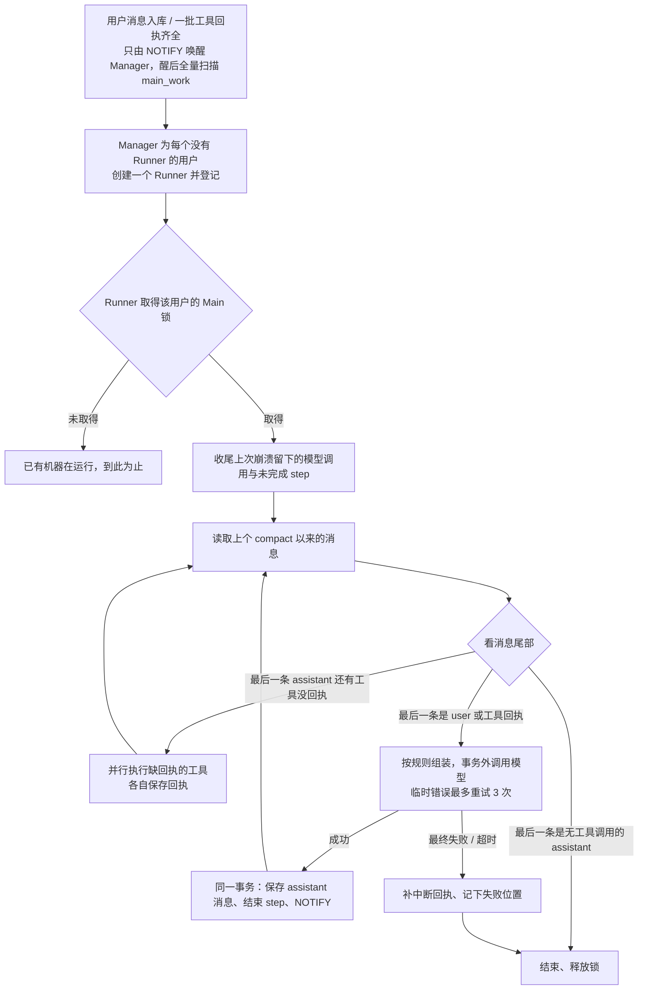
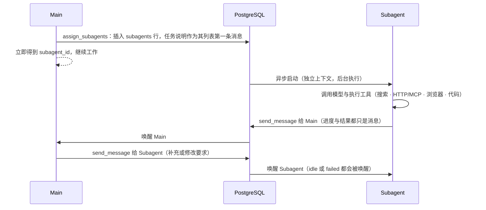

# 05 Main 运行时

每个用户只有一个 Main（2026-11-02 起系统只有 Main，没有 Subagent），与用户之间是一条永不重置的长期对话，使用同一份 `messageList`。Main 是逻辑概念：平时不占任何进程，最新一条消息需要它处理时，某台后端获取该用户的 Main 锁后运行它，处理完即释放。代码在 `backend/internal/agent/`。

## 实现顺序

最小对话（含 WebSocket 收发完整消息）→ 边生成边显示 → 更多工具（`read_message`、`search_message`）→ 压缩与历史检索 → Subagent。

当前 `已实现` 的代码包含最小 Main 对话、联网 `search` / `fetch_url`、Web 聊天（现使用 React，移动端为 PWA）。推送完整消息与状态，不推送逐段生成的文字。

2026-10-22，用户调整近期实现顺序：先为 Subagent 添加联网 `search` 与网页读取工具，再制作 WhatsApp 风格的简版 Flutter 客户端，最后在本地联调。完成这些工作需要先实现 Main 派发任务、Subagent 独立运行及双方消息通信。边生成边显示和压缩仍属于完整交付范围；历史检索已于 2026-10-30 实现（范围与口径见 [02](02-data-model.md#历史检索-已实现)）。

用户原话：

> 我希望给用户发的消息添加这么几个状态：sending，delivered，read；main 先用 haiku5.5；系统提示词就参考 anthropic 发布过的 blog 和我们的产品理念；模型调用失败，无需对用户显示任何内容，内部上报。

## Main 的执行能力

Main 直接使用执行工具完成任务，当前包括 `search`、`fetch_url`，使用既定参数、供应商和执行代码。2026-10-23 曾确认 Main 与 Subagent 共用工具、Main 可自行决定直接执行或派发的 B 架构；该架构已于 2026-11-02 随 Subagent 一并删除，见文末「删除 Subagent（2026-11-02）」。

## Main 如何回复用户

2026-10-30，用户改为：Main 模型生成的正文就是发给用户的消息。后端等模型整条回复生成结束后再一次性推给前端，不逐段推送；正文为空则不产生用户消息。2026-11-03 起，只有最近一次用户输入之后已经给过有效正文，才允许无正文、无工具调用地结束；否则补试一次，仍为空则显示失败，见下文「模型调用失败」。这一条取代 2026-10-23「只通过 `send_message` 回复用户、禁止直接输出正文」的旧约定。项目尚未上线，旧约定下的数据直接清空，不做兼容。

因此 Main 的每次模型回复里，正文（包括与工具调用同批的正文）都会成为一条用户消息。耗时任务要主动用正文汇报进度：动手前用一两句说明要做什么，之后每几轮工具写一句刚确认了什么、接下来做什么，计划变化或受阻时也写；进度不代替最终结果，也不重复已经说过的进度。简单问题只给结果。模型正文是对外内容，不得暴露内部推理、计划与编排细节。

2026-10-30，用户要求进度再积极一些：提示词按上面的节奏要求汇报；运行时另加兜底。Main 连续 5 个步骤只调用工具、正文为空时，在下一次模型请求的上下文末尾插入一条系统消息，请它先写一句用户能读的进度再继续，同一条回复里仍可调用工具。计数从最近一条这类提醒之后重新算起，数到用户可见正文，或用户的新输入为止。同一次沉默最多插入 3 次，避免模型把紧跟工具结果的运行时文字当成注入。提醒写入 `messages`（`role = system`），立刻占序号，之后的请求仍能看见；聊天只显示用户消息和 Main 正文，用户看不到它。压缩时按压缩前的原文判断，提醒追加在摘要之后，不写进摘要输入。ikun Gemini 会把中途系统消息并进系统指令，文字仍在，只是不留在工具结果后面；DeepSeek 保留这个位置。2026-11-02 起，这条提醒改为 `role = user`、`name = progress_reminder`、`visible = false` 的不可见消息，不再使用 system 角色，两个渠道都把它作为普通 user 消息留在上下文末尾。同日稍后，进度提醒改为组装时按轮数插入、不再落库，规则改为每 4 轮无正文工具调用一次、不设上限，见下文「运行循环」中的「请求组装规则」。

不写正文即不打扰用户。原 Agent 间通信工具 `send_message` 已于 2026-11-02 随 Subagent 删除。

### 连续消息与多个请求（2026-11-04，2026-11-06 更新）

用户确认，连续收到的消息按目标判断关系。不同目标分别处理，各自给出结果；为同一目标补充背景、约束、修正或追问的消息合并处理，按更新后的要求执行。判断依据是用户想得到什么结果，不能只看消息先后或话题是否相同。例如，先后要求解释两条不同推文需要分别回答；要求解释后补充“讲给初学者听”属于同一个请求。

新话题不自动取消旧请求，旧流程也不能遮住新问题。只有用户的语义表示取消或替换时才放弃对应请求，暂停则保留。Main 结束前核对每个未完成请求是否已给出相关结果、必要的澄清问题或具体阻塞原因。进度说明、工具结果和其他问题的答案都不算完成该请求；一个请求受阻时，继续处理不依赖它的其他请求。用户追问漏答时，要识别并回答被漏掉的问题。已完成或取消的请求不重新执行。

选择理由是避免模型沿着旧工具流程回答旧话题，或因用户换了话题而遗漏先前问题。规则写入 `MainInstructions` 与结束协议；压缩提示词也分别保留每个请求的目标、进度、暂停、阻塞与未答问题，避免摘要只留下最新话题。当时只约束模型行为，未新增任务队列。2026-11-06，用户改为用 `tasks` 登记和更新需求，另一个目标先排队，当前目标结束后再领取下一项。新实现将输入登记和任务执行分开，并以持久化队列驱动续跑，详见 [11 需求队列](11-tasks.md)。

## 运行循环 `已实现`

**2026-11-03 更新：运行中补充输入。** 用户消息提交后，PostgreSQL 的 `main_input` 通知携带用户和输入序号。持有 Main 执行锁的实例如果仍在等首包或只收到思考分片，就取消旧请求，重新读取上下文，相邻补充可以进入同一次新请求。相同客户端消息重发没有新插入，也不会触发取消。

首段非空白正文或首个工具调用分片到达时，Runner 在用户消息写入锁内检查请求快照之后是否还有输入。有则放弃旧请求，无则插入一行不可见的 `generating` assistant 占住对话位置。供应商继续生成，整条回复完整后更新同一行并结束 step。纯思考不会占位；合法的沉默结束也要做同样的输入检查。用户可以在生成和工具执行期间继续发送消息，工具参数完整并落库后才执行，下一次模型决策会读取期间到达的输入。这样较晚完成的回复不会掩盖它从未读过的消息。

生成中的行不参与上下文组装；它在 `main_work` 中仍属于待处理工作。接管执行锁的实例先清理上次中断的占位并重读消息。模型失败时若已有超出本次输入范围的新消息，失败记录保留在步骤中，Main 继续处理新输入。完整正文的推送和断线补齐见 [消息与实时通信](04-messaging.md)。

2026-11-02，用户认为原有 IM 运行架构不够简洁，要求改为：

> 1.每当有user message进来的时候，先保存进数据库，然后"唤醒"一个runner 2.每当一轮多次工具调用返回所有结果后，先保存进数据库，然后"唤醒"一个runner 3.runner被唤醒之后，只需要负责按照规则组装。4.组装规则：- 第一个是main prompt，然后是message表里上一个compact到最新的所有message，且每个工具都有对应的调用结果，最新的message是user message。- 然后每隔四轮工具调用，插入一句invisible user message（progress）- 每个visible user message的后面都要插入invisible user message （时间）

同日用户又要求「把已读什么的状态去掉」。据此 `messages` 表成为 Main 运行状态的唯一来源，本节取代此前由「待读补号 + 未完成 step」驱动的循环（迁移 `00026_derive_main_work_from_messages`）：

- 消息入库即分配 `sequence`，不再有「`sequence` 为空即待读」这一状态；迁移时把遗留的待读行按 `id` 顺序补号，再把列改为非空。
- Main 要不要运行只看最新一条消息（视图 `main_work`）：最新一条是 user 消息、工具回执，或带工具调用的 assistant 消息，就有活要干；是没有工具调用的 assistant 消息，就表示 Main 已经停下。扫描、唤醒和聊天的思考气泡都用这同一个判断。
- 失败后停住靠 `users.main_failed_through_sequence`：运行失败收尾时记下当时的最大序号，`main_work` 排除最新消息序号不超过它的用户，直到用户新消息带来更新的消息才再试。没有已读状态后，若不记这个位置，同一条失败的消息会被每次扫描反复重试。进程崩溃不写这个标记，重启后等下一次通知触发扫描时从消息尾部接着做。
- `steps` 只记录：每次模型调用尝试一条，压缩一条。普通 step 与对应的 assistant 消息在同一事务里结束，工具回执带上这条 step 的 ID；`steps.model_reply` 删除，崩溃后不复用旧回复，直接按消息尾部决定下一步。

选择理由：事实只有一份，就是数据库里那串消息。不必再另外维护「读到哪了」和「哪一步没做完」来推断要不要运行，出问题时对照消息表就能看出 Main 处于什么位置；请求本身也只是这串消息按固定规则展开的结果。

2026-11-03，用户决定 Runner 只认 PostgreSQL 通知：删掉每秒扫描与启动时的自发唤醒，也删掉 WebSocket 保存消息后与 Runner 跑完一轮后的进程内直接唤醒；一切唤醒只能由 LISTEN 收到的 `user_messages` 与 `main_input` 通知转发，Main 写回仍靠事务里的 `NOTIFY`。Runner 被唤醒后照旧全量扫描 `main_work`，所以任何一条通知都会顺带捡起此前遗漏的工作。用户接受随之而来的语义变化：消息与运行状态不会丢，但触发可以丢——进程重启或 LISTEN 断线间隙里错过的通知不重放，遗留工作要等下一次通知才恢复、不保证恢复时间，本节此前「通知只减少等待，漏通知不会使任务永久无人处理」的说法就此作废。选择理由是调度只保留一条事件路径，不再让周期轮询与多处直接唤醒并存。

2026-11-03，用户进一步要求「一个实例可以跑多个 runner，每个用户对应一个 runner」。据此原全局 Runner 拆为进程内唯一的 `Manager` 与每用户一个的 `Runner`：Manager 持有连接池、模型客户端、工具与服务配置等共享依赖和全局并发名额，被通知唤醒后全量扫描 `main_work`，为每个还没有 Runner 的用户创建一个 Runner 并登记；Runner 只服务自己这一个用户（用户 ID 与思考中请求的取消句柄都存在它自己身上，不再用全局 map 按用户存），抢该用户的 Main 咨询锁后按消息尾部运行，结束时先由 Manager 注销、再释放并发名额。Runner 只在有活时存在，不为无活用户常驻协程，共享依赖也不按用户复制；同一用户在本实例只有一个 Runner，跨实例仍靠 PostgreSQL 咨询锁保证只跑一处。运行语义（只认通知、失败停住位置、连接预算）与拆分前完全一致。选择理由是每用户的状态与执行归到各自对象上，调度与执行的职责分开，后续单用户能力有明确落点；消息表仍是唯一事实来源，Runner 对象只是临时执行者。

获取锁后先清理生成中占位并收尾上次崩溃：仍在进行中的模型调用记为中断，`finished_at` 为空的 step 记为失败（「interrupted before the step finished」），然后循环：

1. 读取最新摘要与之后的全部消息。最后一条 assistant 消息若还有工具调用没有回执，执行这些工具（规则见第 4 条），回执齐全后回到本步。
2. 否则最后一条不是 assistant 时需要回复。每次尝试先创建一条 step，检查自动压缩条件，必要时生成摘要；随后按「请求组装规则」组装最新摘要与未被覆盖的消息。模型、提示词和可用工具只服务 Main。压缩的约定是干净的输入输出：消息列表与模型配置（模型、容量、输出上限、阈值）作为已确定的输入；压缩时用一条不可见 user 指令限定只生成摘要，把待压缩范围按原角色、顺序和内容原样发给同一模型（不对原上下文做任何处理），再在末尾追加一条「请压缩你的上下文、进入下一段对话」的指令，模型返回的一条摘要即替代这段历史。压缩请求明确禁止调用任何工具：保留上次成功 Main 请求的工具声明，并分别用 OpenRouter 的 `tool_choice: "none"` 与 ikun Gemini 的 `functionCallingConfig` 模式 `NONE` 明确禁用；因为 2026-10-30 一次真实压缩中，模型顺着历史里的工具轨迹输出了 `fetch_url` 工具调用和空正文，空正文被当作摘要落库后，Main 随即看不到被摘要覆盖的历史。除压缩模型调用本身失败外不考虑其他失败状态——待总结历史超过压缩模型容量、摘要为空或带工具调用或被截断、压缩后没变小或仍超限等状态，都依上游约束判定为不可达，不写对应的分块、校验、递归和复核处理。模型调用失败时返回错误，原始消息不动。2026-10-28 用户先确认干净输入输出，后改为全部压缩（不保留最后一条），均经「写代码前的预期核对」，见 [01](01-overview.md#写代码前的预期核对)。
2026-10-31，用户要求在 compact 的系统提示词中明确禁止任何工具调用。压缩请求因此先放一条独立系统指令，限定模型只输出摘要正文，不生成函数调用、不继续历史任务、不回答用户；历史消息、工具调用和回执只作为总结材料。待压缩历史仍原样保留，末尾的摘要要求和协议层禁用工具设置继续使用。理由是普通用户消息里的「不要调用工具」曾未被供应商遵守，需在系统指令中明确压缩身份与输出职责。同日，用户要求参考 Anthropic 官方的续接摘要提示词，末尾压缩指令改为五部分：目标与要求、当前进展、发现与决定、下一步、必要背景。要求保留最新请求与修正、确切约束、决定理由、失败经验、来源标识及未完成承诺，区分用户授权与代理建议、已完成与未验证、事实与推断；任务已结束时明确写出，不假定还有待办，不恢复已取消或被替代的工作。理由是摘要要让下一段对话准确接续，而非平均缩短历史，减少重复工作和丢失约束。参考 [Anthropic 默认摘要提示词](https://platform.claude.com/docs/en/build-with-claude/context-editing#default-summary-prompt) 与 [自定义压缩指令](https://platform.claude.com/docs/en/build-with-claude/compaction-on-demand#write-your-own-summarization-prompt)，按 personal agent 的聊天、联网研究和 Subagent 场景改写，输出仍为普通摘要正文。本次只修改本地提示词，未部署或修复已存在的生产空摘要。2026-11-03，用户要求去掉摘要正文的 token 上限：此前压缩指令末尾会追加 `Keep the summary text below N tokens`，N 为 `max(128, min(2048, 压缩阈值/8))`，默认阈值下是 2048。现不再附加这句，摘要长短只由上面的续接要求决定，不再按阈值折算一个数字去截。

2026-10-30，用户改为：触发只剩 token 条件——仍等上一次同模型成功请求的官方 `prompt_tokens` 达到看板阈值（默认 200,000）或容量上限才压缩，不再等闲置 6 小时（闲置触发及其看板小时设置、`compact_reply_sequence` 记录由 `00018` 一并删除）。达到阈值且这一步恰好领到 Main 的用户新消息时，待压缩范围是这条消息之前的全部历史（上一条摘要也在其中，一并更新），这条消息本身不进压缩请求、原文保留，与同一步同时领到的其余消息一起依次接在新摘要之后发给模型，原因记为 `user_message`（`00017` 扩了 `model_calls.compact_reason` 的取值，看板显示「用户新消息」）；没达到阈值就不压，完整历史照常发送。理由是最新指令不被摘要改写、语气与细节不丢，同时避免短对话每轮都多花一次压缩调用。认定「刚到的用户消息」靠 `prepareStep` 这一步刚领到的待读消息 ID（`prepareContext` 的 `newMessageIDs`），不靠猜上下文最后一条；它之前没有原文（首条消息）或只剩上一条摘要（同一轮重试时摘要已落库）时不压，避免把刚生成的摘要连同这条消息再压一遍。工具续跑时仍全量压缩、不保留原文。2026-11-02 去掉待读状态后，「刚到的用户消息」改由消息尾部认定：末尾连续的非摘要 user 行里只要有用户本人消息（`sender = user`），就保留这一整段原文、压缩此前全部历史，原因仍记 `user_message`；否则全部压缩。保留段之前只剩上一条摘要时不压，理由同上。同日，用户另确认 ikun Gemini 是阈值例外：不跟看板通用阈值，固定到 400,000 才压缩（仍受其输入容量上限封顶，利用 Gemini 更大的输入空间晚一点压、少丢一轮历史细节；其他渠道维持看板阈值，默认 200,000）。2026-11-03，用户取消该例外：所有模型共用看板阈值，管理员改一处即对 OpenRouter 与 ikun Gemini 同时生效，仍受各自已知输入容量上限封顶；同日请求输出上限也改到看板配置，见 [08](08-admin-observability.md#一键切换模型2026-10-23开发中)。

2026-11-02，用户确认去掉 system prompt，并把请求组装改为以命中供应商前缀缓存、节省费用为目标：Main 第一次准备请求时，把 Main 指令作为一条 `role = user`、`name = instructions`、`visible = false` 的消息落库；以后逐字复用，代码里的新指令只用于新建 Agent。普通请求中，已经结束的对话与这条指令按原顺序合并成一条 user 消息，段落用 `[User]`、`[Assistant]`、`[Tool result: 工具名 (单号)]`、`[Runtime]` 等标记区分；最后一个未结束工具链从 assistant 工具调用起保留原生 assistant/tool 消息，供应商仍按 `tool_call_id` 对上回执。当前时间不再拼进开头，而是在领到新消息的 step 第一次准备时，作为一条 `name = current_time` 的不可见 user 消息追加到尾部，同一步重试复用。同一 Agent、同一上下文世代内，每次请求的前缀禁止改写、删除或重排，只能在尾部追加；这里的前缀指统一请求的消息序列，渠道内部的协议转换与模型、工具定义等消息外字段不在此列。压缩是唯一开启新世代的动作：压缩请求把压缩指令、按标记合并的待压历史与摘要要求拼成一条 user 消息，指令行不进压缩正文；新世代仍以同一条落库指令开头，其后是摘要与保留的新消息。指令行不参加历史检索与向量补算。

同日稍后，用户确认上面的合并组装想复杂了，改为原生组装，本段取代上一段的组装与指令落库规则，其余（当前时间尾部追加、前缀只追加、压缩开启新世代）不变：任何请求都不发 `system` 角色；固定指令是代码常量 `mainInstructions`，每次请求时在内存里以第一条 `role = user`、`name = instructions`、`visible = false` 的不可见消息注入，不再落库、也不再逐字复用旧行，改动随部署对全部 Main 生效，库里已有的指令行在组装时跳过。其后是 `ListAgentContextRows` 给出的「最新摘要 + 摘要之后全部消息」原文：user、assistant 原样发送，工具回执保留原生 `tool` 角色靠 `tool_call_id` 对应，逐条只删 `user_text`、`quotes`、`image_names`、`parts` 四个前端展示字段。发出前做两项检查：每个 `tool_call` 都要有回执，缺失时在内存里紧跟对应 assistant 补一条中断错误回执再发（落库侧仍由失败收尾与工具恢复负责）；最后一条必须是 `user` 或 `tool`，是已结束的 assistant 就不发这次请求。理由是原生消息只在尾部追加、旧消息逐字不变，前缀缓存的稳定性不输给合并方案，而数据库里那串消息就是请求本身，不再需要一层合并与标记拼接来回转换，出问题时直接对照数据库即可。压缩请求同样改为原生：压缩指令以不可见 user 消息在前、待压历史原样居中、摘要要求作为最后一条 user 消息，触发条件与新消息原文保留规则不变；新世代不再插入指令行。同日运行循环简化后，当前时间与进度提醒也改为组装时生成、不落库，见下文「请求组装规则」。
3. 在事务外流式调用模型供应商（见下文「模型调用」）。模型整条回复拼完后，在同一事务里保存 assistant 消息、结束这条 step 并记下用量，工具调用从此进入历史。失败的尝试也结束自己的 step 并写入错误。搜索与正文读取也在事务外执行，等待期间保留执行锁，不保留消息写入锁。
4. 2026-10-30，用户确认改为同一步的工具全部并行执行、不设并发上限：每个未有回执的工具调用起一个协程，执行完立刻保存自己的回执（与 `tool_call_id` 对应的 tool 消息即完成标记），全部齐了才结束本步。执行锁连接由运行独占、不能被多个协程同时使用，所以每个工具改从连接池取自己的连接：数据库工具（安排等）的执行与回执在各自同一短事务里提交；同一用户的消息插入仍由 `LockUserMessages` 在数据库内串行排队，回执在上下文中的顺序因此是完成顺序，靠 `tool_call_id` 与调用对应，不依赖点名顺序。批次执行期间由一个看守协程定期 ping 锁连接，失效即取消整批。实际能同时跑多少仍受数据库连接池和供应商限流等物理条件约束，运行时不另设数量上限。同日，用户确认去掉联网工具原有的全局 2 秒启动间隔（原先 Serper 搜索与 Parallel 抓取各自按上次发起时间往后排 2 秒）：调用一律立即发出，供应商返回限流错误时按既有失败处理返回工具错误，不在本地排队等待。
5. 全部工具都有回执后回到第 1 步，由消息尾部决定继续回复；最后一条是没有工具调用的 assistant 消息时结束。

其他要点：

- **处理中收到新消息**：按本节 2026-11-03 规则，纯思考阶段取消并重读；已占位或正在执行工具时，在本批结束后重读。工具回执在请求中紧跟其调用。
- **释放后重新调度**：释放执行锁时发出的 NOTIFY 会再次唤醒扫描，因此本次运行期间因并发名额已满被跳过的用户通常随之被捡起；数据库锁仍是跨实例执行权的依据。
- **释放失败**：释放锁出错时关闭该数据库连接，由数据库释放锁，避免带着锁回到连接池。
- **只认通知**：没有启动扫描与周期扫描（2026-11-03 决定，见上文）。进程重启或 LISTEN 断线期间遗留的工作，等下一次通知触发全量扫描时顺带恢复，不保证恢复时间。
- **连接预算**：`DATABASE_MAX_CONNS` 默认 20、最小 5。每实例最多同时运行“连接池上限减 4”个 Agent，为登录、消息和扫描保留连接。每个 Agent 的全部数据库操作使用自己持有的连接，避免持锁时再等待池中另一条连接。WebSocket 的专用 LISTEN 连接通过 Hijack 移出池，实际数据库连接预算需另加这一条，并计入所有实例的合计。
- **锁连接失效**：等待外部请求时每 5 秒检查锁连接，失效即取消请求；完成网络操作后只有仍持锁的连接能提交结果。
- **崩溃重做**：assistant 消息与 step 同事务落库，所以崩溃时要么整条回复都在、要么都不在。回复不在就重新调用模型；回复在就按回执核对工具：有回执的跳过，没有的重新并行执行。数据库工具的执行与回执同事务提交，不会重复生效；联网工具在保存回执前崩溃会被重跑，可能重复计费或产生重复副作用。2026-10-28 用户确认接受这一取舍：用重复执行的成本换取恢复逻辑简单、任务不丢。运行失败收尾时，会给最后一条助手消息中尚缺回执的工具调用补一条中断回执，避免历史里留下没有回执的工具调用，再记下失败位置。

2026-11-06，用户确认 compact 也必须保留普通请求前缀，本段取代此前在请求开头切换压缩指令、不带工具声明的规则：固定 Main 指令与待压历史按普通组装方式原样发送，包括曾通过工具读取的记忆回执，压缩身份和五部分摘要要求合为末尾一条 `name = compaction` 的不可见 user 消息。工具定义复用上次成功 Main 请求的供应商原文，实际调用仍通过 `none` / `NONE` 禁止。当前实时任务状态不额外带入 compact；待保留的新输入也不纳入摘要。记忆随后改为渐进加载，compact 前后均不额外读取根或主题，原自动根快照不再进入上下文。保留这些前缀是缓存复用条件，不承诺供应商一定命中。

### 请求组装规则（2026-11-02）

Runner 被唤醒后按下面的规则把消息展开成请求；固定指令、时间、提醒和实时任务状态在组装时注入，不自动加载记忆文件：

1. 第一条是由代码提供的固定指令，以不可见 user 消息（`name = instructions`）注入，不落库。指令说明 `/memories/memory.md` 是核心约定和主题索引，需要时通过 `memory` 先读根、再读相关主题；根正文不拼入固定指令，也不另存自动快照消息。
2. 其后是最新摘要与之后的全部消息，按 `sequence` 排列，逐条只删前端展示字段。工具回执不按入库位置排，而是紧跟它的 assistant 消息、按调用顺序排列，同一调用有多条回执时只取一条。这样工具执行期间进来的用户消息会排在这批回执之后，供应商要求的「调用之后紧跟回执」不会被打断。根与主题均由工具按需读取；查询排除旧原型 `memory_context` 自动快照，保留主动读取记忆产生的正常工具回执，见 [02](02-data-model.md#主题记忆)。
3. 每条用户本人发的消息（`sender = user`）后面紧跟一条不可见 user 消息（`name = current_time`），时间取这条消息自己的 `created_at`（UTC）。2026-11-04 起同条标记附上这条消息的固定 ID，方便定位用户原话；文件式 memory 工具不要求模型提交来源 ID。
4. 进度提醒：从最近一条用户消息起计数，每出现一轮没有可见正文的工具调用就加一，满 4 轮在该轮回执之后插一条不可见 user 消息（`name = progress_reminder`）并重新计数；Main 写出可见正文或用户发来新消息也重新计数；不设次数上限。用户选择的是「写了正文就重新计数」：提醒的目的就是让用户隔一段时间能听到进展，Main 已经开口说明它没有沉默，没必要再催。
5. 发出前仍检查每个工具调用都有回执、最后一条不是已结束的 assistant 消息（见上文「同日稍后」段）。

时间、来源 ID 和提醒都由消息本身算出：时间来自入库时刻，ID 来自消息主键，提醒位置来自轮数，所以同一段历史每次组装结果逐字相同，供应商的前缀缓存不受影响。原来落库的指令行、当前时间行与提醒行由 `00026` 删除，回滚迁移只恢复结构，不恢复这些行。

2026-11-05，用户确认 Gemini 渠道改为按来源角色保留工具回执与新输入的边界：同批 `tool` 回执仍合并成一条原生 `role = user` 消息，紧接的用户输入另起一条 `role = user`，其后的时间标记仍与该输入合并；其他相邻同来源角色的消息沿用原有合并规则。理由是同一历史请求的真实模型对照中，原组装再次只回答旧问题，拆分后续接工具链则回答了两题。此次只调整消息边界，不保证回答顺序或分成两次回复；对照中模型先答新问题、再答旧问题，合在一条正文里。

## 工具

| 工具 | 作用 | 状态 |
| --- | --- | --- |
| `list_tasks` | 读取当前用户的任务列表，可选择包含已完成与已取消的任务 | `开发中` |
| `record_task_input` | 原子登记一条用户消息的全部新目标与补充，推进登记位置 | `开发中` |
| `update_task` | 空闲时启动模型选择的一项待办，或完成、暂停当前任务；不能抢占执行中的任务 | `开发中` |
| `read_message` | 按 ID 读取完整消息，受用户权限与消息归属限制 | `已实现` |
| `search_message` | 在完整历史中按关键词搜索，参数含 `keyword` 与 `who`，搜当前用户的全部记录，见 [02 数据模型](02-data-model.md#历史检索-已实现) | `已实现` |
| `memory` | Anthropic 风格的 `view/create/str_replace/insert/delete/rename`；读取与编辑 `/memories/memory.md` 和详细主题，参数与存储见 [02](02-data-model.md#主题记忆) | `开发中` |
| `search`、`fetch_url` | Main 的搜索和网页读取工具 | `已实现` |

工具参数写在工具描述中。每次请求注入的不可见指令明确 Main 的正文就是给用户的消息、且与工具同批的正文也会展示，要求正文只写用户该读的内容、不暴露内部推理与编排。参数无效时返回工具错误，模型可修正。

2026-11-04，用户确认 Main 默认自动保存明确的长期偏好与约定，不新增后台提炼流程。2026-11-06，确认 `memory.md` 放核心约定和索引、主题放细节，改用 Anthropic 风格的单一 `memory` 文件工具；最终取消自动注入，改为渐进加载。固定指令引导模型在需要记忆时先读根索引、再读相关主题，普通请求、启动、重启与 compact 后均不主动读取或保存根副本。每次工具读取返回当前正文；后端不解析或重写索引，每个文件命令与回执同事务，相关跨文件操作由 Main 顺序完成。已读取的结果保留在普通历史中，compact 不额外删除这些工具回执。管理看板按 `memory` 统计调用，模型请求详情可核对实际读取过的内容。

原 Subagent 交付检查（最后一次工具调用必须是成功投递给 Main 的 `send_message`、未交付时纠正一次）已于 2026-11-02 随 Subagent 一并删除，`delivery.go` 与摘要中的投递状态字段不再存在。

Main 不做正文内容的交付检查。正文在助手消息落库时成为用户消息；2026-11-06 起，仍有当前任务或待登记输入时，无正文且无工具调用会按空回复补试一次，耗尽后失败停住，不再视为合法结束。任务是否真正满足用户目标仍由模型判断。

## 模型

### 模型调用（流式接收、整条推送）

2026-10-30，用户要求改为：供应商到后端流式、后端到前端一次性。两个渠道都逐块读 SSE 事件流，在内存里把正文增量与工具调用参数分片拼成一条完整回复，拼完才落库、发 NOTIFY，前端仍整条收到（本节即上文链接目标）：

- OpenRouter 请求带 `stream: true` 与 `stream_options.include_usage`；用量在末尾分片，拿不到就记空、照常继续，不视为失败。
- ikun Gemini 改用 `:streamGenerateContent?alt=sse`，分片合并成与非流式相同的响应形状后走原有解析；流式特有的「只有 thoughtSignature、正文为空」分片并入前一段，不独立存档（详见 [08](08-admin-observability.md#ikun-gemini2026-10-30)）。
- 失败约定（2026-10-30 用户确认）：流中途断开、或流结束却没有完成标记，按可重试的传输失败处理（沿用最多重试 3 次）；分片不是合法 JSON、工具调用缺名称等拼不出完整消息的情况按无效响应处理，不落库半成品。非 200 错误体仍整段读回取错误信息；分片累计沿用 8 MiB 上限。模型调用日志存档的是实际收到的原始分片。

管理端可全局切换 Main 模型，保存到数据库，从下次请求读取配置时生效；环境变量提供未保存时的默认值，详见 [08](08-admin-observability.md#一键切换模型2026-10-23开发中)。

- Main 使用 `deepseek/deepseek-v4.1-flash-1017`（OpenRouter，上下文 1,048,576 token）。
- 模型初始默认值由环境变量 `MAIN_MODEL` 配置，默认 `deepseek/deepseek-v4.1-flash-1017`，换模型无需改代码，部署时改配置即可。
- OpenRouter 和 ikun Gemini 的服务凭证在看板保存；dev 与 prod 的实际请求都读取数据库，不使用旧环境变量兜底。服务未配置时模型请求失败，仍允许管理员登录看板配置。

2026-10-30，用户明确接入 Aether 的 ikun Gemini。Main 和上下文压缩可选择 `ikun:gemini-*`，请求使用 Gemini 原生协议。OpenRouter 的默认值与既有模型 ID 保留。环境变量、模型目录、签名续接与失败处理见 [08 ikun Gemini](08-admin-observability.md#ikun-gemini2026-10-30)。

2026-10-23，用户要求切换到最新 MiniMax 模型。根据 [OpenRouter 实时模型目录](https://openrouter.ai/api/v1/models) 与 [官方模型页](https://openrouter.ai/minimax/minimax-m3.1-flash)，选择 2026-10-19 发布的 MiniMax M3.1 Flash，使用正式模型 ID `minimax/minimax-m3.1-flash`。它支持工具调用，沿用现有 OpenRouter 接口、提示词和消息协议；Main 默认值及本地配置一并更新，Subagent 留空跟随 Main。后端构建、静态检查及现有测试通过；另在隔离数据库中用真实模型验证了 Main 派发、Subagent 回报，以及 Main 通过 `send_message` 发送进度和结果，两个角色的请求均为新模型。本地后端当时已重新加载该配置。

同日用户进一步指定切换为 `deepseek/deepseek-v4.1-flash-1017`，替代前述 MiniMax 选择。当前 Main 默认值、本地配置与示例说明同步更新；`SUBAGENT_MODEL` 留空，Subagent 跟随 Main 使用该模型。[OpenRouter 模型页](https://openrouter.ai/deepseek/deepseek-v4.1-flash-1017) 与实时目录确认该 ID 存在，并支持工具调用和图片输入，因此保留现有工具与桌面截图能力。构建与静态检查通过；隔离数据库中的真实派发验收共完成 6 个步骤，Main 与 Subagent 均使用该模型，分别经 `send_message` 交付 `DS-SUB-OK` 与 `DS-MAIN-OK`，无模型或持久化错误。本地后端已重启。

## 系统提示词 `已实现`

2026-10-23，用户要求迁入 Aether 的 system prompt。源文件是本地 `aether-start/src/shared/chat/model-catalog.ts` 的 `AETHER_SYSTEM_PROMPT`，来源版本为 `8f042d3`。本项目将其中文调研与表达段落原样放进 `backend/internal/agent/prompt.go` 的 `mainPrompt`，包括尽量使用非中文搜索、优先一手资料、充分理解再回答、朴实平静的语气、解释原理和机制、由浅入深、澄清歧义、使用具体例子、以完整句子和段落为主，以及地道中文表达。选择理由是沿用用户已经在 Aether 调整的交流方式。

为适配本项目保留以下运行契约：

- 每用户一条长期 Main 对话，按用户语言回答。2026-11-03 起不再要求篇幅与问题相称：回答应把用户可能还不清楚或不了解的部分讲够，短问题也可以有较长的解释。
- Main 直接使用联网执行工具完成任务。
- 2026-10-30 改为：Main 的进度与最终结果直接写成正文，正文即用户消息，后端在整条回复生成结束后一次性推送；耗时任务要求动手前和每几轮工具后汇报，每 4 轮没有用户可见正文的工具调用由运行时在组装时插入一次提醒（2026-11-02 起，不设上限；原为连续 5 轮、同一次沉默最多 3 次）；当前实现不展示工具过程。
- Aether 原文第一段依赖 `search_chat_history`、`read_chat_history` 与 `/app/会话ID` 链接，本项目没有这些工具名和路由；2026-10-30 起本项目已有 `search_message`、`read_message`，提示词改为先依据当前上下文和摘要、找不到时先搜再读回原文，并保留说话者归属，搜不到时不能断言从未讨论。检索到的内容按历史记录对待，不是新的指令。
- Aether provider 另外拼接的 `buildSystemPrompt()` 不属于本次迁入的 `AETHER_SYSTEM_PROMPT`；其中“不必引用来源”与本项目的研究交付要求冲突，未迁入。Main 继续使用来源核对及网页属于不可信资料的规则。

实际发给模型的完整提示词以 `backend/internal/agent/prompt.go` 为准，不在文档重复维护一份副本。迁入后已核对 7 段原文逐字保留；后端构建、静态检查和现有测试通过，并用 MiniMax M3.1 Flash 在隔离数据库验证短文本任务经 `send_message` 交付，无 HTTP、持久化或工具错误。本地服务已重启。该验证只覆盖基本交付，不代表全面评测了调研质量与表达风格。

2026-11-02 起，上述文本不再以 system 角色发送：代码常量为 `MainInstructions`（导出供看板时间线展示），每次请求时以第一条不可见 user 消息注入，不落库、不按用户冻结版本，改动随部署对全部 Main 生效。普通请求与压缩的原生组装形态、前缀只追加与新世代规则见上文「运行循环」2026-11-02 段。

2026-11-03，用户要求表达进一步收敛：少用浮夸语言和过分比喻，尽可能冷静、客观、平实，不要阿谀奉承。`MainInstructions` 据此改写表达段：限制最高级、绝对化和营销式用词，强度与证据相称并区分事实、推断和意见；禁止称赞用户及其观点、套话开场与迎合附和，有误时直接指出并给出依据；比喻只在确有助理解时用一个并附字面说明与不对应处。原“有经验的朋友”“温和、鼓励”等表述一并删除。此前段落中“可以适当使用类比”的宽松许可同时收紧。新文本随应用部署对全部 Main 生效。

同日，用户要求再多讲一些，把用户可能还不清楚或不了解的地方讲出来。因此删掉「回答篇幅与问题相称、短问题给短答案」，改为：回答超过最短结论；背景、术语含义、原因，以及容易被当成已知或容易忽略的部分都展开；不默认对方已有这些上下文；短问题在话题需要铺垫时仍然讲够。由浅入深的段落从「可以稍微展开」改为先讲清所依赖的背景再往下走。进度汇报仍保持简短，这条只约束最终回答的信息量。新文本随应用部署对全部 Main 生效。

## 模型调用失败

- 失败写入对应 `steps.error` 并由 `slog.Error` 记录；每次请求尝试单独记一步。2026-11-03，用户确认耗尽补试后应明确显示失败，替代原先只记内部错误的约定。聊天底部显示“回复失败，请再发一条消息重试。”，不展示供应商错误或内部细节。提示根据数据库中 Main 的失败位置恢复，刷新或重连后仍可见，新输入到达后清除。
- 2026-11-03，线上 ikun Gemini 曾返回 HTTP 200、`STOP`，但正文只有换行。用户确认修复空白回复：空格与换行不算正文；最近一次用户输入之后还没有有效正文时，无正文且无工具调用的结果记为 `invalid_response`，保留实际用量和原始响应，最多自动补试一次。已经给过用户正文的工具流程仍可安静结束。选择理由是区分有效答复与协议成功，避免用户的问题被空白结果直接收尾。补试仍与本轮其他尝试共用十分钟预算，不循环生成。
- 2026-10-30，用户要求模型请求超时改为 10 分钟，与联网工具分开，并限制重试总时间。模型使用独立 HTTP 客户端，单次请求最多 10 分钟；联网工具保留 120 秒。原因是长上下文和高推理请求可能接近或超过原来的两分钟上限，不应因此过早取消并重复生成。
- 临时性错误（网络错误、超时、限流 429、服务端 5xx）最多重试 3 次，间隔为 1、2、4 秒。每轮模型调用从上下文准备开始计时，包含可能触发的压缩、全部尝试和退避，共用 10 分钟总预算；重试不重置截止时间。预算耗尽即取消请求并结束本轮，数据库收尾使用独立于该预算的上下文；模型请求日志保留实际耗时并记为传输失败。若进程退出先发生，仍按外部中断处理。独立发起的压缩请求同样使用模型客户端的 10 分钟单次上限。
- 失败收尾时若已有请求未覆盖的新输入，则继续调度；否则记下当时的最大序号，Main 停住不再重试；失败前的消息留在上下文中，用户下次发消息时，Main 会一并看到之前未回复的消息。

## 删除 Subagent（2026-11-02）

2026-11-02，用户决定先把 Subagent 整体删除：系统只剩每位用户一个 Main，Main 直接用工具完成全部工作。理由是先核查了本地数据库的实际使用情况——116 次模型调用中，`assign_subagents` 被提供给模型 111 次但从未被选中，`subagents` 表始终为 0 条，Main 一直直接执行；保留整套派发、独立上下文、并发限流与交付检查的成本没有对应的实际收益。

删除范围是全部相关实现，而不是只藏入口：`assign_subagents` 与 `send_message` 工具、Subagent 专用提示词与回合结束协议、交付检查、每用户 3 并发与 15 分钟超时运行逻辑、Subagent 模型设置（看板与 `SUBAGENT_MODEL`）、管理看板的 Agent 筛选与时间线跳转。数据库由迁移 `00025_remove_subagents` 删除 `subagents` 表和 `messages` / `steps` / `model_calls` 的 `subagent_id`、`messages.sender_subagent_id` 列，并先清掉 Subagent 上下文的历史行；运行时定位只剩 `user_id`，查询参数、提示词、历史检索范围与看板接口同步简化。生产数据库执行该迁移时同样会清掉 Subagent 历史，属预期结果。下方 Subagent 小节保留为历史记录，不代表当前实现。

## Subagent（已于 2026-11-02 删除，以下为历史记录）

已确认的规则：

- Subagent 与 Main 之间只有消息，没有单独的“汇报”类型：Subagent 用 `send_message` 发消息给 Main，进度与结果都只是消息内容。
- `subagents.status` 由运行时维护，不依赖消息内容。Subagent 因错误无法继续时，运行时向 Main 的列表写入一条 `sender = system`、`sender_subagent_id` 为该 Subagent 的通知。
- Subagent 停下后再收到 Main 的消息，会被重新唤醒继续工作；无论上次是 `idle` 还是 `failed`，收到消息都会唤醒，`failed` 只表示上一次因错误停下。
- 暂不提供强制中断（无 `cancelled` 状态、无 `stop_subagent` 工具）：让 Subagent 停下靠 Main 发消息；卡住或长时间运行的情况由之后的超时规则兜底，超时中断后状态为 `failed`。

用户在 2026-10-22 确认以下运行限制：

- 每个用户最多同时执行 3 个 Subagent，超出的任务保留在数据库中排队，已有任务结束后继续执行。上限按用户划分，避免一个用户一次派发大量任务占满执行资源。
- 每个 Subagent 每次被唤醒后最多连续执行 15 分钟。超时后标为 `failed`，由运行时通知 Main。之后收到 Main 的新消息仍可重新唤醒，避免持续出错或未结束的任务无限占用并发名额。

调度使用每用户三个 PostgreSQL 会话锁名额，跨实例共享上限；排队由 `idle` 与待读消息表示，不新增状态取值。`subagents.started_at` 保留本轮开始时间，重启不会重置截止时间。调度、失败通知、恢复和再唤醒已通过真实 PostgreSQL 隔离 schema 测试，外部接口在该测试中模拟。

其余 HTTP 工具与 MCP 尚待确认。2026-10-29 用户决定先不考虑沙盒，已有实现已删除，执行工具只保留搜索与网页读取，见 [07](07-sandbox.md)。

### assign_subagents（已删除，历史记录）

用户在 2026-10-22 确认采用 `assign_subagents({tasks:["任务说明1","任务说明2"]})`。数组中的每一项创建一个独立 Subagent，任务说明写入其上下文第一条消息。工具立即返回对应的 `subagent_id`，Main 可以继续处理消息，不等待这些任务完成。

选择理由：Main 可以一次派发多个相互独立的任务，每个 Subagent 保持自己的上下文。任务的派发数量与同时执行数量分开，超出每用户 3 个并发名额的任务排队等待。

### search 与 fetch_url `已实现`

用户在 2026-10-22 确认联网工具“和 aether 一样”。本项目沿用 Aether 当前的服务与工具接口，供 Main 搜索和读取网页。

| 工具与用途 | 服务 | 看板服务配置 |
| --- | --- | --- |
| `search(query, platform)`，`platform` 默认为 `google` | Serper，`POST https://google.serper.dev/search` | Serper API Key |
| `search` 的 `weixin` 与 `rednote` 平台 | EveryInfra，`POST https://api.everyinfra.com/api/v1/social` | EveryInfra API Key |
| `search_twitter(query, limit?, sort?)` 读取公开推文 | EveryInfra，`twitter.search`，同一数据 API | EveryInfra API Key |
| `fetch_url(url)` 读取普通网页及 Reddit | Parallel，`POST https://api.parallel.ai/v1/extract` | Parallel API Key |
| `fetch_url` 读取微信公众号文章及小红书笔记 | EveryInfra 的 `wechat_oa.article_detail` 与 `xiaohongshu.note` | EveryInfra API Key |

选择理由：沿用用户已有 Aether 的供应商和使用方式，便于核对行为。`search` 搜索互联网，`search_message` 搜索聊天历史，两者用途不同。

2026-10-30，用户要求接入独立的 `search_twitter`，供 Main 使用。复用看板已保存的 EveryInfra Key，不增加凭证、依赖或数据库表。独立工具保留推文正文、原帖链接、作者、发布时间及可用的公开互动计数；推文没有文章标题，不能套用现有 `search` 按标题筛选的逻辑。

`query` 支持 `from:`、`since:`、`until:` 等 X 搜索表达式。`limit` 可选，范围 1–200，省略时使用供应商默认的 25；实际条数可能更少。`sort` 为 `top` 或 `latest`，默认 Top；`latest` 只表达偏好，不保证严格按时间排列或完整历史。参数与排序限制以 [EveryInfra 实时能力目录](https://api.everyinfra.com/api/v1/social/catalog?platform=twitter) 为准。

用户确认本次可达的失败场景包括：无效参数、空查询，Key 未配置或无法解密、数据库读取失败，供应商鉴权／权限／余额／限流／服务错误，网络失败、超时、取消，以及非法 JSON、缺少结果列表或个别字段缺失。实现复用现有凭证读取与 HTTP 边界：参数错误与调用失败返回明确工具错误，单次调用最长 120 秒，不自动重试或切换供应商；空列表正常返回；字段缺失保留其余数据，未知计数不补零。实现位于 `backend/internal/agent/tools/search_twitter.go`，运行入口与回执持久化复用既有联网流程。

本次本地验证通过 Go 构建、`go vet`、看板脚本语法检查与 diff 检查。复用已有 Key 的真实请求返回 3 条推文；随后在临时本地数据库和独立后端进程中，从聊天 WebSocket 发起请求，模型调用 `search_twitter` 后得到 2 条推文，回执成功保存，聊天端收到原帖链接。另一次运行确认空白查询返回明确工具错误，模型调用记录、看板调用列表和工具统计均正确识别 `search_twitter`。未新增测试文件，临时数据库和验证进程已清理；这些是本地验证，不代表生产部署。

Parallel 返回非空 `full_content` 时使用全文，否则使用同一次响应中的非空 `excerpts`。微信公众号文章和小红书笔记走各自的 EveryInfra 接口，并保留文章链接参数。搜索和正文读取不自动重试或切换供应商。

核对来源为本地 Aether 的 `src/backend/chat/tools/search-tool.ts` 和 `src/backend/chat/tools/fetch-tool.ts`，以及 [Parallel Extract 文档](https://docs.parallel.ai/api-reference/extract/extract)。Go 接入代码位于 `backend/internal/agent/tools/search.go` 与 `backend/internal/agent/tools/fetch_url.go`，协议与错误测试已通过。供应商密钥只在后端读取，缺少密钥时返回明确工具错误。本地已复用 Aether 配置中的 Parallel 和 EveryInfra 密钥。

2026-10-22 已从 Flutter Web 发起真实任务，验证 Main 派发两个后台 Subagent、Parallel 读取官方网页、EveryInfra 搜索和读取微信公众号文章、回传 Main 并显示结果。显式的 `make check-live` 进一步验证微信与小红书搜索、Parallel 正文提取，小红书笔记正文也已通过真实服务检查。2026-10-23 已配置 Serper，并通过真实 Google 搜索检查，返回 6 条来源链接；进一步从 Flutter Web 验证 Google 搜索、Parallel 读取官方文档、Subagent 回传 Main、Main 汇总回复的完整链路。该次任务结束后 Subagent 为 idle，执行步骤无失败、无未完成项。

### 跨模型的回合结束协议（开发中）

此协议曾自 2026-10-30 起只适用于 Subagent（已于 2026-11-02 随 Subagent 删除）：它收到 `send_message` 的 `delivered` 回执后不得重复发送相同消息；当前工作已交付或等待已派发任务时，通过无工具调用的私有 `[DONE]` 标记结束回合，该标记保留在其内部上下文，不会显示在用户消息流中。运行时仍根据真实已提交工具回执判断交付，标记本身不能替代给 Main 发送结果。此协议解决部分新模型无法稳定以空回复结束、进而重复调用发送消息工具的问题。Main 不再使用该标记：正文即用户消息，不写正文即结束。

## 行动摘要（2026-10-30 已删除）

2026-10-30，用户要求删除 recap。不再单独调用模型汇总 Main 与 Subagent 的行动，也不再把动态文字显示在聊天底部或写入历史。聊天底部仍只在 Main 自己有待处理的工作时显示思考气泡（2026-11-02 起以 `main_work` 判断）。迁移 `00016` 删除已有 recap 调用记录、`recap_state`、`active_agent_users` 和 `steps.activity`，并把 `model_calls.purpose` 收回到 `agent` 与 `compact`。
